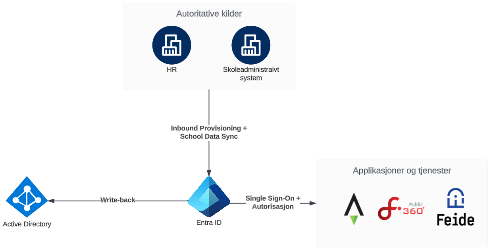

# Integrasjon av tjenester

Designet legger opp til at alle applikasjoner og tjenester integreres mot Entra ID, både for Single Sign-On, autorisasjon og brukerprovisjonering der det er behov for det.

!!! info "Brukerprovisjonering?"
    Brukerprovisjonering vil si at IAM-plattformen populerer en brukerdatabase i applikasjonen direkte, på forhånd, før brukeren logger inn i applikasjonen.

Det er ofte mulig å integrere en applikasjon på flere måter, og for å sørge for at man alltid velger den "beste" måten, er det etablert en del faste integrasjonsmønstre, som alltid skal benyttes, og man velger alltid den første på listen som lar seg benytte:

## Brukerprovisjonering

1. [SCIM-basert integrasjon](./Brukerprovisjonering/01-SCIM-basert integrasjon.md)
2. [Populering av applikasjon via API-basert integrasjon](./Brukerprovisjonering/02-API-basert integrasjon.md)
3. [Filuttrekk](./Brukerprovisjonering/03-Fil-basert integrasjon.md)
4. [Applikasjon leser selv via Microsoft Graph](./Brukerprovisjonering/04-App-read integrasjon.md)

## Single Sign-On

1. [Multi-tenant app for SaaS applikasjoner](./Single%20Sign-On/1.md)
2. [OpenID Connect integrasjon](./Single%20Sign-On/2.md)
3. [SAML federering](./Single%20Sign-On/3.md)

## Autorisasjon

1. [App-roller og tildelinger](./Autorisasjon og grupper/01-App-roller og tildelinger.md)
2. [Assigned groups as claim](./Autorisasjon og grupper/02-Assigned groups as claim.md)
3. [SCIM-transferred groups](./Autorisasjon og grupper/03-SCIM-transferred groups.md)
4. [Pipeline transferring app roles to app via API integration](./Autorisasjon og grupper/04-Pipeline transferring app roles.md)
5. [Application reading groups from Microsoft Graph](./Autorisasjon og grupper/05-Application reading groups.md)
