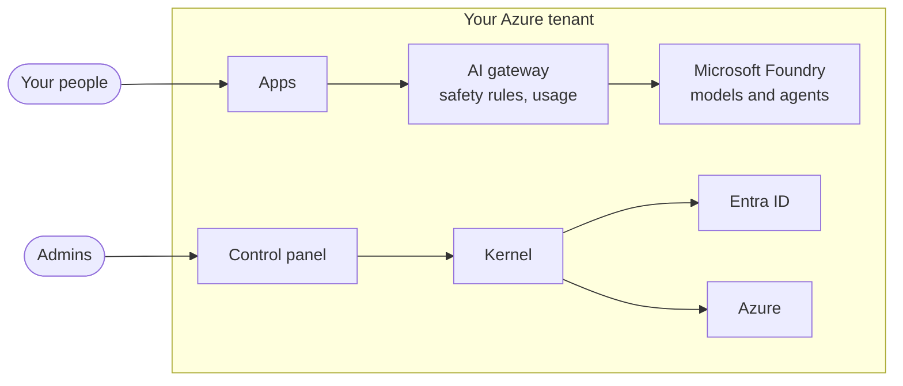

# How it works

AI Universe is installed once per organisation, in a subscription you own. It is not a shared cloud service: every part of it, including the models, runs in your tenant.

## The parts

| Part | What it does |
|-|-|
| **Control panel** | Where admins and app owners create apps, choose models, manage people and follow cost. Sign-in is with your own Entra ID. |
| **Apps** | The AI apps your teams use. Each app has its own code repository, its own cloud resources, its own people and its own agent. In the platform's technical pages an app is also called a *galaxy*. |
| **Kernel** | The engine behind the control panel. It creates apps, runs upgrades and talks to Entra ID and Azure on the platform's behalf. |
| **AI gateway** | Every call to a model goes through it. It holds the only credential for the models, applies the safety rules and records usage for cost reporting. |
| **Microsoft Foundry** | Hosts the models and agents, in your subscription. |

## What reaches Fortytwo

Only two things cross the boundary of your tenant:

- **Releases.** New versions are copied from Fortytwo's release registry into your deployment's own registry when you upgrade.
- **The licence check.**

Your data, prompts, replies and logs stay in your subscription. Fortytwo cannot sign in to your deployment.

## How an app reaches its users

Each app gets its own address under a domain you choose at install, such as `hr-assistant.ai.yourcompany.com`. All traffic enters through one Application Gateway with a web application firewall. Nothing else in the deployment is reachable from the internet.

People sign in with their normal work account. An app only lets in the people and groups you give access to on that app's [People](apps/people.md) page.

## How a question reaches a model

1. Someone asks an app's agent a question.
2. The app sends it to the AI gateway, never straight to a model. Apps hold no model keys.
3. The gateway checks the question against your [safety rules](control-panel/ai.md#safety-rules), records usage, and passes it to the model.
4. The reply comes back through the same rules before the person sees it.
5. If the agent needs to look something up, it calls one of the app's own tools. The platform only lets it use the tools you allowed on the [Agents](apps/agents.md) page.
