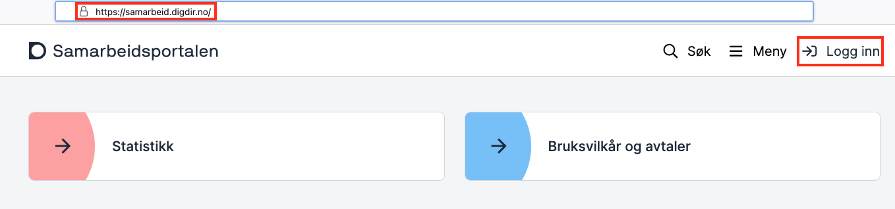
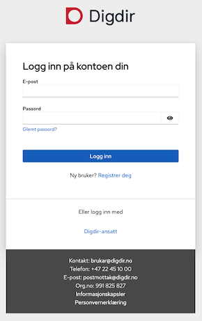
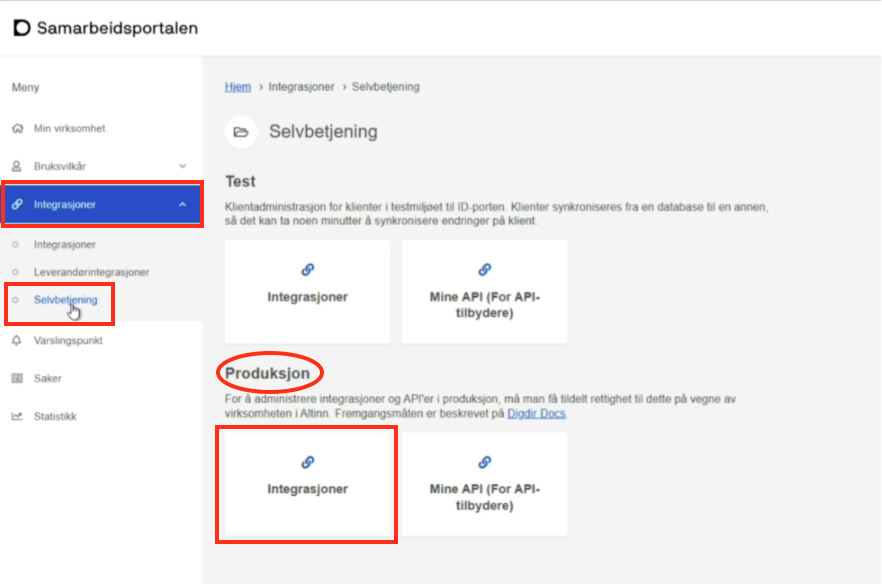
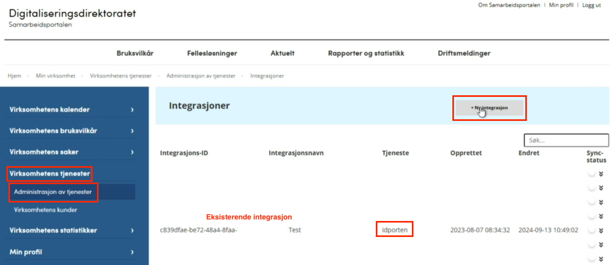
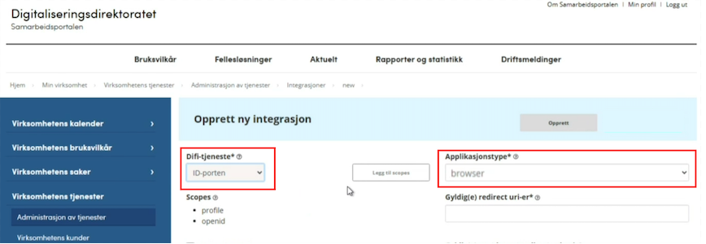
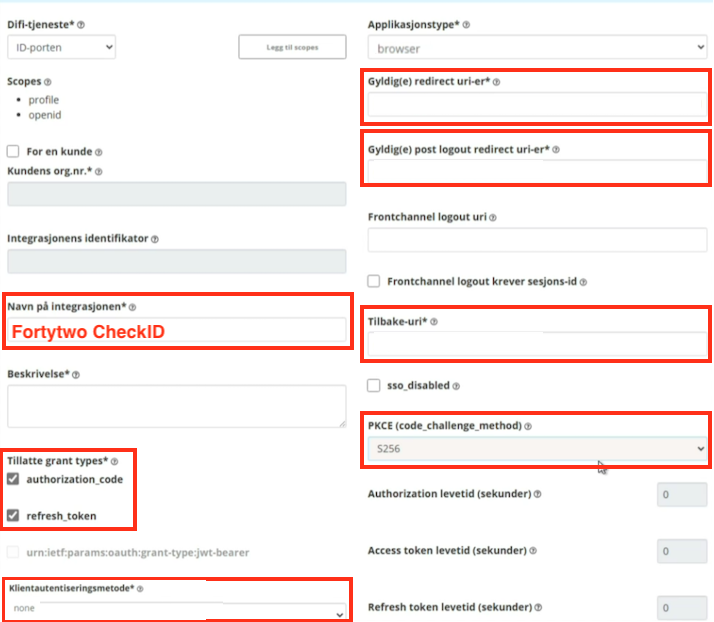
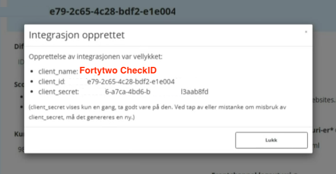

# ID-porten konfigurasjon

For å bruke Digitaliseringsdirektoratet ID-porten løsning kreves det tilgang til [Samarbeidsportalen](https://samarbeid.digdir.no/).

::::steps
### Logg inn i Samarbeidsportalen

### Logg inn DigDir

### Minside selvbetjening

### Ny integrasjon Samarbeidsportalen

### Ny ID-porten browser klient

### ID-porten klient konfig

### Integrasjon opprettet

::::
