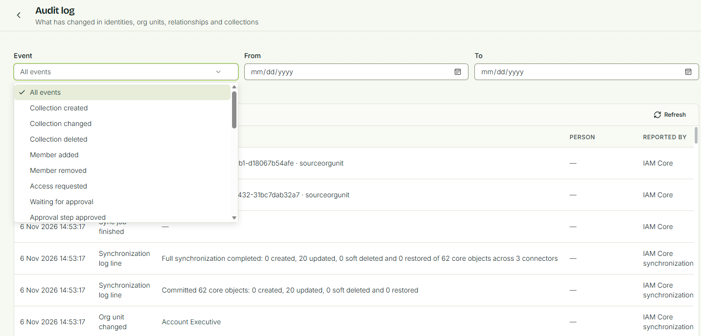
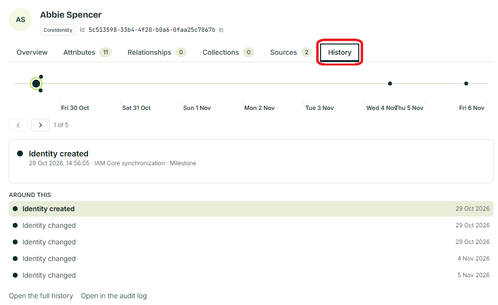
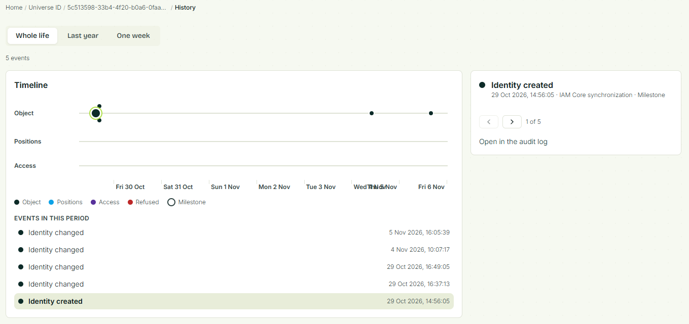
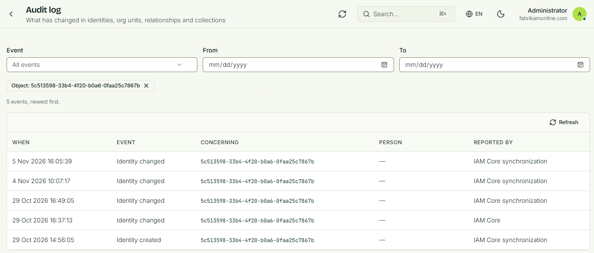

# Audit log

The audit log stores information about everything important that has happened in the identity universe. It tracks the following changes and actions:

- Collections created/changed/deleted
- Member added/removed
- Access requested, waiting for approval, approval step approved
- Request rejected/cancelled
- Identity created/changed/deleted/given a new id
- Org unit created/changed/deleted/given a new id
- Relationship created/changed/deleted
- Sync job stared/finished
- Sync log entry
- Connector object created/changed/deleted
- Connector log entry

The audit log also tracks an object's history. This will give you a history of all important changes that have happened to an object over time.

By default, the audit logs are saved for 90 days. If you need to store audit logs for a longer time, please contact Fortytwo.

## All events

In the default view of the audit log, you will see all items in chronological order, with the newest item first. You can filter the information in this view based on date and event type.

## From the identity explorer

To find history information about one object in the identity universe, find the object in the Identity Explorer and click on History. This will give you the summary of audit log entries associated with this object.

From here, you can either see a timeline when you click **Open the full history** or see detailed audit log entries when you click **Open in the audit log**.

If you selected the object’s full history, you'll see a timeline of changes along with a summary of changes. You can select to see additional changes in the audit log.

If you have selected to see the object in the audit log, the audit log will appear with a filter on the object’s ID.

