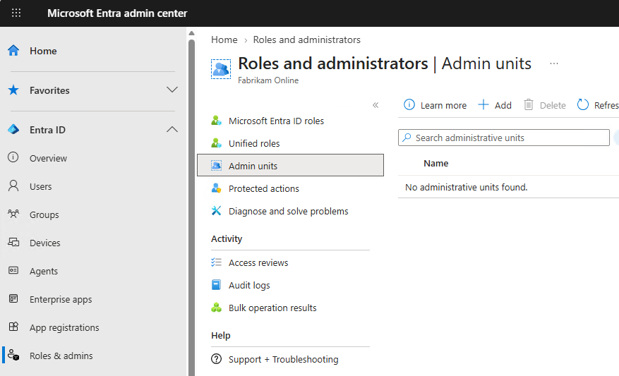
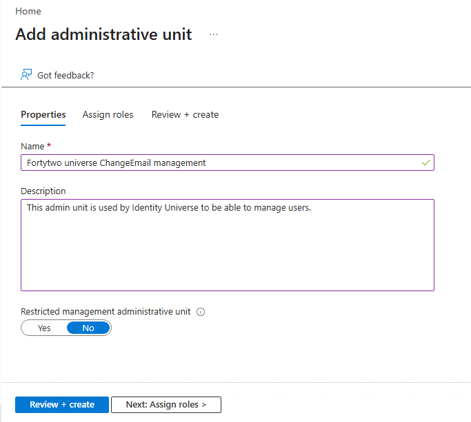
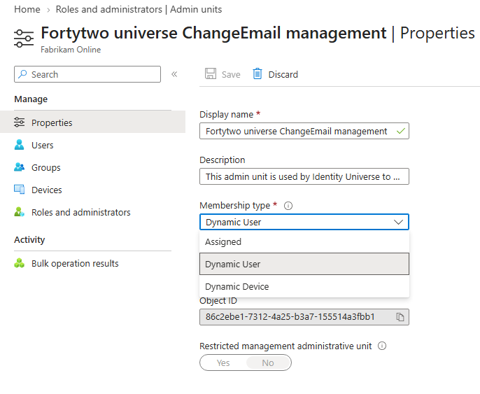
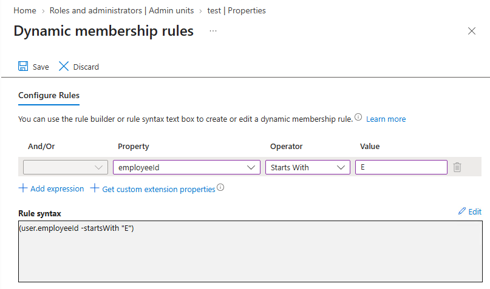
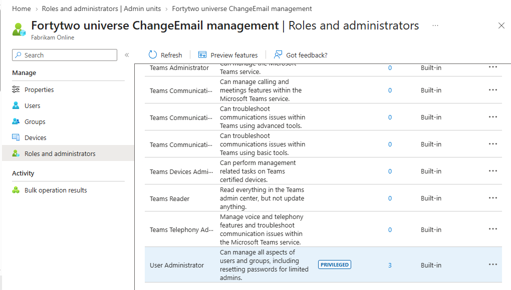
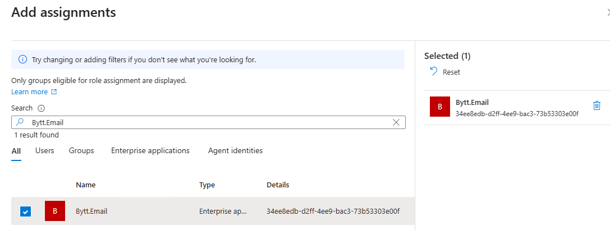

# Entra write permissions

## Configure write permissions

Change email will require write permissions to Entra to be able to update attributes on users. You might have already given permissions to Identity Universe to update your users, but Change Email is using a different application and requires explicit permissions.

In this step, we will show how to limit permissions using Administrative Units in Entra. We will assume you have some kind of identifier on your users you can use to scope your users into an admin unit.

In Microsoft Entra admin center, navigate to **Roles & admins** and **Admin units**. Click **+Add**.

Give your admin unit a descriptive name and click **Review + create**. Click **Review + create** again without adding any roles (enterprise applications can't be assigned permissions at create). Click **Create**.

Find your admin unit and click **Properties**. Change **Membership type** to **Dynamic User**.

Click **Add dynamic query** and create a query that would include all users in scope for identity universe. In this example, all users with an EmployeeId starting with **E** is in scope. Click **Save**.

Here are some more examples of how you can create your query.

| Who | Criteria |
| - | - |
| All enabled users                                  | (user.accountEnabled -eq true) |
| All enabled users with of different company values | (user.companyName -in ["Company 1", "Company 2"]) |
| All users with a certain UPN suffix                | (user.userPrincipalName -endsWith "@customer.com") |

Click **Save** and click **Yes** to confirm you want to change the admin unit to be using dynamic membership.

Go to **Roles and administrators** and click **User Administrator**.

Click **+Add assignments** and search for the app **Bytt.Email**. Click **Add**.

