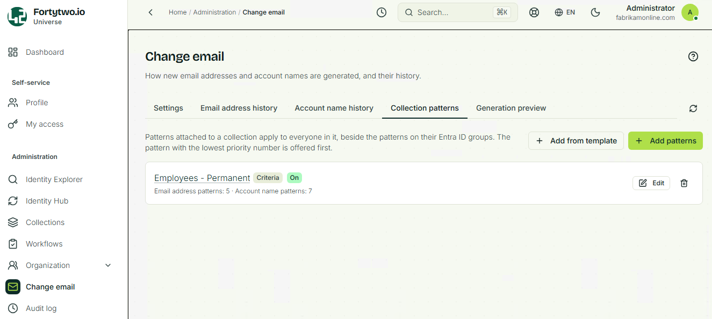
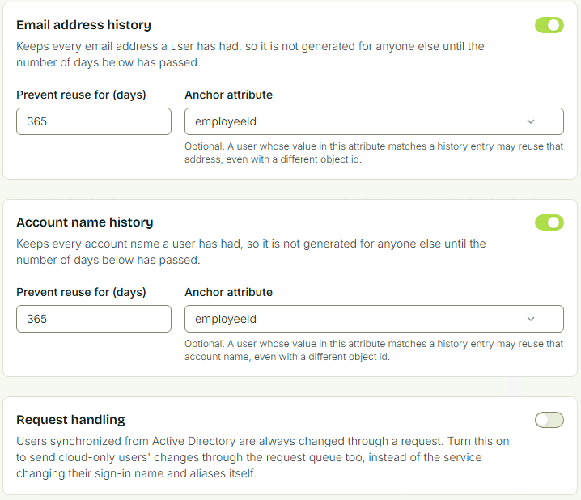

# Configure Identity Universe

## Create email and account patterns

Navigate to **Change email** and **Collection patterns**.

You can either create patterns manually from the [design](../plandesign/index.md) you created earlier with +Add patterns or add pre-configured pattern templates with **+Add from template**.
Select each group of users that should have different email patterns using collections. Then add all email address patterns and account name patterns and save.

## Enable email address history and account name history

Navigate to **Settings** and, if you want history to be stored, enable these settings.

If you enable this setting, it will read your Entra tenant and populate history information with already existing users.
