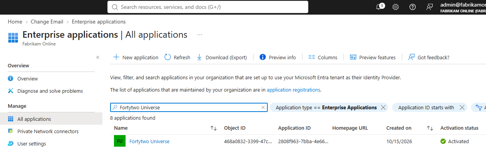
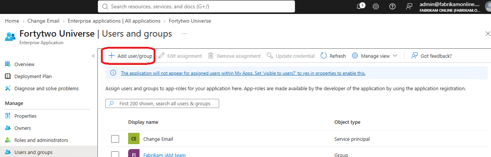
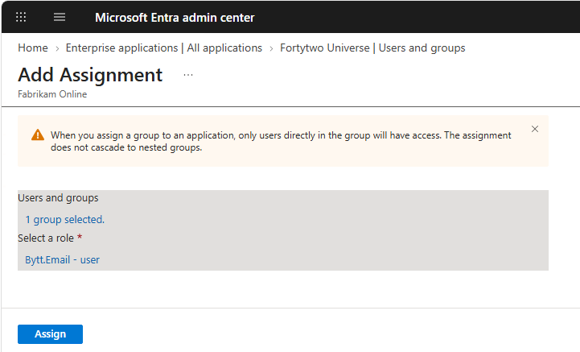
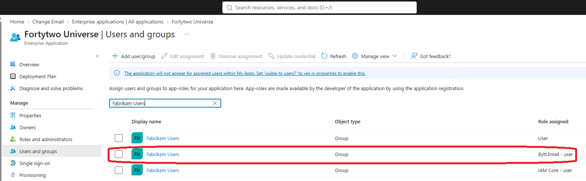

# Grant users access

In these steps, we will grant all users access to the self-service page. You might want to change this and only include your test users initially.

::::steps
### Locate the Fortytwo Universe app

In Entra under **Enterprise Apps**, locate **Fortytwo universe**.

### Add user/group

Under **Users and groups**, click **Add user/group**.

### Assign users or groups

Assign any relevant user or group of users.

### Check the assignments

The assignments should now look like this. Notice that if you utilize other Fortytwo services, these role assignments are also managed here.

::::
