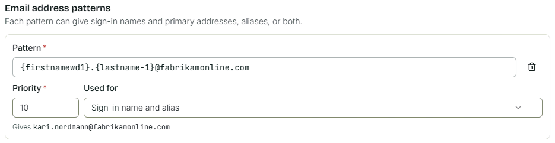
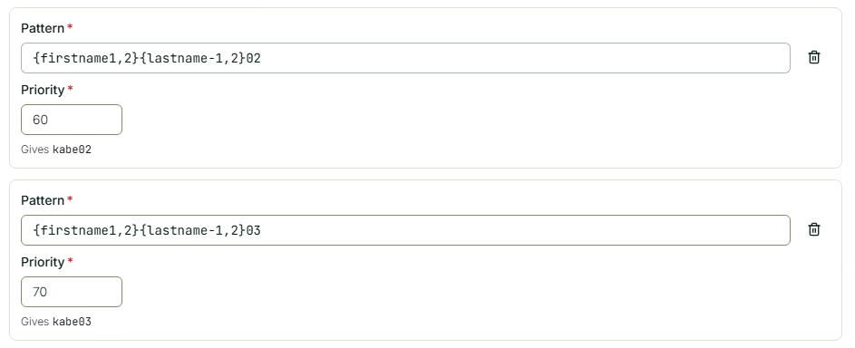
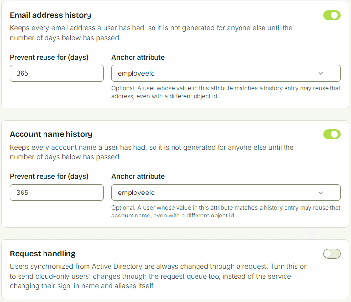

# Plan and Design

Change email is used to assign an email address and account name for a user. You can have different patterns for  groups of users, so employees, contractors, and students can have different email addresses.

Patterns for email and account names are associated with a [collection](../../collections/index.md), so make sure you have configured these for the groups of people who need different patterns.

## Patterns

For each collection, you define patterns in the order you want them to be selected. The order patters are evaluated is defined with a priority, where a lower number is higher priority. You define one set of patterns for the Email address and a different set for the account name. For email, you can also select if a pattern is used for userPrincipalName, email address, or both.

A pattern can contain placeholders. This will take information from the user to build the email address and account name.

This is how one rule can look like:

When you want the logic to include the next free number, you would define these as separate patterns with correct priority these should be tested.

If a user is a member of multiple email pattern collections, they are merged. When displayed to the user, the resulting email addresses are sorted in order of length, with any address with a number before the @ is sorted last.

### Placeholders

| Placeholder                | Replaced with                                      |
|----------------------------|----------------------------------------------------|
| {firstname1}               | First firstname                                    |
| {firstname2}               | Second firstname                                   |
| {firstname3}               | Third firstname                                    |
| {firstname-1}              | Last firstname                                     |
| {firstname-2}              | Second last firstname                              |
| {firstname-3}              | Third last firstname                               |
| {lastname1}                | First lastname                                     |
| {lastname2}                | Second lastname                                    |
| {lastname3}                | Third lastname                                     |
| {lastname-1}               | Last lastname                                      |
| {lastname-2}               | Second last lastname                               |
| {lastname-3}               | Third last lastname                                |
| {firstnamewd1}             | First firstname, with dashes included              |
| {firstnamewd2}             | Second firstname, with dashes included             |
| {firstnamewd3}             | Third firstname, with dashes included              |
| {firstnamewd-1}            | Last firstname, with dashes included               |
| {firstnamewd-2}            | Second last firstname, with dashes included        |
| {firstnamewd-3}            | Third last firstname, with dashes included         |
| {lastnamewd1}              | First lastname, with dashes included               |
| {lastnamewd2}              | Second lastname, with dashes included              |
| {lastnamewd3}              | Third lastname, with dashes included               |
| {lastnamewd-1}             | Last lastname, with dashes included                |
| {lastnamewd-2}             | Second last lastname                               |
| {lastnamewd-3}             | Third last lastname                                |
| {onpremisessamaccountname} | The onpremisessamaccountname attribute of the user |
| {mailnickname}             | The mailNickname attribute of the user             |
| {currentsuffix}            | The current UPN suffix of the user                 |

We also allow for extracting the first *n* characters of the placeholders, through the {&lt;placeholder&gt;,*n*} pattern:

| Placeholder       | Replaced with                                                     |
|-------------------|-------------------------------------------------------------------|
| {firstname1,1}    | First character of first firstname                                |
| {lastnamewd-1,3}  | First three characters of the last lastname, with dashes included |

### Example usage

A user that is a member of *Example Group 1* and *Example Group 2*, with the configurations shown below, will get the following options available to them:

| Option | Alias | Sign-in name |
|-|-|-|
| {firstname1}.{lastname-1}@contoso.com | Yes | Yes |
| {firstname1}.{firstname2,1}.{lastname-1}@contoso.com | Yes | Yes |
| {firstname1}.{lastname-1}@nwtraders.com | Yes | Yes |
| {firstname1}.{firstname2,1}.{lastname-1}@nwtraders.com | Yes | Yes |

A user that is a member of only *Example Group 1* will get these options:

| Option | Alias | Sign-in name |
|-|-|-|
| {firstname1}.{lastname-1}@contoso.com | Yes | Yes |
| {firstname1}.{firstname2,1}.{lastname-1}@contoso.com | Yes | Yes |

A user that is member of only *Example Group 3* will get these options (will only be able to add aliases):

| Option | Alias | Sign-in name |
|-|-|-|
| {firstname1}.{lastname-1}@test.com | Yes | |
| {firstname1}.{firstname2,1}.{lastname-1}@test.com | Yes | |

A user that is member of *Example Group 1* and *Example Group 3* will get these options:

| Option | Alias | Sign-in name |
|-|-|-|
| {firstname1}.{lastname-1}@contoso.com | Yes | Yes |
| {firstname1}.{firstname2,1}.{lastname-1}@contoso.com | Yes | Yes |
| {firstname1}.{lastname-1}@test.com | Yes | |
| {firstname1}.{firstname2,1}.{lastname-1}@test.com | Yes |  |

## History

Change email can store used email addresses and account names, so they are not used for a while. This is off by default, but you likely want an address to be quarantined for a while, so an alias isn’t reused for a time you define.

It is possible to configure an anchor attribute. This attribute allows a user to get back a reserved alias when the attribute has the same value as a previous account. This is useful for scenarios where a user leaves the company and is then rehired within the Change Email quarantine period with the same employeeId.

