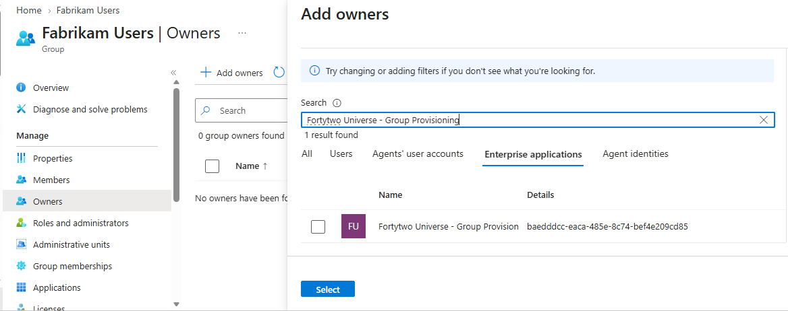
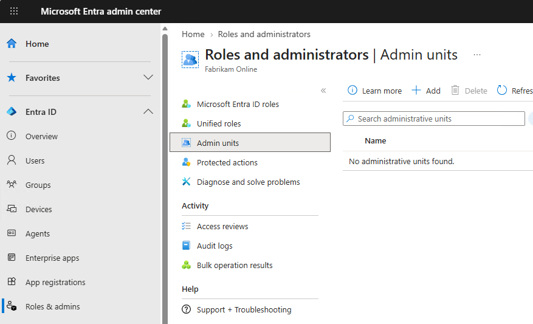
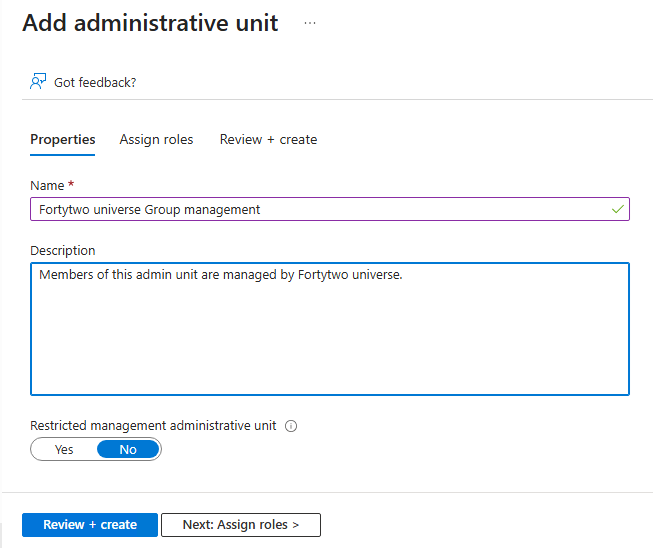
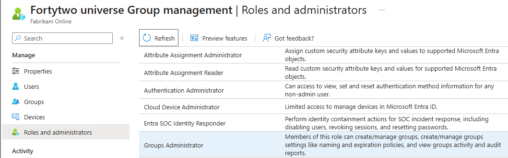
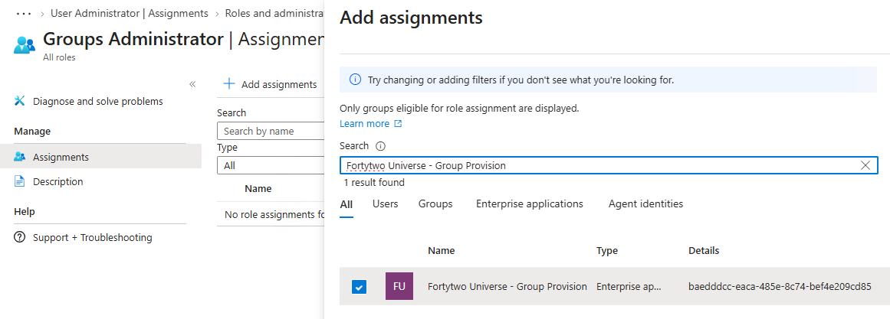
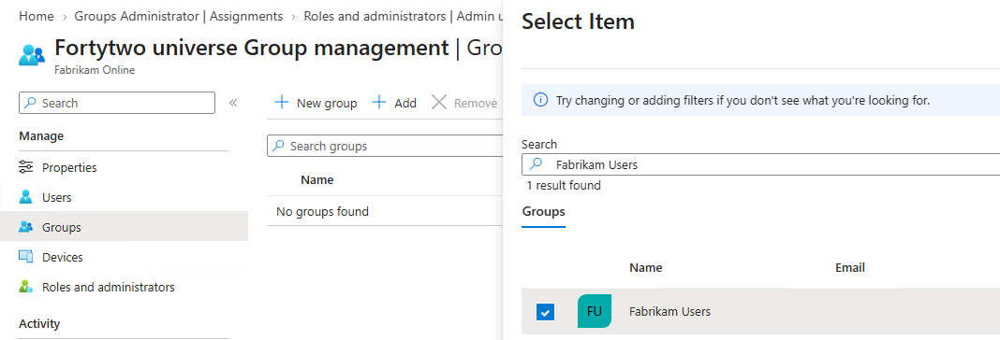
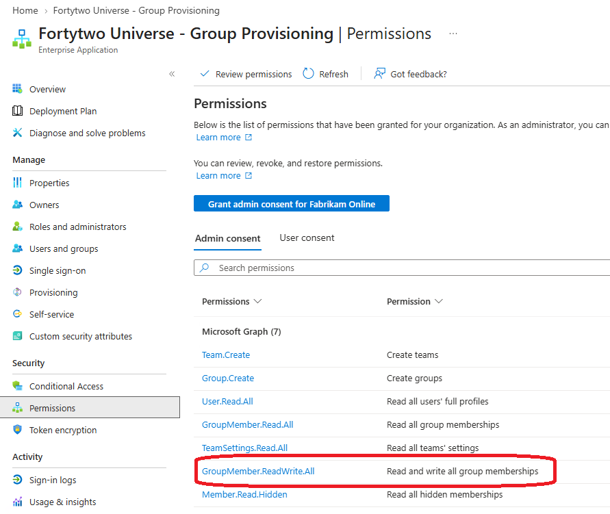

#  Group Link Entra write permissions

The Group Provisioning app needs explicit write permissions to update group membership. You can grant these permissions in several ways:
-	[Make the Group Provisioning app the group owner](#make-the-group-provisioning-app-the-group-owner)
-	[Create an Administrative Unit where the Group Provisioning app can manage members](#create-an-administrative-unit)
-	[Grant the Group Provisioning app the GroupMember.ReadWrite.All permission](#grant-the-groupmemberreadwriteall-permission)

Select one option that suits you.

## Make the Group Provisioning app the group owner

You can assign the Enterprise app as an owner to the groups you want it to manage. In the Entra portal, find the group, click **Owners** and **+Add owners**. Select **Enterprise applications** and the **Fortytwo Universe – Group Provisioning** app. Mark it and click **Select**.



The user must be at least **Groups Administrator** to be able to add group owners.

## Create an Administrative Unit

Entra does not allow dynamic queries on admin units targeting groups. It is not possible to have an attribute on the group itself and automatically have it included in the scope of the admin unit. Adding and removing groups is still a manual task.

In Microsoft Entra admin center, navigate to **Roles & admins** and **Admin units**. Click **+Add**.



Give your admin unit a descriptive name and click **Review + create**. Click **Review + create** again without adding any roles (enterprise applications can't be assigned permissions at create). Click **Create**.



Go to **Roles and administrators** and click **Groups Administrator**.



Click **+Add assignments** and search for the app **Fortytwo universe - Group Provisioning**. Click **Add**.



Under **Groups**, click **+Add** and add all groups Fortytwo universe should be able to manage.



## Grant the GroupMember.ReadWrite.All permission

You can grant the Group Provisioning app the permission to write all group members. The downside is that an admin in Identity Universe can take over any group with manual members in Entra. If you do not have complete trust between Entra administrators and Identity Universe administrators, this option is probably not for you.

The Entra portal does not allow you to add permissions to an Enterprise application. You must use PowerShell for this.

``` Powershell
Connect-MgGraph -Scopes "Application.Read.All","AppRoleAssignment.ReadWrite.All"

# Get the Enterprise Application
$sp = Get-MgServicePrincipal -Filter "displayName eq 'Fortytwo universe - Group Provisioning'"

# Get Microsoft Graph
$graph = Get-MgServicePrincipal -Filter "appId eq '00000003-0000-0000-c000-000000000000'"

# Get the GroupMember.ReadWrite.All application permission
$permission = $graph.AppRoles |
    Where-Object {
        $_.Value -eq "GroupMember.ReadWrite.All" -and
        $_.AllowedMemberTypes -contains "Application"
    }

# Grant the permission
$params = @{
    PrincipalId = $sp.Id
    ResourceId  = $graph.Id
    AppRoleId   = $permission.Id
}

New-MgServicePrincipalAppRoleAssignment `
    -ServicePrincipalId $sp.Id `
    -BodyParameter $params
```

The result is one additional permission on the Enterprise app.

