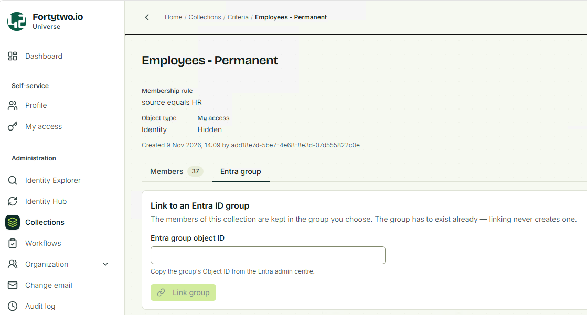
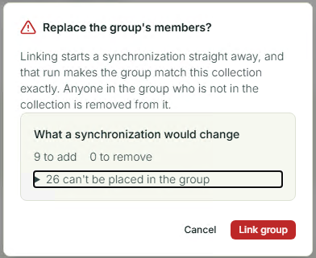
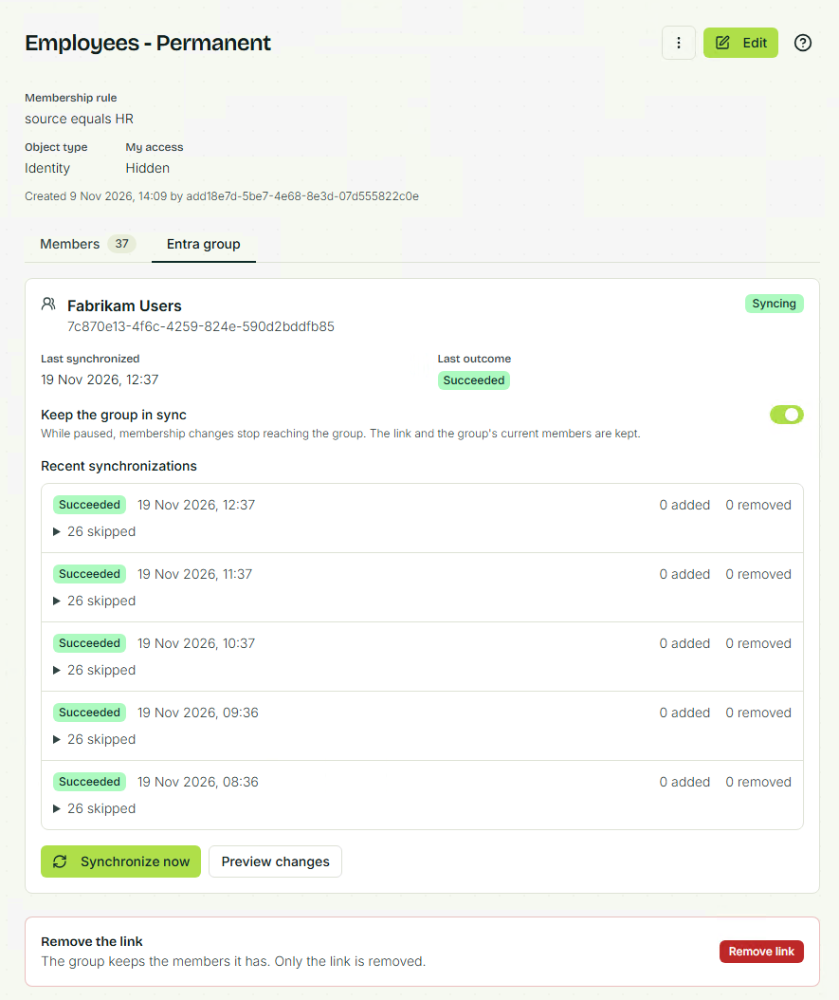

# Group Link in Portal

To link a collection to a group in Entra, navigate to the collection and select **Entra group**. Paste the Object ID of the group into **Entra group object ID**.

Identity Universe will read the group members in Entra and provide a summary of what will change in the group. If there are group members who cannot be members of a group, for example they lack an account in Entra, this is shown.

If you are happy with the result, click **Link group**.

You can now see that group members are synchronizing, so if they change in Entra, Identity Universe will detect and fix it. You can also pause synchronization and remove the link if needed.

