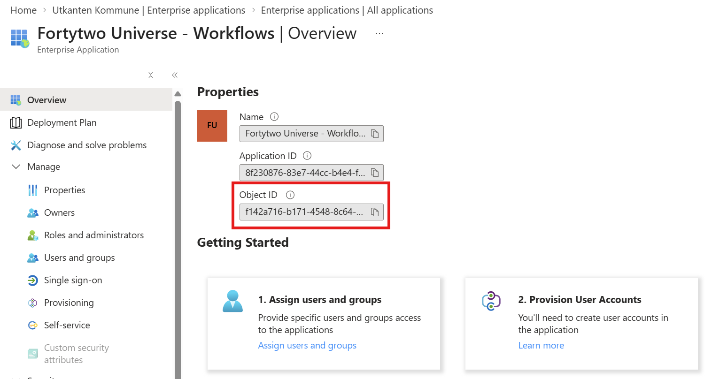

# Grant access to send emails through Microsoft 365

Fortytwo Universe allows you to use your own email addresses in Microsoft 365 as sender addresses for emails. This means that your users see a sender like **noreply@contoso.com**, which is a known domain, and you will have no issues with spam filters blocking the email.

There are a few steps required to grant Fortytwo Universe access to send emails. They are done once per mailbox.

The permission is given **in Exchange Online, for the mailboxes you choose**, with [Role Based Access Control for Applications](https://learn.microsoft.com/en-us/exchange/permissions-exo/application-rbac). Fortytwo Universe does not ask for the Microsoft Graph permission `Mail.Send` in Microsoft Entra ID, because that permission lets an application send as *anyone* in your organization.

## Before you start

You need:

- a **Global administrator** or **Privileged role administrator**, to consent to the application;
- an **Exchange administrator**, who is a member of the **Organization Management** role group, for the steps in Exchange Online;
- the [Exchange Online PowerShell module](https://learn.microsoft.com/en-us/powershell/exchange/connect-to-exchange-online-powershell);
- the address of each mailbox Fortytwo Universe may send from.

## Grant the access

::::steps
### Consent to the application

If you have not already done so, consent to the **Fortytwo Universe - Workflows** application:

https://login.microsoftonline.com/common/adminconsent?client_id=a215ca40-216b-49aa-ac23-f5256a8d6555

The application will now appear under **Enterprise applications** in the Microsoft Entra admin center.

### Find the application's object ID

In the Microsoft Entra admin center, open **Enterprise applications** and select **Fortytwo Universe - Workflows**. Copy its **Object ID**. The **Application ID** is always `a215ca40-216b-49aa-ac23-f5256a8d6555`.



### Connect to Exchange Online

```powershell
Install-Module ExchangeOnlineManagement -scope CurrentUser
Connect-ExchangeOnline
```

### Tell Exchange Online about the Fortytwo Universe application

Replace the object ID with the one you copied:

```powershell
New-ServicePrincipal -AppId "a215ca40-216b-49aa-ac23-f5256a8d6555" -ObjectId "OBJECT_ID_OF_FORTYTWO_UNIVERSE_WORKFLOWS_APP" -DisplayName "Fortytwo Universe - Workflows"
```

### Say which mailboxes it may send from

Create a management scope that covers only the mailboxes Fortytwo Universe is allowed to send from. Replace the address with your sender address:

```powershell
New-ManagementScope -Name "Fortytwo-Universe-MailSend-Scope" -RecipientRestrictionFilter "PrimarySmtpAddress -eq 'noreply@contoso.com'"
```

For several mailboxes, join the addresses with `-or`:

```powershell
New-ManagementScope -Name "Fortytwo-Universe-MailSend-Scope" -RecipientRestrictionFilter "PrimarySmtpAddress -eq 'noreply@contoso.com' -or PrimarySmtpAddress -eq 'servicedesk@contoso.com'"
```

### Give the permission for those mailboxes

```powershell
New-ManagementRoleAssignment -App "OBJECT_ID_OF_FORTYTWO_UNIVERSE_WORKFLOWS_APP" -Role "Application Mail.Send" -CustomResourceScope "Fortytwo-Universe-MailSend-Scope"
```

### Check it

Test a mailbox that is allowed and one that is not:

```powershell
Test-ServicePrincipalAuthorization -Identity "OBJECT_ID_OF_FORTYTWO_UNIVERSE_WORKFLOWS_APP" -Resource "noreply@contoso.com" | Format-Table
Test-ServicePrincipalAuthorization -Identity "OBJECT_ID_OF_FORTYTWO_UNIVERSE_WORKFLOWS_APP" -Resource "someone.else@contoso.com" | Format-Table
```

`InScope` is `True` for the mailbox you allowed and `False` for any other.
::::

:::note
Exchange Online keeps an application's permissions in a cache. A change can take between 30 minutes and two hours to apply to emails that are sent. The test command above does not use the cache, so it shows the result at once.
:::

You can now use the mailbox as **Send from** in a workflow's **Send email** action. See [Email](./email.md).

## Add or remove a mailbox later

Change the management scope. The role assignment keeps pointing at it:

```powershell
Set-ManagementScope -Identity "Fortytwo-Universe-MailSend-Scope" -RecipientRestrictionFilter "PrimarySmtpAddress -eq 'noreply@contoso.com' -or PrimarySmtpAddress -eq 'hr@contoso.com'"
```

## Take the permission away

Remove the role assignment. Fortytwo Universe can then send from no mailbox:

```powershell
Get-ManagementRoleAssignment -Role "Application Mail.Send" | Where-Object { $_.CustomResourceScope -eq "Fortytwo-Universe-MailSend-Scope" } | Remove-ManagementRoleAssignment
```