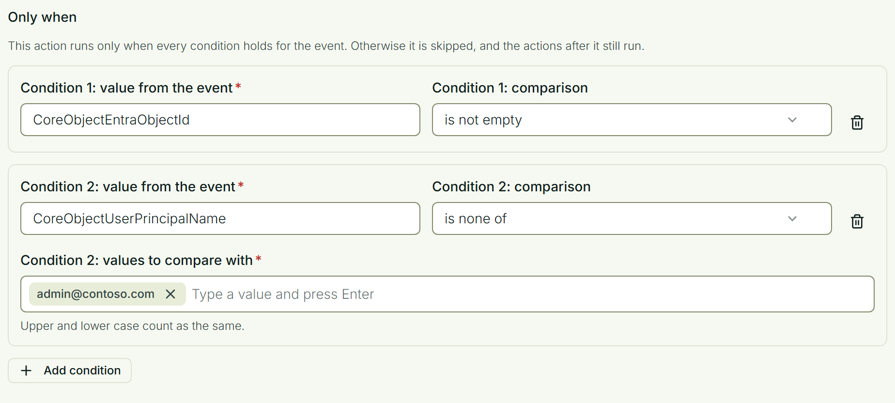

# Conditions

A workflow runs all its steps every time its event occurs. A **condition** on a step changes that: the step runs only when the condition holds for the event, and is skipped otherwise.

Use it to:

- leave a message unsent when the event has nobody to send it to;
- send one message for some products, reasons or collections, and another for the rest;
- act only once a person has an account in Entra ID.

## Add a condition

Every step, whether a webhook, a Teams message, a Slack message or an email, ends with a part called **Only when**.

Select **Add condition** and fill in:

| | |
|-|-|
| **Value from the event** | The name of a value the event carries. These are the names a message uses between `{{` and `}}`, written here without the braces. The field suggests the values of the event you chose. |
| **Comparison** | **is empty**, **is not empty**, **is one of** or **is none of**. |
| **Values to compare with** | For the last two comparisons. Type a value and press Enter, as many times as you need. |

## How conditions work

- A step can have up to 10 conditions. It runs only when **all** of them hold.
- A skipped step does not stop the workflow. The steps after it still run.
- To do one thing in one case and something else otherwise, add two steps with opposite conditions.
- Values are compared as text. Upper and lower case count as the same.
- A value the event does not have counts as empty. The field tells you when not every event you chose has the value.
- When a value holds a list, such as the managers of a license holder, **is one of** holds when any item in the list matches.
- The **test** buttons send straight away and do not look at conditions.

## What you can ask about

A condition can use the values of the event itself, such as `ProductName`, `Reason` or `CollectionName`.

For a person the event names, it can also use their display name, first name, last name, email address, user principal name and Entra object id. They are named after the event's value without `Id`: `RequesterEmail`, `CoreObjectEntraObjectId`.

Nothing else about a person can be asked for. In particular, a condition cannot ask which organizational unit someone belongs to. Build a collection with that rule and let the workflow start when someone joins it.

## Wait until a person has an account

A new person is often registered before their Entra ID account exists. A workflow does not wait, but it can start from the change you are waiting for:

1. Choose the event **When identity attributes change**, and list the attribute `entraObjectId`.
2. Add the step, for example a welcome message.
3. Give the step the condition `CoreObjectEntraObjectId` **is not empty**.

The step runs when the account arrives. It is skipped if the attribute is cleared later.
