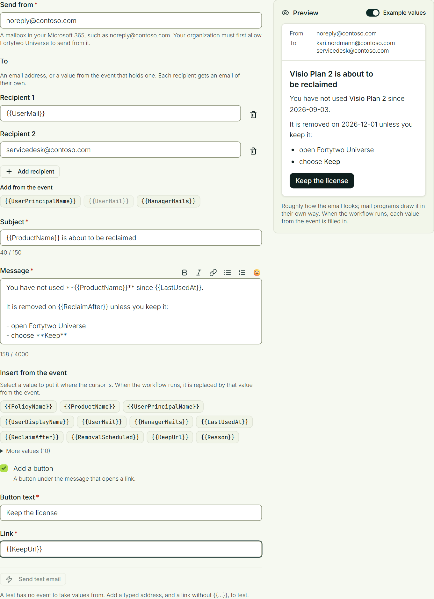

# Email

A workflow can send an email when something happens in Identity Universe: a license is about to be reclaimed, an access request is waiting, an identity changed. The email is sent through **your own Microsoft 365**, from a mailbox you choose, so it comes from an address your people know and passes your spam filters.

You decide what is sent, to whom and when, under **Workflows** in Fortytwo Universe.

## Before you start

You need:

- an **Exchange administrator** in your organization, to let Fortytwo Universe send from a mailbox;
- a mailbox to send from, for example a shared mailbox such as `noreply@contoso.com`;
- a person with the **Workflow - administrator** role in Fortytwo Universe, to build the workflows (see [Permissions](../get-started/permissions/index.md)).

### What Fortytwo Universe can do in your tenant

- It sends as the application **Fortytwo Universe - Workflows**, which your administrator consents to.
- It can send only from the mailboxes you allow. See [Grant access to send emails through Microsoft 365](./grant-access-to-send-emails-through-microsoft-365.md).
- It only sends what your own workflows ask for.
- It does not read any mailbox.

## Let Fortytwo Universe send from a mailbox

This is done once per mailbox, by an Exchange administrator. Follow [Grant access to send emails through Microsoft 365](./grant-access-to-send-emails-through-microsoft-365.md).

:::note
A change to what the application may do in Exchange Online can take up to two hours to apply. An email sent before that is refused.
:::

## Send an email from a workflow

::::steps
### Create the workflow

In Fortytwo Universe, open **Administration** > **Workflows** and create a workflow, or edit one. Choose its trigger as usual.

### Add the action

Under **Actions**, select **Send email**.

### Choose the sender and the recipients

- **Send from**: the mailbox the email is sent from. It must be one you have allowed.
- **To**: up to ten recipients. Each is an email address you type, or a value from the event that holds an address, such as `{{UserMail}}` or `{{RequesterEmail}}`. The values of that kind that the trigger's events carry are listed under **Add from the event**.

Each recipient gets an email of their own and does not see the others.

### Write the email

Write the **Subject** and the **Message**. The buttons above the message make text bold or italic, add a link, or turn lines into a bulleted or numbered list. The last button, **Add an emoji**, opens a row of emoji.

To put a value from the event into the email, select it under **Insert from the event**. It goes in where the cursor is, written as `{{Name}}`, and is replaced by the event's value when the workflow runs.

When the event is about a person in the Universe ID, the list also has that person's display name, first name, last name, email and user principal name, for example `{{RequesterDisplayName}}` or `{{CoreObjectEmail}}`. The values are looked up when the workflow runs. If the person cannot be found, the email is not sent and the reason is recorded in the workflow run's outcome.

Optionally select **Add a button**. The button opens an `https://` link, which can also be a value from the event.

### Check the preview and test it

The **Preview** beside the form shows roughly how the email looks, with **Example values** filled in. Mail programs draw an email in their own way.

**Send test email** sends the email, as written, to the addresses you typed. A test has no event, so it needs at least one typed address.
::::

The subject can be up to 150 characters, the message up to 4,000 and the button text up to 40. One action sends to at most 50 addresses once the event's values are filled in.

## When an email is not sent

**Accepted is not the same as sent.** When a workflow runs, or when you press **Send test email**, the email is queued. Whether Microsoft 365 lets the mailbox be used shows a moment later, when it is sent.

Fortytwo Universe tries again when Microsoft 365 is busy or unavailable: up to twelve times, spread over half an hour or more. When it gives up, the email is recorded as not delivered, with the reason:

| Reason | What to do |
|-|-|
| Microsoft 365 refused the email, because the application has not been consented to | An administrator consents to **Fortytwo Universe - Workflows** (see [Grant access](./grant-access-to-send-emails-through-microsoft-365.md)) |
| Microsoft 365 refused the email, because the application is not allowed to send from this mailbox | Allow the mailbox, or correct **Send from** in the workflow. A new permission can take up to two hours to apply |
| Microsoft 365 refused the email, because the sender's mailbox was not found | Correct **Send from** in the workflow |
| It was not accepted after every attempt | Microsoft 365 was unavailable for a long time. The next email is tried again as usual |

When the event has no address for one recipient, the others still get the email, and the workflow run's outcome names the recipient that was left out.

Three things are worth knowing about how emails are delivered:

- **One mailbox sends at most one email every two seconds.** Microsoft 365 allows a mailbox 30 messages a minute, so a burst of several hundred emails from the same sender takes several minutes. Other senders are not held up by it.
- **A bounce is not seen by Fortytwo Universe.** An email that Microsoft 365 accepts but cannot deliver to the recipient comes back to the sender's mailbox, as for any email.
- **An email can, in rare cases, arrive twice.** If Microsoft 365 took an email but its answer was lost on the way back, it is sent again instead of risking that it never arrived.

You can find the emails that were not delivered in two places:

- **The audit log** shows **Message sent** and **Message not delivered**, from the source **Notifications**. Open an event to see who the email was for, which mailbox it was sent from and why it failed. See [Audit log](../auditlog/index.md).
- **A workflow can react to it.** The trigger **When a message cannot be delivered** starts a workflow each time an email, a [Teams message](./teams.md) or a [Slack message](./slack.md) is given up on, for example to tell an operations channel or to call a webhook.

## Stop sending

Remove the action from the workflow, or switch the workflow off. To take away the permission, remove the role assignment in Exchange Online described under [Grant access](./grant-access-to-send-emails-through-microsoft-365.md#take-the-permission-away).
