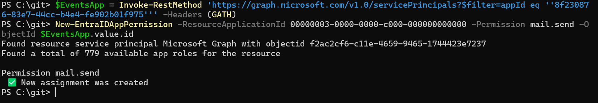
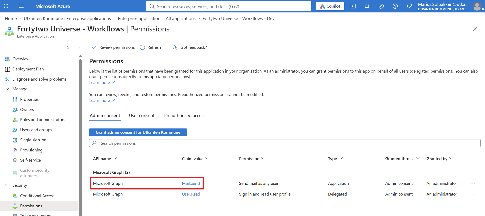
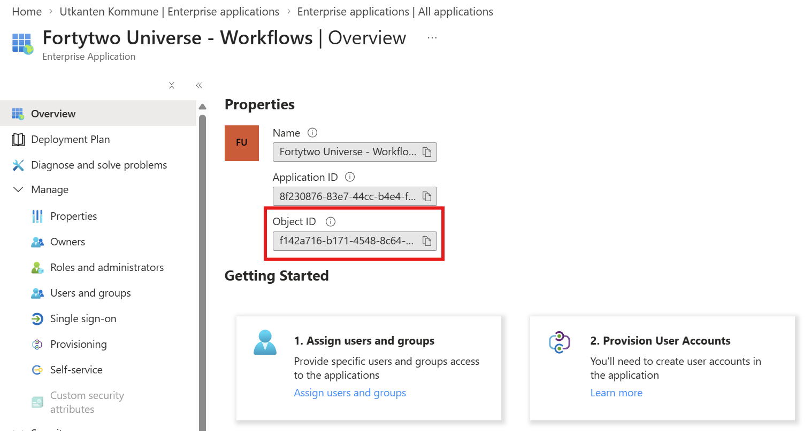

# Grant access to send emails through Microsoft 365

Fortytwo Universe allows you to use your own email addresses in Microsoft 365 as sender addresses for emails. This means that your users can see sender like **noreply@contoso.com**, which is a known domain, and you will have no issues with spam filters blocking our email.

There are a few steps required to grant Fortytwo Universe access to send emails. This is a one time thing, and you do not need to do this again. 

Our service do not request the Graph permission ```Mail.Send``` by default, both because not all customers use this service, and because if you grant this permission without adding the application access policy as described below, we can send emails as *anyone*, which is not something we want.

## Step 1 - Grant graph permission

There is no user interface provided by Microsoft to manually grant graph permissions to multi tenant applications. This must be done using [Microsoft Graph](https://learn.microsoft.com/en-us/graph/api/serviceprincipal-post-approleassignments?view=graph-rest-1.0&tabs=http), or using our [EntraIDAccessToken](https://www.powershellgallery.com/packages/EntraIDAccessToken) PowerShell module.

1. If you have not already done so, consent to the **Fortytwo Universe - Workflows** application:

https://login.microsoftonline.com/common/adminconsent?client_id=8f230876-83e7-44cc-b4e4-fe902b01f975

2. Make sure your last open browser is signed into the Azure Portal as a global administrator.

3. Run the below PowerShell to sign in

```PowerShell
Install-Module EntraIDAccessToken -Scope CurrentUser
Add-EntraIDInteractiveUserAccessTokenProfile
```

4. Locate the **object id** of your Managed Service Identity and run the below code in PowerShell:

```PowerShell
$EventsApp = Invoke-RestMethod 'https://graph.microsoft.com/v1.0/servicePrincipals?$filter=appId eq ''8f230876-83e7-44cc-b4e4-fe902b01f975''' -Headers (GATH)
New-EntraIDAppPermission -ResourceApplicationId 00000003-0000-0000-c000-000000000000 -Permission mail.send -ObjectId $EventsApp.value.id
```



5. After this, you should see the permission listed on the **Fortytwo Universe - Workflows** app



## Step 2 - Application access policy

An important step to limit the Mail.Read access is to use [Role Based Access Control for Applications in Exchange Online](https://learn.microsoft.com/en-us/exchange/permissions-exo/application-rbac).

1. Connect to Exchange Online PowerShell:

```PowerShell
Connect-ExchangeOnline
```

2. Create a Restrictive Management Scope

Define a scope that filters down to only the specific mailboxes Fortytwo Universe is allowed to send from. Replace target-mailbox@yourdomain.com with your allowed sender address:

```PowerShell
New-ManagementScope -Name "Limit-Fortytwo-Universe-MailSend-Scope" -RecipientRestrictionFilter "PrimarySmtpAddress -eq 'target-mailbox@yourdomain.com'"
```

3. Get the **object id** of the **Fortytwo Universe - Workflows** enterprise app:



4. Create the role assignment in Exchange:

```PowerShell
New-RoleAssignment -Role "Application Mail.Send" -SecurityPrincipal "OBJECT_ID_OF_FORTYTWO_UNIVERSE_WORKFLOWS_APP" -CustomResourceScope "Limit-Fortytwo-Universe-MailSend-Scope" 
```

5. Verify permissions

```PowerShell
Test-ServicePrincipalAuthorization -Identity "OBJECT_ID_OF_FORTYTWO_UNIVERSE_WORKFLOWS_APP" -Resource "target-mailbox@yourdomain.com"
```
