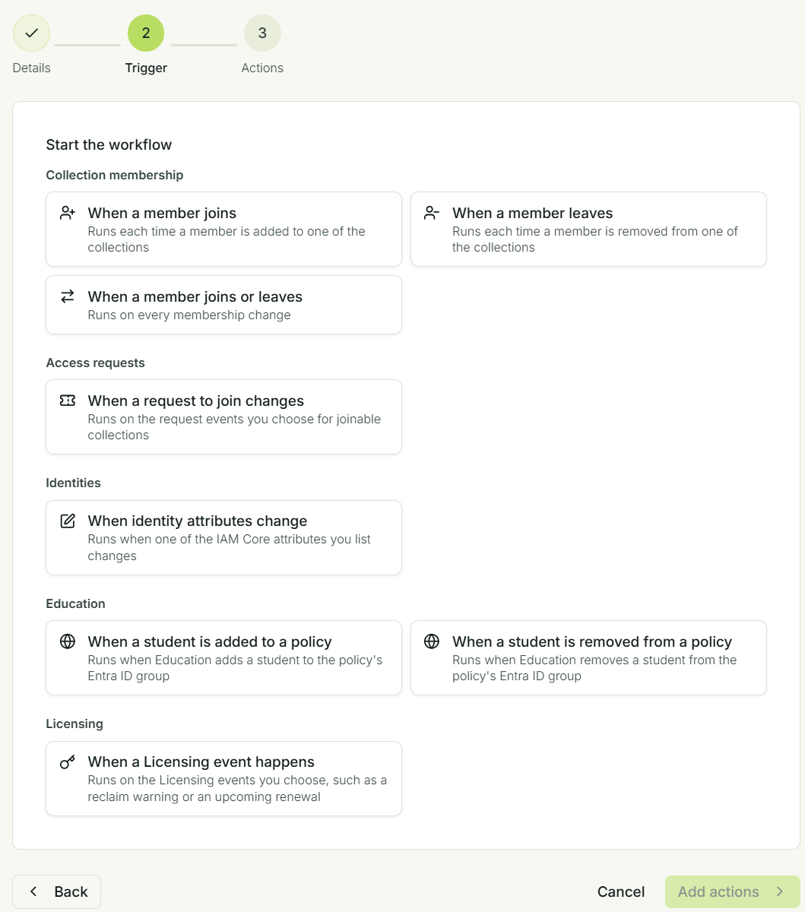

# Events

There are plenty of events being issued by the different Fortytwo Universe services, where you can create workflows that starts when the events occur:

## Workflow steps

The following workflow steps are available:

| | |
|-|-|
| [Webhook](./webhook.md) | Starts a LogicApp, Function app, Lambda, etc. |
| [Teams message](./teams.md) | Sends a message in Microsoft Teams to a person, a channel or both, through the Fortytwo Universe app |

Fortytwo Universe do not provide a full generic workflow builder, as we instead recommend invoking LogicApps through a Webhook.