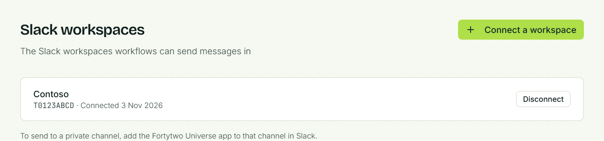
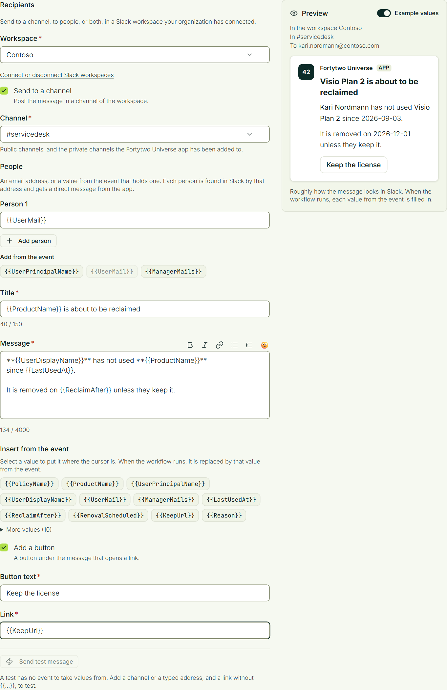

# Slack

A workflow can send a message in Slack when something happens in Identity Universe: a license is about to be reclaimed, an access request is waiting, an identity changed. The message goes to a channel, to people directly, or both, and is posted by the **Fortytwo Universe** app in your own Slack workspace.

You decide what is sent, to whom and when, under **Workflows** in Fortytwo Universe. The app only delivers those messages.

## Before you start

You need:

- a person who is allowed to **install apps** in your Slack workspace. In many workspaces that is a workspace administrator or owner;
- a person with the **Workflow - administrator** role in Fortytwo Universe, to connect the workspace and build the workflows (see [Permissions](../get-started/permissions/index.md)).

It can be the same person. Whoever connects the workspace must be both.

### What the app can do in your workspace

When you connect a workspace, Slack shows what the app asks for. This is what it means:

| Slack permission | What Fortytwo Universe uses it for |
|-|-|
| Send messages as the app (`chat:write`) | Posting the messages your workflows send, and writing to people directly |
| Send messages to channels the app is not a member of (`chat:write.public`) | Posting in a public channel without first adding the app to it |
| View basic information about public channels (`channels:read`) | Listing the channels to choose from in a workflow |
| View basic information about private channels the app has been added to (`groups:read`) | Listing those private channels too |
| View people in the workspace and their email addresses (`users:read`, `users:read.email`) | Finding the person a message is for, by email address |

- It only posts what your own workflows ask for.
- It **reads no messages**, in channels or in direct messages, and nothing you write to it is passed on to Fortytwo Universe.
- It can post in a **private channel** only after someone has added it to that channel.
- You can withdraw its access at any time, from Fortytwo Universe or from Slack.

## Connect a workspace

This is done once per workspace.

::::steps
### Open Slack workspaces

In Fortytwo Universe, open **Administration** > **Workflows** and select **Slack workspaces**.

### Start the connection

Select **Connect a workspace**. Slack opens in the same browser tab. If you are signed in to several workspaces, choose the right one in the upper right corner.

### Approve the app

Slack lists what the app asks for. Select **Allow**. Slack sends you back to Fortytwo Universe, and the workspace appears on the list.
::::

:::note
The approval must be finished within 15 minutes, by the person who started it. Otherwise Fortytwo Universe refuses it and you start again from **Connect a workspace**.
:::

If your workspace requires apps to be approved before they are installed, Slack shows a request form instead of **Allow**. Send the request, and connect again once a Slack administrator has approved the app.

### Private channels

The app can post in every public channel straight away. To let it post in a private channel, add it to that channel in Slack: open the channel, write `@Fortytwo Universe`, send the message and choose to add the app when Slack asks.

## Send a message from a workflow

::::steps
### Create the workflow

In Fortytwo Universe, open **Administration** > **Workflows** and create a workflow, or edit one. Choose its trigger as usual.

### Add the action

Under **Actions**, select **Send Slack message**.

### Choose who gets it

- **Workspace**: the connected workspace to send in. With one workspace connected it is already chosen.
- **Send to a channel**: tick it and choose the channel. Public channels are listed, and the private channels the app has been added to.
- **People**: up to ten. Each is an email address you type, or a value from the event that holds an address, such as `{{UserMail}}` or `{{RequesterEmail}}`. The values of that kind that the trigger's events carry are listed under **Add from the event**.

A message needs a channel, a person, or both. Each person gets a direct message from the app.

:::note
A person is found in Slack by email address. The address must be the one the person has on their Slack account. When your Slack accounts use the same addresses as Microsoft Entra ID, the values from the event match.
:::

### Write the message

Write the **Title** and the **Message**. The buttons above the message make text bold or italic, add a link, or turn lines into a bulleted or numbered list. The last button, **Add an emoji**, opens a row of emoji.

To put a value from the event into the message, select it under **Insert from the event**. It goes in where the cursor is, written as `{{Name}}`, and is replaced by the event's value when the workflow runs.

When the event is about a person in the Universe ID, the list also has that person's display name, first name, last name, email and user principal name, for example `{{RequesterDisplayName}}` or `{{CoreObjectEmail}}`. The values are looked up when the workflow runs. If the person cannot be found, the message is not sent and the reason is recorded in the workflow run's outcome.

Optionally select **Add a button**. The button opens an `https://` link, which can also be a value from the event.

### Check the preview and test it

The **Preview** beside the form shows roughly how the message looks in Slack, with **Example values** filled in.

**Send test message** sends the message, as written, to the channel and to the addresses you typed. A test has no event, so it needs a channel or at least one typed address.
::::

The title can be up to 150 characters, the message up to 4,000 and the button text up to 40. One action writes to at most 50 people once the event's values are filled in.

## When a message does not arrive

**Accepted is not the same as delivered.** When a workflow runs, or when you press **Send test message**, the message is queued. What Slack answers shows a moment later, when it is sent.

Fortytwo Universe tries again when Slack is busy or unavailable: up to twelve times, spread over half an hour or more. When it gives up, the message is recorded as not delivered, with the reason:

| Reason | What to do |
|-|-|
| Slack refused the message, because the app is not a member of the channel | Add the app to the private channel in Slack (see [Private channels](#private-channels)) |
| Slack refused the message, because the channel was not found or is archived | Choose another channel in the workflow |
| Slack refused the message, because nobody in the workspace has this email address | Correct the address, or make sure the person's Slack account has the address the event gives |
| The Slack workspace is not connected | The workspace was disconnected, or the app was removed in Slack. Connect it again under **Slack workspaces** |
| It was not accepted after every attempt | Slack was unavailable for a long time. The next message is tried again as usual |

When the event has no address for one person, the channel and the other people still get the message, and the workflow run's outcome names who was left out.

Two things are worth knowing about how messages are delivered:

- **One channel or person gets at most one message every two seconds**, which keeps within what Slack allows. A burst of messages to the same channel is spread out; other channels and people are not held up by it.
- **A message can, in rare cases, arrive twice.** If Slack took a message but its answer was lost on the way back, it is sent again instead of risking that it never arrived.

You can find the messages that were not delivered in two places:

- **The audit log** shows **Message sent** and **Message not delivered**, from the source **Notifications**. Open an event to see the channel or the person it was for and why it failed. See [Audit log](../auditlog/index.md).
- **A workflow can react to it.** The trigger **When a message cannot be delivered**, under **Notifications**, starts a workflow each time a Slack message, a [Teams message](./teams.md) or an [email](./email.md) is given up on, for example to tell an operations channel or to call a webhook.

## Disconnect a workspace

Under **Slack workspaces**, select **Disconnect** next to the workspace. Fortytwo Universe gives up the access Slack gave it and forgets it. Workflows that send to that workspace then fail, with the reason that the workspace is not connected, until it is connected again.

You can also remove the app in Slack, under **Tools & settings** > **Manage apps**. Fortytwo Universe notices the next time a workflow sends there, and marks the workspace as not connected.
