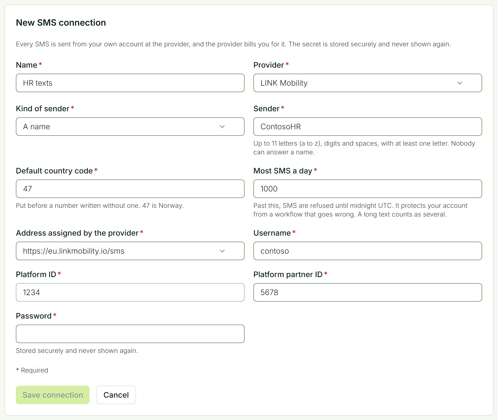
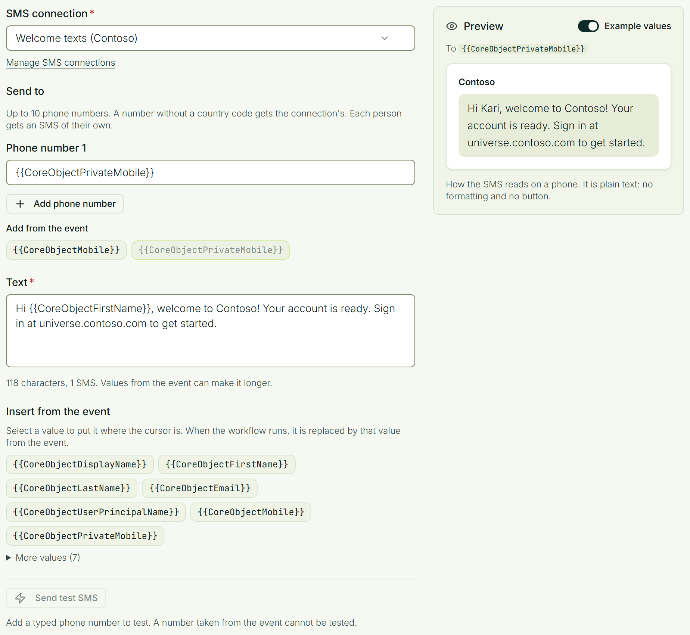

# SMS

A workflow can send an SMS when something happens in Identity Universe: a new employee gets their account, a license is about to be reclaimed, an access request is waiting. It reaches people who have no Teams, email or Slack yet, because all it needs is a phone number.

The SMS is sent through **your own account** at an SMS provider. Fortytwo Universe has no SMS account of its own: your account sends, your sender name shows on the phone, and your provider bills you.

You decide what is sent, to whom and when, under **Workflows** in Fortytwo Universe.

## Before you start

You need:

- an account at one of the supported providers: **Twilio**, **LINK Mobility** or **Sveve**;
- that account's details for sending through its API (see the table below);
- a person with the **Workflow - administrator** role in Fortytwo Universe, to add the connection and build the workflows (see [Permissions](../get-started/permissions/index.md)).

| Provider | What you need from the provider |
|-|-|
| Twilio | Your Account SID, and an API key: its SID and its secret. You create the API key in the Twilio Console. |
| LINK Mobility | The address, username, password, platform ID and platform partner ID that LINK Mobility's support gave you. |
| Sveve | Your username and your API password. The API password is under API in Sveve's own pages, and is not the password you sign in with. |

## Add an SMS connection

A connection is added once. Workflows then choose it by name.

1. Open **Workflows** and select **Connections** > **SMS connections**.
2. Select **Add connection**.
3. Fill in the form and select **Save connection**.

| | |
|-|-|
| **Name** | What the connection is called where a workflow chooses it. |
| **Provider** | Twilio, LINK Mobility or Sveve. The fields further down change to what that provider needs. |
| **Kind of sender** and **Sender** | What the SMS comes from. A name is up to 11 letters (a to z), digits and spaces, and nobody can answer it. A phone number is written with a plus and the country code. Some providers also take a short number, or a sender you have set up with them, such as a Twilio Messaging Service. |
| **Default country code** | Put before a phone number written without one. With 47, the number 912 34 567 becomes +47 912 34 567. |
| **Most SMS a day** | Past this number, SMS are refused until midnight UTC. It protects your account from a workflow that goes wrong. |
| The provider's own fields | The details from the table above. |

The password, key or secret is stored securely and is never shown again, to you or to anyone else.

You can add several connections, for instance one for each sender name.

## Send an SMS from a workflow

1. Create a workflow, or open one, and go to its actions.
2. Select **Send SMS**.
3. Choose the **SMS connection**.

### Choose who gets it

Under **Send to**, add up to 10 phone numbers. Each one is either:

- a number you type, or
- a value from the event. For a person the event is about, you can choose their mobile number or their private mobile number, for example `{{CoreObjectPrivateMobile}}`.

Each person gets an SMS of their own.

### Write the text

An SMS is plain text. It has no formatting and no button. To put in a value from the event, select it under **Insert from the event**; it appears between `{{` and `}}`.

Under the text you see how many SMS it is:

- one SMS holds **160 characters**;
- once the text has a character outside the usual alphabet, such as an emoji or some Sami letters, one SMS holds **70**. Æ, ø and å are fine;
- a longer text is sent as several SMS joined together, and your provider charges for each;
- at most **three** can be sent as one message. A longer text is refused. It is not cut.

When the text has values from the event, the count is of the text as you wrote it, and the values can make it longer.

### Test it

**Send test SMS** sends a real SMS to the numbers you typed. Your provider charges for it. Values from the event are left as written, and a number taken from the event is left out.

## Welcome a new employee

A new employee is often registered before their account exists, and their private mobile number is the only way to reach them. To send a welcome SMS once the account is ready:

1. Choose the event **When identity attributes change**, and list the attribute `entraObjectId`.
2. Add **Send SMS**, to `{{CoreObjectPrivateMobile}}`.
3. Add two [conditions](./conditions.md) to the action: `CoreObjectEntraObjectId` **is not empty**, and `CoreObjectPrivateMobile` **is not empty**.

The SMS goes out when the account arrives, and people without a private mobile number are skipped.

## When an SMS does not arrive

- **A value that is not a phone number gets no SMS.** The others still get theirs, and the workflow's outcome says how many values were not phone numbers.
- **An SMS is never sent twice.** If your provider does not answer, Fortytwo Universe does not try again, because a second try could become a second SMS.
- **"Sent" means your provider took the SMS.** Whether it reached the phone is something only your provider knows. Look in your provider's own log.

What your provider answers is in the **audit log** in Fortytwo Universe, as **Message not delivered** with the number and one of these reasons:

| Reason | What it means |
|-|-|
| The SMS provider refused the SMS | The provider said no, for example because the number is not a mobile number or your account may not send to that country. The provider's own words are shown. |
| The SMS connection is not there, or its credentials are not accepted | The connection was disconnected, or the provider no longer accepts the password or key. Edit the connection and type the new one. |
| The provider did not answer, so it is not known whether the SMS was sent | The SMS may or may not have gone out. It was not sent again. |

A workflow that reaches the connection's daily limit says so in its outcome, and sends again after midnight UTC.

## Change or disconnect a connection

Under **SMS connections**, select **Edit** to change the name, the sender, the daily limit or the provider's details. To replace the password or key, type the new one; leave the field empty to keep the one that is stored. Workflows that use the connection keep working.

**Disconnect** switches the connection off. Workflows that send through it then fail until they are given another connection.
