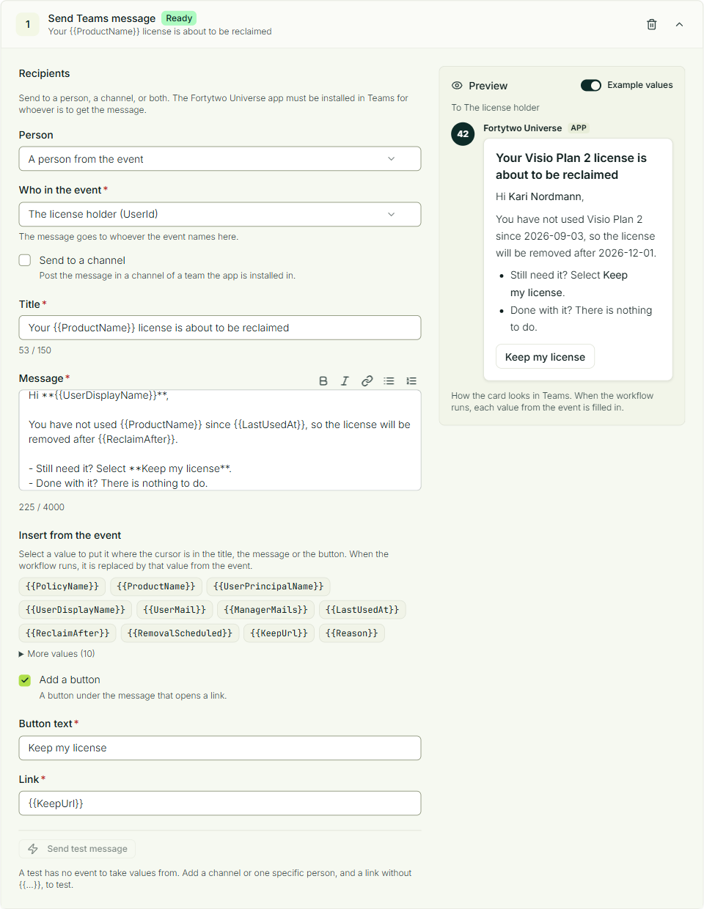
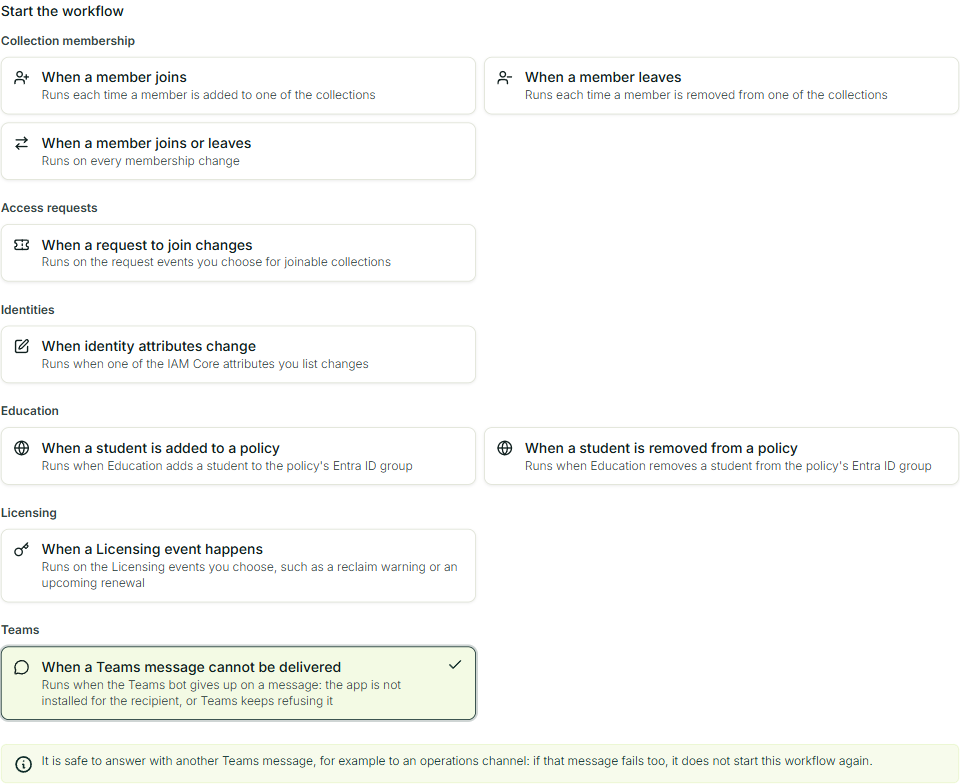

# Microsoft Teams app

The **Fortytwo Universe** app for Microsoft Teams delivers the messages your workflows send. A workflow can tell a person in a chat, post in a team's channel, or both, when something happens in Identity Universe: a license is about to be reclaimed, an access request is waiting, a student was added to a policy.

You decide what is sent, to whom and when, under **Workflows** in Fortytwo Universe. The app only delivers those messages.

## Before you start

You need:

- a **Teams administrator** in your organization, to add the app;
- a person with the **Workflow - administrator** role in Fortytwo Universe, to build the workflows (see [Permissions](../get-started/permissions/index.md));
- the app package, a zip file named `fortytwo-universe-teams-prod-<version>.zip`, which you get from Fortytwo.

### What the app can do in your tenant

- It asks for **no Microsoft Graph permissions** and needs **no admin consent**.
- It can only post where it is installed: for a person who has the app, or in a team the app is added to.
- It only posts what your own workflows ask for.
- It does not read your chats or channels. It only sees what is written directly to it, and answers that with a short help text.

## Install the app

::::steps
### Add the app to your organization

1. Open the [Teams admin center](https://admin.teams.microsoft.com) and go to **Teams apps** > **Manage apps**.
2. Select **Actions** > **Upload new app** and choose the zip file.
3. The app appears as **Fortytwo Universe**, published by Fortytwo. It can take a few hours before it shows up for everyone.

:::note
If your organization blocks custom apps, allow them under **Teams apps** > **Manage apps** > **Org-wide app settings** > **Custom apps**, or allow this one app in the app permission policy that applies to the people who should get messages.
:::

### Install it for the people who should get messages

A person can only get a message from the app once it is installed for them.

- **For many people:** in the Teams admin center, go to **Teams apps** > **Setup policies**, open the policy that applies to them (or **Global (Org-wide default)** for everyone), and under **Installed apps** select **Add apps** > **Fortytwo Universe**. Teams installs the app for each person over the following hours.
- **For yourself, to try it:** in Teams, open **Apps**, search for **Fortytwo Universe** and select **Add**.

Each person gets one short welcome message when the app is installed for them.

### Add it to the teams whose channels should get messages

In Teams, open the team, select **...** > **Manage team** > **Apps**, find **Fortytwo Universe** and select **Add**. The app posts one welcome message in the team and can then post in its channels.
::::

## Send a message from a workflow

::::steps
### Create the workflow

In Fortytwo Universe, open **Administration** > **Workflows** and create a workflow, or edit one. Choose its trigger as usual.

### Add the action

Under **Actions**, select **Send Teams message**.

### Choose who gets it

Send to a person, a channel, or both:

- **Person**: **A person from the event**, the person the event is about, or **One specific person**, chosen with **Choose person**.
- **Send to a channel**: pick the channel. Only teams the app is added to are listed.

### Write the message

Write the **Title** and the **Message**. The buttons above the message make text bold or italic, add a link, or turn lines into a bulleted or numbered list.

To put a value from the event into the message, select it under **Insert from the event**. It goes in where the cursor is, written as `{{Name}}`, and is replaced by the event's value when the workflow runs. Ids and the event's own details are under **More values**.

Optionally select **Add a button**. The button opens an `https://` link, which can also be a value from the event, such as the link a person uses to keep a license.

### Check the preview and test it

The **Preview** beside the form shows the message as it arrives in Teams, with **Example values** filled in. Turn them off to see where each value goes.

**Send test message** sends the message, as written, to the channel and the specific person you chose. A test has no event, so a test needs a channel or one specific person.
::::

The title can be up to 150 characters, the message up to 4,000 and the button text up to 40.

### Who can be taken from the event

| Trigger | A person from the event |
|-|-|
| When a member joins or leaves | The member, when every chosen collection is built from a rule, all of users or all of identities |
| When a student is added to or removed from a policy | The student |
| When a Licensing event happens | The license holder, or for a reclaim the license holder's manager |
| When a Teams message cannot be delivered | The person who did not get the message |
| When a request to join changes | The person who asked to join, the approver or the person who rejected the request, whichever every chosen event names |
| When identity attributes change | The identity that changed |

Some events name people by their **Universe ID** rather than their Entra account: access requests, identity changes and collections of identities. Fortytwo Universe looks up each person's Entra account when the workflow runs. Someone without one does not get the message, and is named in the run's outcome; everyone else still gets it.

## What people see in Teams

Messages arrive from **Fortytwo Universe**, in the person's chat with the app or as a post in the chosen channel, as a card with the title, the message and the button.

When the app is installed, a person gets this welcome message:

> Hello. I am the Fortytwo Universe bot.
>
> I send you a message here when a workflow that your administrators have set up concerns you. There is nothing you need to do.

A team gets a welcome that says the app can post in its channels when a workflow says so.

Anyone can write `status` to the app to check that it is installed and can deliver messages. Anything else written to it gets a short explanation of what the app does.

## When a message does not arrive

The app tries again when Teams is busy. When it gives up, the message is recorded as not delivered, with the reason:

| Reason | What to do |
|-|-|
| The app is not installed for the recipient | Install the app for that person, or add it to that team (see [Install the app](#install-the-app)) |
| Teams refused the message | Check that the person or the channel still exists and that the app is still added there |
| Teams did not take it after every attempt | Teams was unavailable for a long time. The next message is tried again as usual |

You can find these in two places:

- **The audit log** shows **Teams message sent**, **Teams message not delivered**, **Teams app installed** and **Teams app removed**, from the source **Teams bot**. Open an event to see who the message was for and why it failed. See [Audit log](../auditlog/index.md).
- **A workflow can react to it.** The trigger **When a Teams message cannot be delivered** starts a workflow each time a message is given up on, for example to tell an operations channel or to call a webhook.

It is safe to answer with another Teams message: if that message fails too, it does not start the workflow again.

## Remove the app

- **For one person or one team:** uninstall the app for the person, or remove it from the team. The app stops posting there at once.
- **For the whole organization:** delete the app under **Teams apps** > **Manage apps** in the Teams admin center.

A person who blocks or removes the app stops getting messages. Adding the app again resumes them.
