# Webhook

## Authentication

We recommend always using authentication for your webhooks, such as when calling LogicApps. By this, we mean that there should be no shared access signature or secret put in the url or header, but instead an Entra ID access token should be accepted.

When choosing **Entra ID** as the authentication type, Fortytwo Universe will present a JWT to your application, for the provided scope. The JWT will vary depending on whether your application is configured to accept v1 or v2 tokens. By default the scope ```https://management.azure.com/.default``` is used, which will issue a v1 token.

### V1 token example

The important claims you should verify in your receiving end:

| Claim | Example | Description |
|-|-|-|
| aud | https://management.azure.com | Identifies the intended recipient of the token. Where have chosen to use management.azure.com by default, which is what Microsoft uses for these purposes. |
| iss | https://sts.windows.net/YOURTENANTID/ | Identifier your tenant as the issuer of the token |
| iat, nbf, exp | Unix timestamps | Issued at, not before and expiration |
| appid | a215ca40-216b-49aa-ac23-f5256a8d6555 | Will always be a215ca40-216b-49aa-ac23-f5256a8d6555, which is the app **Fortytwo Universe - Workflows** |

### V2 token example

:::tip
A V2 token will be sent when the webhook if you provide a scope for an app with ```api/requestedAccessTokenVersion``` set to ```2``` in Entra ID.
:::

The important claims you should verify in your receiving end:

| Claim | Example | Description |
|-|-|-|
| aud | 75b405a9-691b-4c32-b599-de25737662b8 | The audience string for your receiveing app. |
| iss | https://login.microsoftonline.com/YOURTENANTID/v2.0 | Identifier your tenant as the issuer of the token |
| iat, nbf, exp | Unix timestamps | Issued at, not before and expiration |
| azp | a215ca40-216b-49aa-ac23-f5256a8d6555 | Will always be a215ca40-216b-49aa-ac23-f5256a8d6555, which is the app **Fortytwo Universe - Workflows** |

### LogicApp authentication example

To configure a LogicApp in the most secure way, follow the below steps:

1. If you have not already done so, consent to the **Fortytwo Universe - Workflows** application:

https://login.microsoftonline.com/common/adminconsent?client_id=a215ca40-216b-49aa-ac23-f5256a8d6555

2. Create your LogicApp using the consumption model:

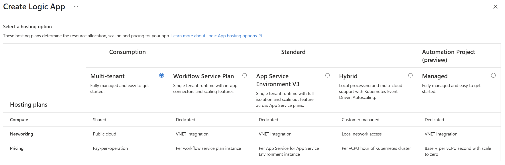

You can have this as a simple starting point using code view, when creating the content of your LogicApp:

```JSON
{
    "definition": {
        "metadata": {
            "notes": {}
        },
        "$schema": "https://schema.management.azure.com/providers/Microsoft.Logic/schemas/2016-06-01/workflowdefinition.json#",
        "contentVersion": "1.0.0.0",
        "triggers": {
            "When_an_HTTP_request_is_received": {
                "type": "Request",
                "kind": "Http"
            }
        },
        "actions": {
            "If_test,_return_true": {
                "actions": {
                    "TestResponse": {
                        "type": "Response",
                        "kind": "Http",
                        "inputs": {
                            "statusCode": 200,
                            "body": {}
                        }
                    },
                    "Terminate": {
                        "runAfter": {
                            "TestResponse": [
                                "Succeeded"
                            ]
                        },
                        "type": "Terminate",
                        "inputs": {
                            "runStatus": "Succeeded"
                        }
                    }
                },
                "runAfter": {},
                "else": {
                    "actions": {}
                },
                "expression": {
                    "and": [
                        {
                            "equals": [
                                "@triggerBody()?['isTest']",
                                true
                            ]
                        }
                    ]
                },
                "type": "If"
            },
            "Not_Implemented_Response": {
                "runAfter": {
                    "If_test,_return_true": [
                        "Succeeded"
                    ]
                },
                "type": "Response",
                "kind": "Http",
                "inputs": {
                    "statusCode": 400,
                    "body": "Not implemented"
                }
            }
        },
        "outputs": {},
        "parameters": {
            "$connections": {
                "type": "Object",
                "defaultValue": {}
            }
        }
    },
    "parameters": {
        "$connections": {
            "type": "Object",
            "value": {}
        }
    }
}
```

3. Under **Authorization**, add the following policy:

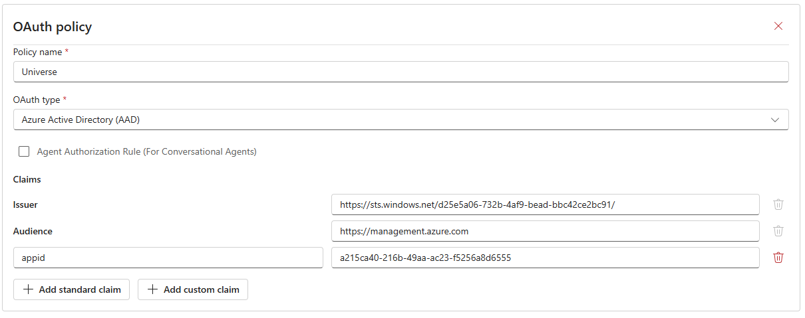

| Claim | Value | 
|-|-|
| Issuer | https://sts.windows.net/YOURTENANTID/ |
| Audience | https://management.azure.com | 
| appid | a215ca40-216b-49aa-ac23-f5256a8d6555 |

This allows the Fortytwo Universe events service to invoke the LogicApp without needing any shared access signature in the url.

3. After adding a HTTP trigger, copy the url:

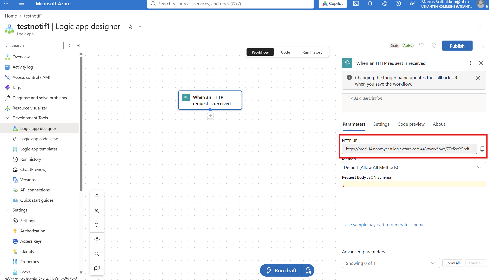

When copying the url of your LogicApp, you will see the three query parameters *sp*, *sv* and *sig* being added. These must be removed (actually, they don't, but we force you to do so in order to be as secure as possible 😉):

[https://prod-14.norwayeast.logic.azure.com:443/workflows/
77cf2d9f2bdf41cb977de860cd601be3/triggers/When_an_HTTP_request_is_received/
paths/invoke?api-version=2016-10-01<s>
&sp=%2Ftriggers%2FWhen_an_HTTP_request_is_received%2Frun&sv=1.0
&sig=c55rRC959lDdI7XcKthSyY9LIQ2dm-dhvfBggG2f-tg</s>](https://prod-14.norwayeast.logic.azure.com:443/workflows/77cf2d9f2bdf41cb977de860cd601be3/triggers/When_an_HTTP_request_is_received/paths/invoke?api-version=2016-10-01)

4. Last, when configuring a workflow, use the modified URL and remember to verify that the webhook works, and that the LogicApp is indeed triggered:

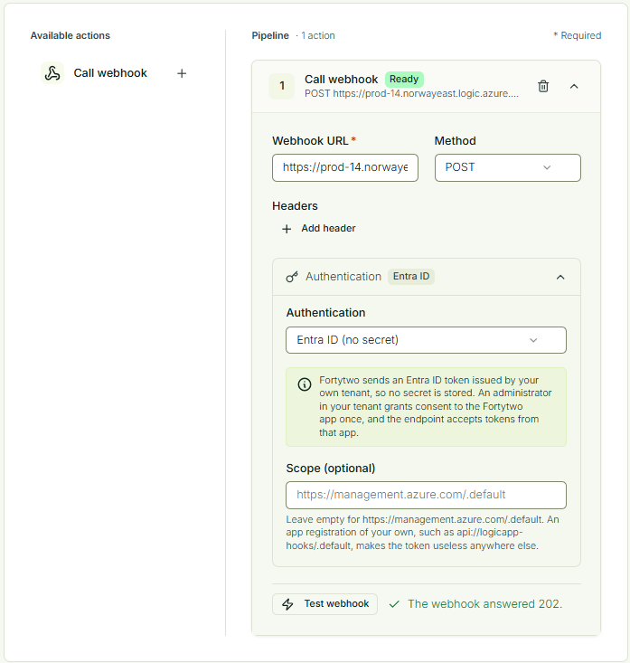

### Authentication deep dive example

In this example we will use https://webhooktest.net/ in order to demonstrate what you receive in the authorization header.

1. Create a new endpoint in the webhook tester: 

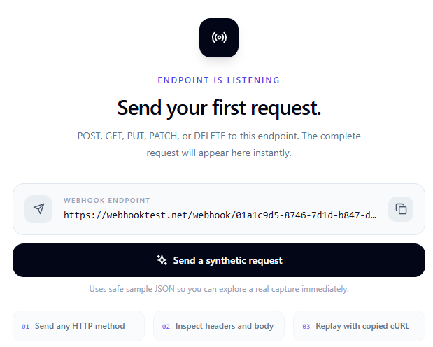

2. Create an app registration in Entra ID

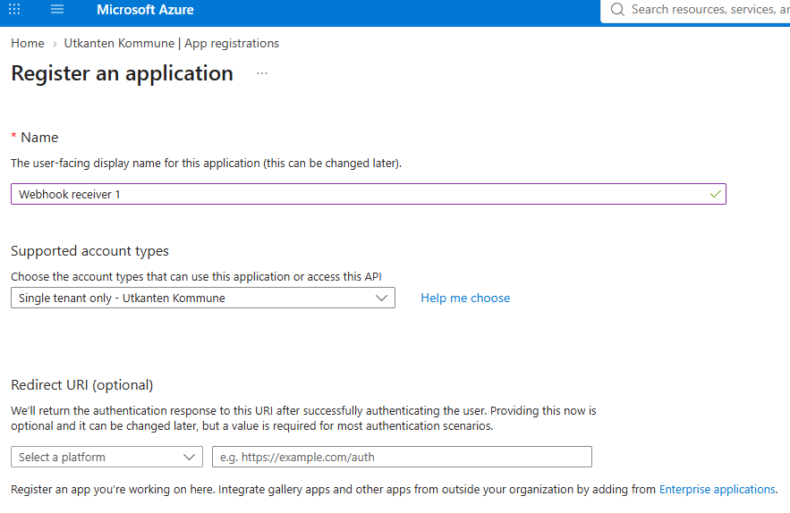

3. Under **Expose an API**, add an Application ID URI. You can use the default, or something with a domain name:

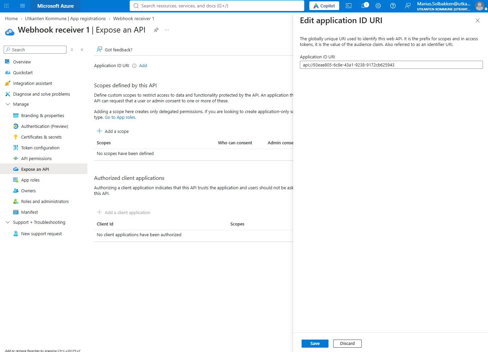

In this example, we chose the default ```api://93eae805-6c8e-43a1-9238-9172cb625943```, which means that the scope we will be requesting a token for is ```api://93eae805-6c8e-43a1-9238-9172cb625943/.default```.

4. Go to your webhook configuration in Fortytwo Universe and paste your url from webhooktest.net, choose **Entra ID** for authentication, insert the scope of your app and click **Test webhook**:

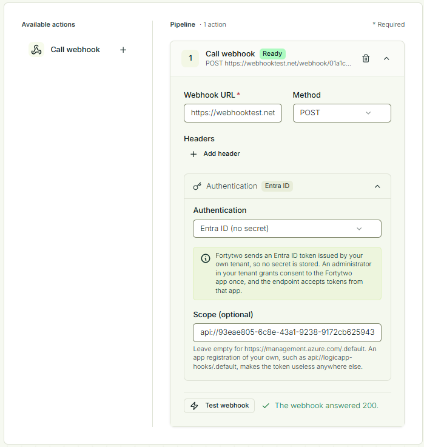

5. In webhooktest.net, we can now see that the webhook was called with an authorization header, which we can use https://jwt.ms to decode:

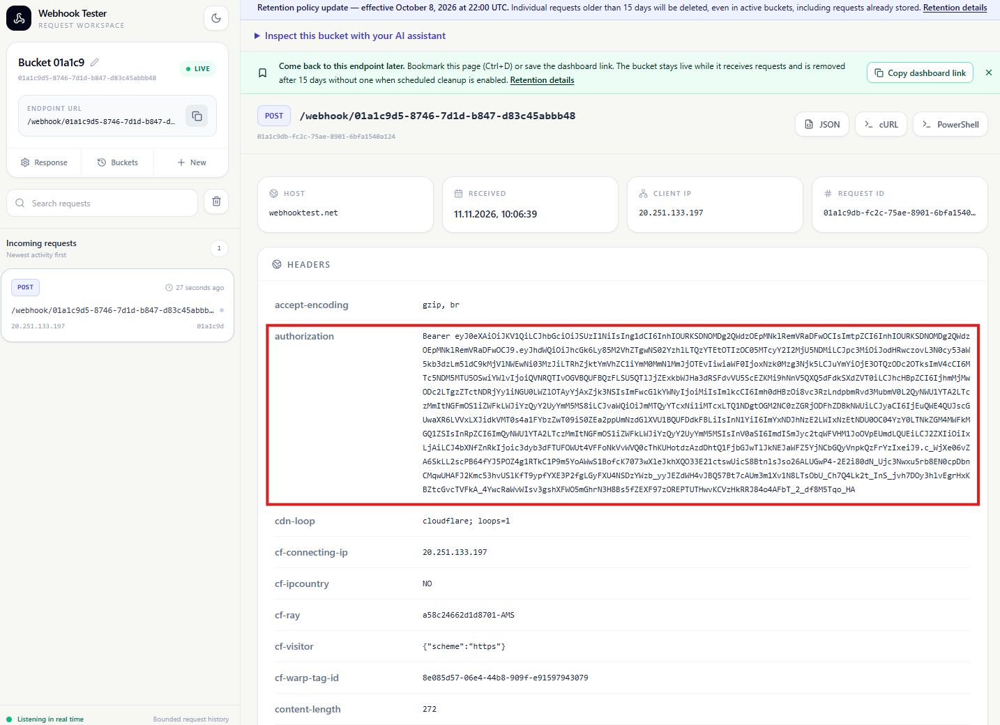

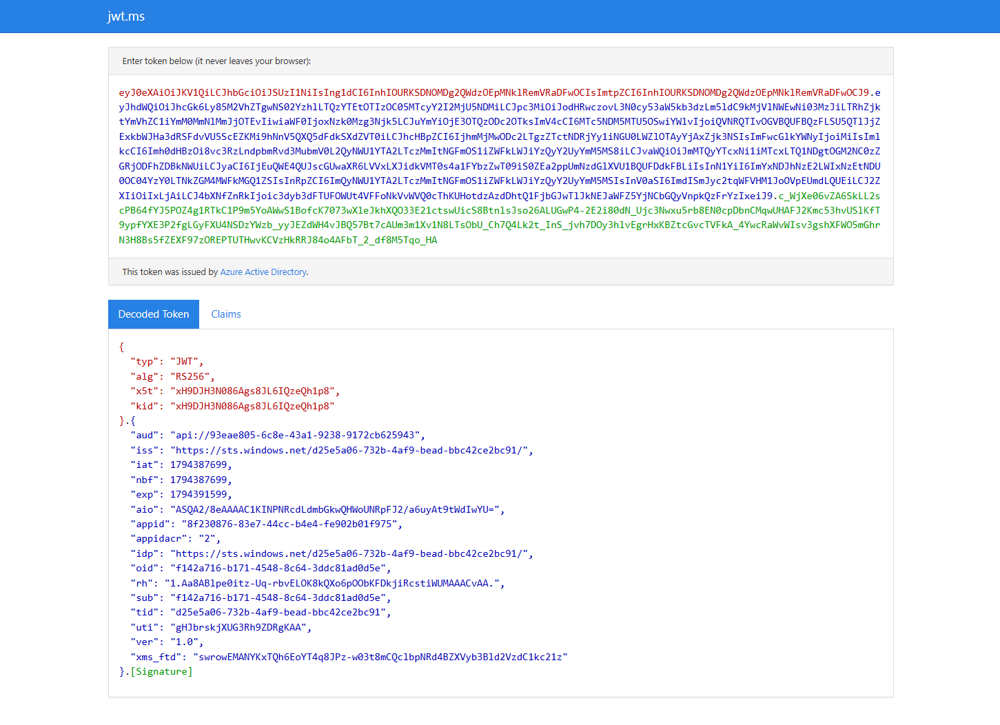

6. You'll notice that by default, the ```ver``` claim is ```1.0```, meaning we have a v1 token. In order to switch to a v2 token, we can configure the app registration manifest:

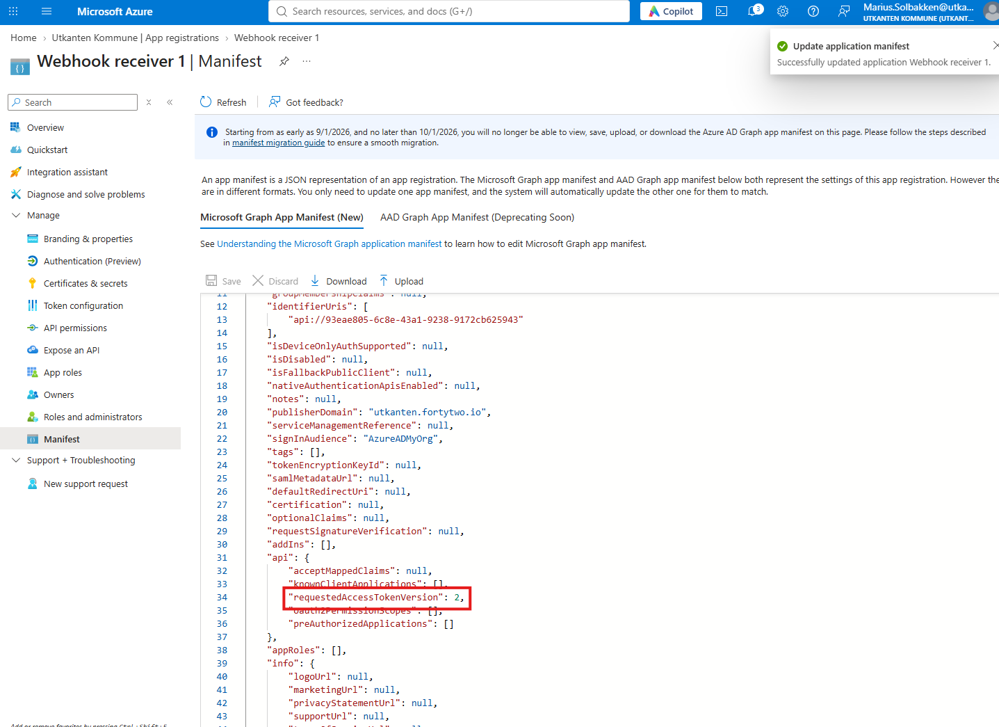

7. After the update, you may have to wait for 1 hour until the cache of Fortytwo Universe expires, before a new **Test webhook**. After this, we can see the ```ver```of the token updated to ```2.0```:

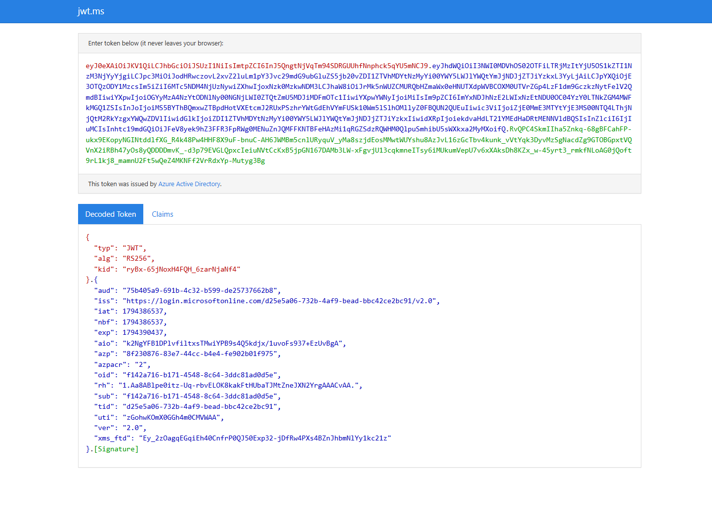

