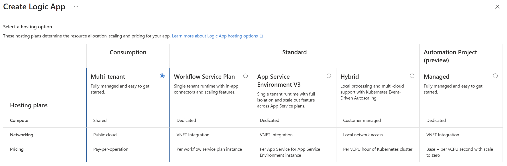
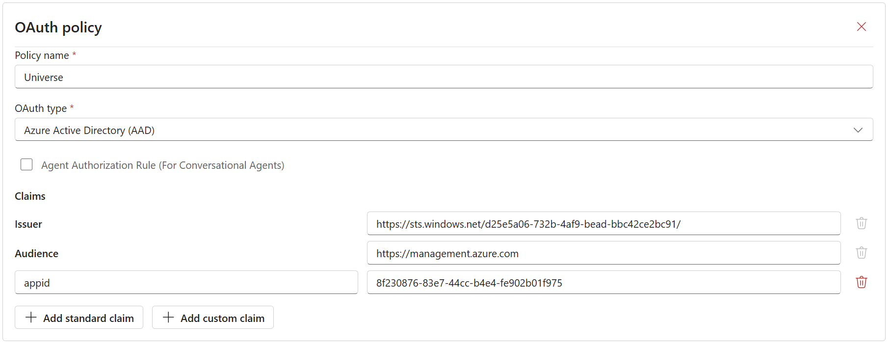
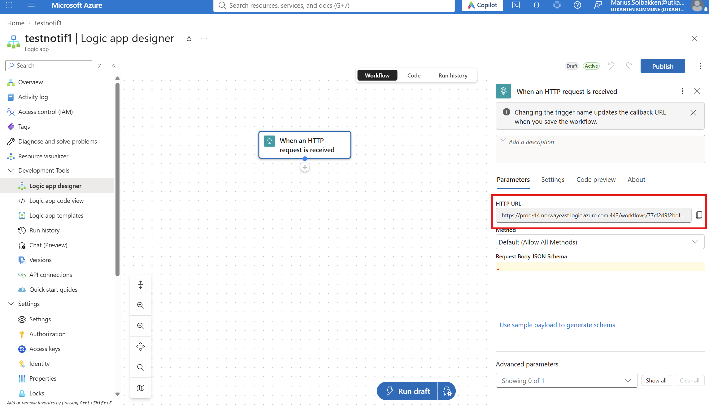

# Workflow authentication

:::tip[LogicApp]
    This example is using LogicApps, but can be used by other services such as Azure Functions.
:::

We recommend always using authentication for webhook uris, such as when calling LogicApps. By this, we mean that there should be no shared access signature or similar put in the url, but instead an Entra ID access token should be accepted.

## LogicApp

To configure a LogicApp in the most secure way, follow the below steps:

1. If you have not already done so, consent to the **Fortytwo Universe - Workflows** application:

https://login.microsoftonline.com/common/adminconsent?client_id=8f230876-83e7-44cc-b4e4-fe902b01f975

2. Create your LogicApp using the consumption model:

3. Under **Authorization**, add the following policy:

| Claim | Value | 
|-|-|
| Issuer | https://sts.windows.net/YOURTENANTID/ |
| Audience | https://management.azure.com | 
| appid | 8f230876-83e7-44cc-b4e4-fe902b01f975 |

This allows the Fortytwo Universe events service to invoke the LogicApp without needing any shared access signature in the url.

3. After adding a HTTP trigger, copy the url:

When copying the url of your LogicApp, you will see the three query parameters *sp*, *sv* and *sig* being added. These must be removed:

[https://prod-14.norwayeast.logic.azure.com:443/workflows/77cf2d9f2bdf41cb977de860cd601be3/triggers/When_an_HTTP_request_is_received/paths/invoke?api-version=2016-10-01<s>&sp=%2Ftriggers%2FWhen_an_HTTP_request_is_received%2Frun&sv=1.0&sig=c55rRC959lDdI7XcKthSyY9LIQ2dm-dhvfBggG2f-tg</s>](https://prod-14.norwayeast.logic.azure.com:443/workflows/77cf2d9f2bdf41cb977de860cd601be3/triggers/When_an_HTTP_request_is_received/paths/invoke?api-version=2016-10-01&sp=%2Ftriggers%2FWhen_an_HTTP_request_is_received%2Frun&sv=1.0&sig=c55rRC959lDdI7XcKthSyY9LIQ2dm-dhvfBggG2f-tg)

4. Last, when configuring a workflow, use the modified URL and remember to verify