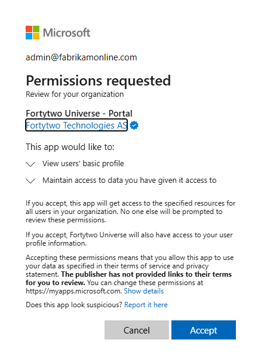
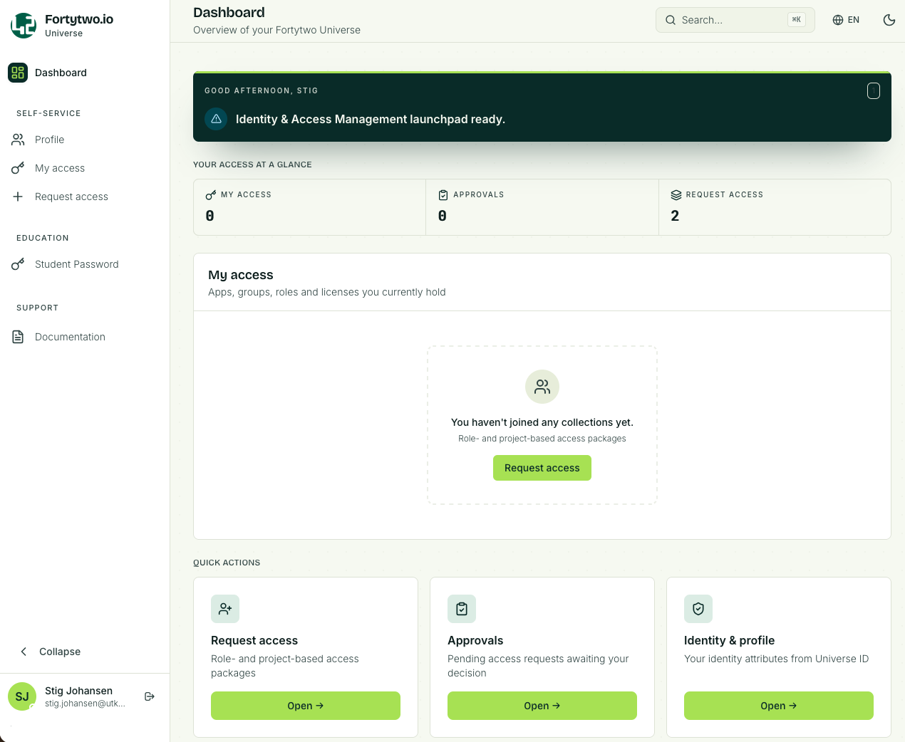
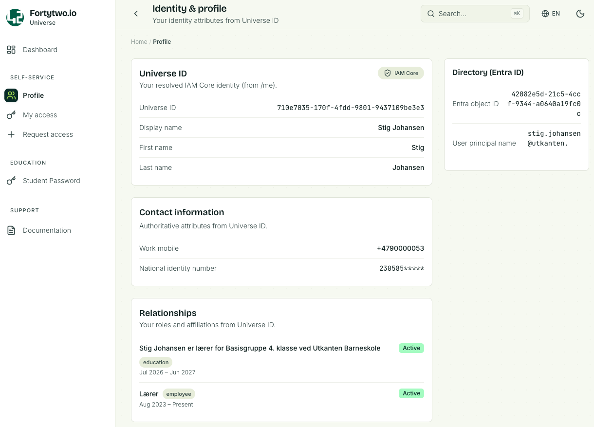
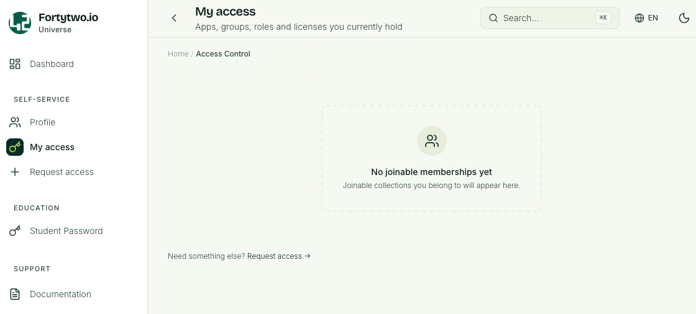
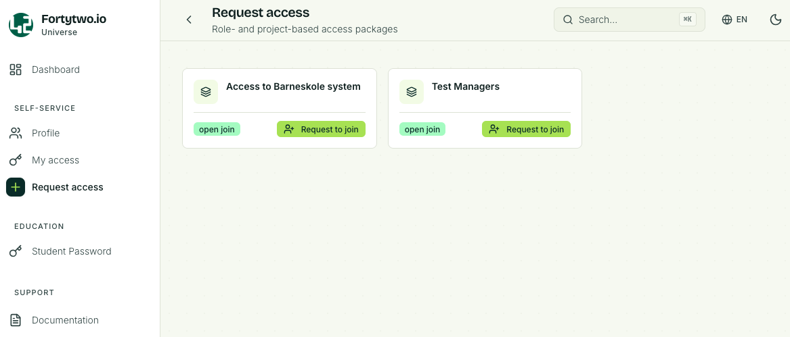
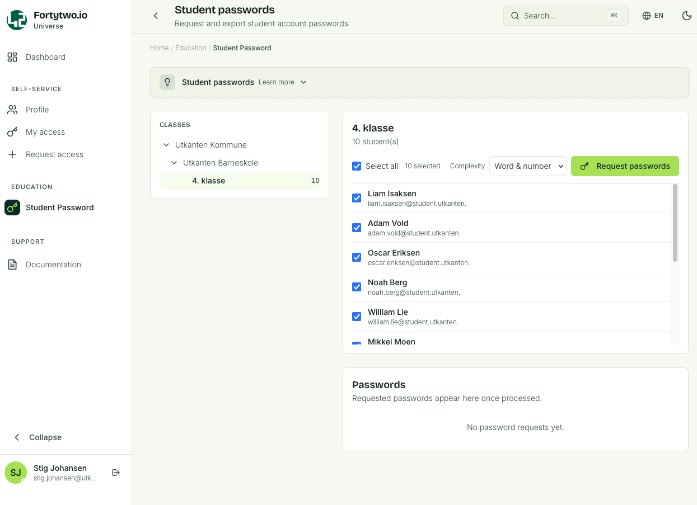
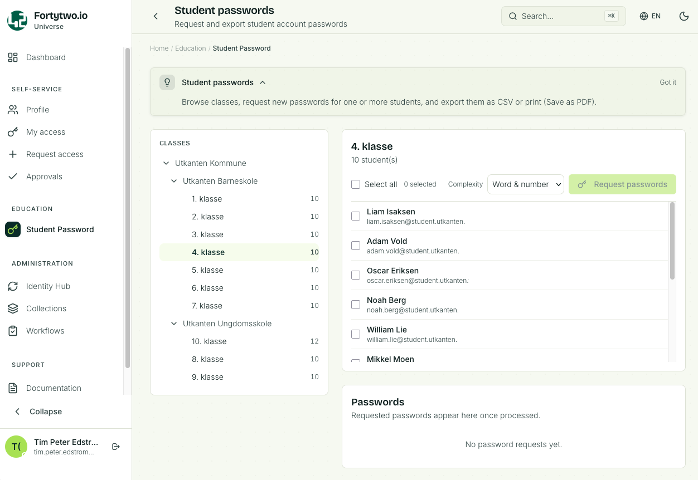
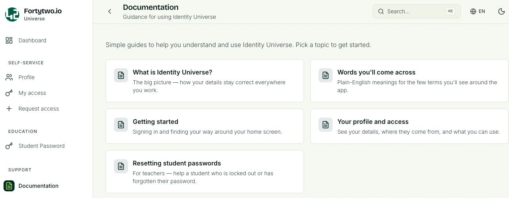

# Get started

## Fortytwo Identity Universe

Go here to access Fortytwo Identity Universe: [https://universe.fortytwo.io](https://universe.fortytwo.io)

### Get your tenant white listed

First, contact Fortytwo so we can whitelist your Entra tenant. Make sure to have your tenant ID ready. If you have multiple tenants, we would need all your IDs; each tenant would be its own instance.

### Admin consent

Identity Universe consists of several components. To get full functionality, you need to consent to all of these. We recommend performing "admin consent" to enable all Entra ID users to access the Identity Universe. This can be achieved by a Global Admin by following and accepting the Microsoft admin consent flow for Identity Universe on behalf of the organisation. If admin consent is **not** in place each person must grant (user) consent when signing in for the first time.

| Name and admin consent link                                                                                                                    | Description                                                                                          |
|------------------------------------------------------------------------------------------------------------------------------------------------|------------------------------------------------------------------------------------------------------|
| [Fortytwo Universe](https://login.microsoftonline.com/common/adminconsent?client_id=2808f963-7bba-4e66-9eee-82d0b178f408)                      | **Required** The Identity Universe API itself, used by all components, including the portal |
| [Fortytwo Universe - Portal](https://login.microsoftonline.com/common/adminconsent?client_id=d5151be7-b1d6-411d-88f1-b1da1350211f)             | **Required** Enables the portal for Identity Universe |
| [Fortytwo Universe - Collections](https://login.microsoftonline.com/common/adminconsent?client_id=70a5c607-eb33-4599-8762-f3a2874732a9)        | **Required** Enables Collections, a core component of Identity Universe |
| [Fortytwo Universe - Entra ID Connector](https://login.microsoftonline.com/common/adminconsent?client_id=2fcb40bf-98fd-499c-b47f-935aaa071984) | **Semi-required** Allows Identity Universe to read data from your tenant and use it as an inbound connector, and is used to create, update and delete users in the case of outbound provisining being enabled. |
| [Fortytwo Universe - PowerShell Client](https://login.microsoftonline.com/common/adminConsent?client_id=68bf2f1d-b9e1-4477-8b90-81314861f05f)  | **Optional** Allows Fortytwo's PowerShell module to connect to your instance so you can get programmatic access |
| [Bytt.Email](https://login.microsoftonline.com/common/adminConsent?client_id=34ee8edb-d2ff-4ee9-bac3-73b53303e00f)                             | **Optional** Allows the bytt.email services access to read email addresses and sAMAccountNames in order to store history and check for uniqueness |
| [Fortytwo Universe - Education](https://login.microsoftonline.com/common/adminconsent?client_id=a4cde9df-633f-42e9-882b-9f3bd3f23979)          | **Optional** Used only for customers using the Education features available in Identity Universe |
| [Fortytwo Universe - Group Provisioning](https://login.microsoftonline.com/common/adminconsent?client_id=baedddcc-eaca-485e-8c74-bef4e209cd85) | **Optional** Used by the Group Link feature to write group memberships |

This is what admin consent looks like:

## Assign permissions

Before you can see or do anything in the portal, you have to [assign permissions](permissions/index.md).

## First glance of the Portal

### Dashboard

When you sign in you will see the Dashboard.

### Profile

The **Profile** page shows information about your user.

### My access

**My access** will list collections you are a member of. Here you also find a link to **Request access**.

### Request access

The **Request access** page will list all collections you can request to join.

### Student password

The **Student password** page will list the class, one or several, that you are responsible for.

If you are a teacher and you have a class of students the class and students will be listed. You will be able reset the password for a single student, or multiple.

The same applies for support personnel, usually local IT support, that have been delegated reset password permissions for a selection of students.

If you are an administrator you will be able to see **all** registered schools and classes, but you will not be able to reset passwords (trying to do so will display an error).

### Documentation

The **Documentation page** will contain be the place to go for user guides and explanations on how to navigate the Identity Universe. This section will keep growing as features are added.

