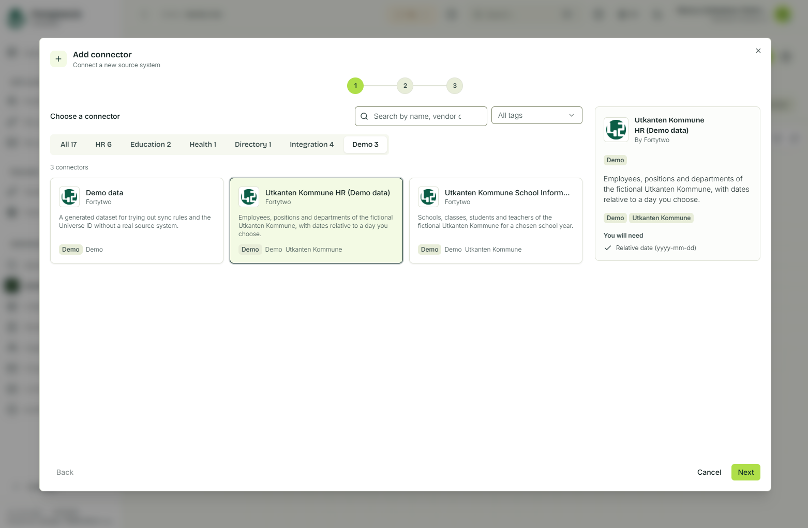
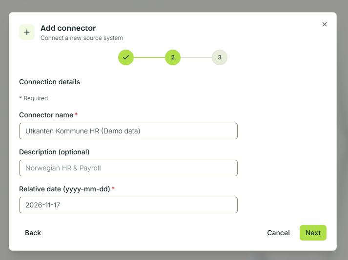

# Configure connectors

# Step 1 - Read up on documentation

Before configuring connectors, it can be a good idea to read up on the following documentation, so that you understand the concept of IAM Core objects (Person, Relationship and Org Unit), connectors, sync rules and how to populate the [IAM Core](../../iam-core/index.md):

- [IAM Core](../../iam-core/index.md)
- [Connectors](../../iam-core/connectors/index.md)
- [Synchronization](../../iam-core/sync/index.md)

# Step 2 - Add source connector

In the [Universe portal](https://universe.fortytwo.io), locate the **Identity hub** and click **+ Add connector**. Locate your source, such as your HR system, as complete the wizard. In this example we will use the demo connector **Utkanten Kommune HR (Demo data)**:

Complete the required fields (varies based on the connector you choose):

# Step 3 - Add Entra ID connector

