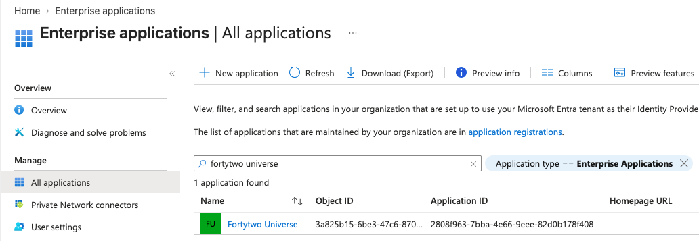
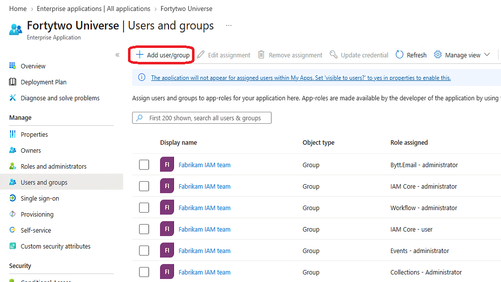
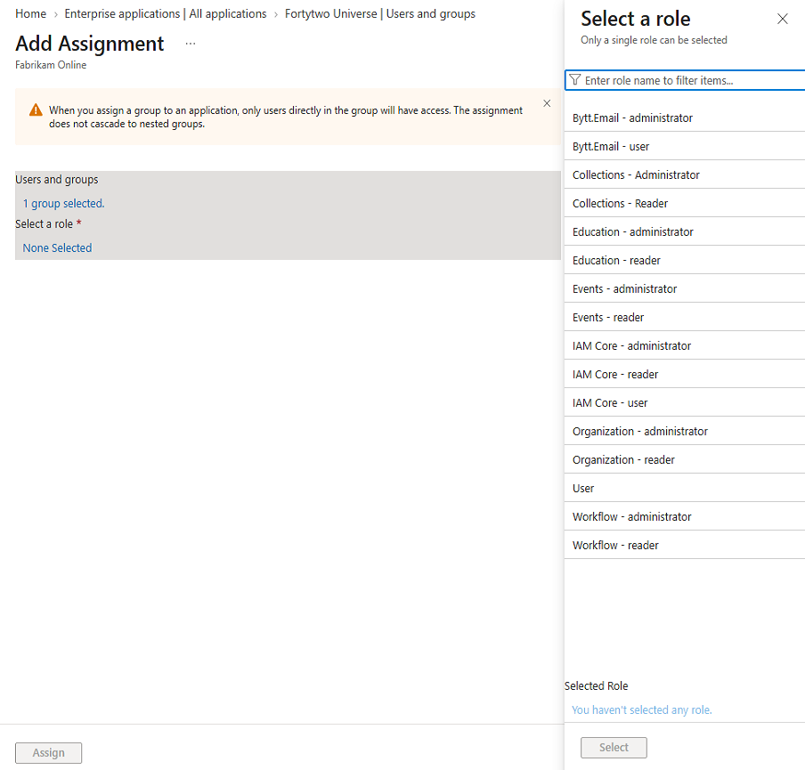
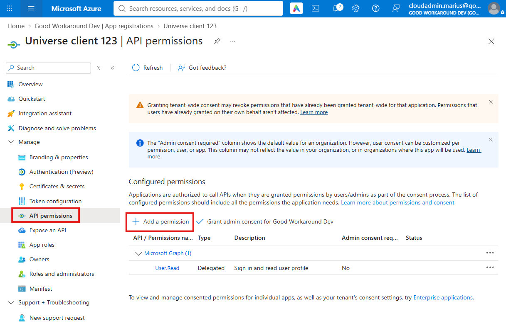
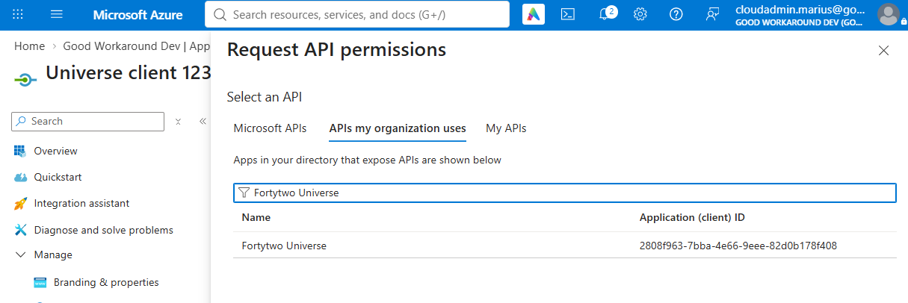
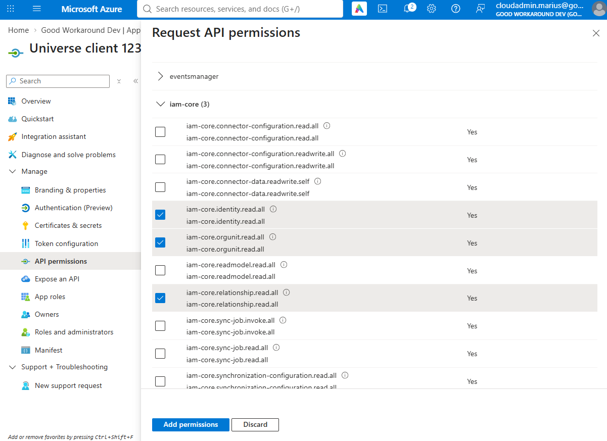
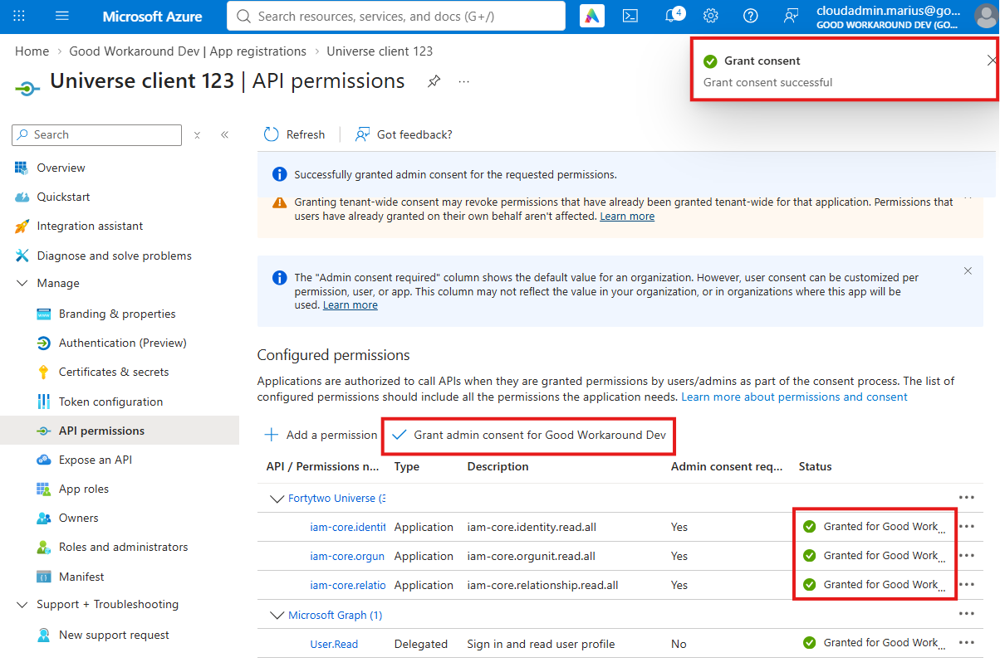
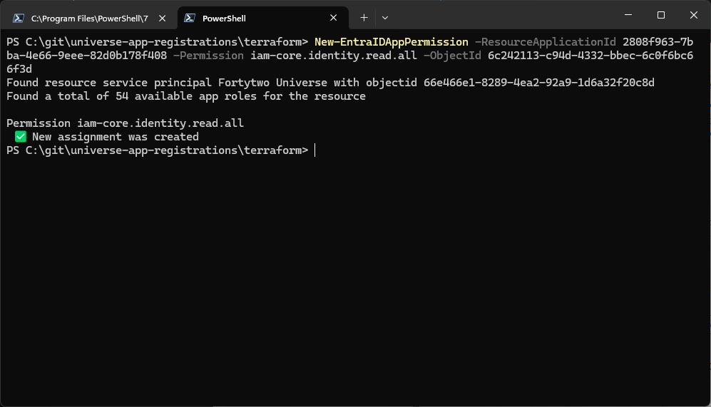
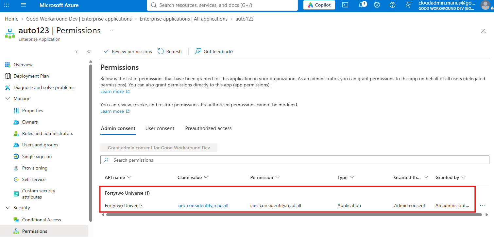

# Permissions

In order for you as an organization to be able to delegate only the minimum required permissions to both your end users, but also your administrators, Fortytwo Universe has lots of roles available, both for users, agents and applications. There are several types of roles available in the system:

| Role | Where? |
|-|-|
| Global user roles | Managed in your Entra ID, carried in the user's access token |
| Global application roles | Managed your in Entra ID, carried in the user's access token |
| Service specific user roles | Managed under specific services, such as [Education](../../education/index.md) having an option to delegate [identities](../../iam-core/objecttypes/coreidentity.md) and [collections](../../collections/index.md) permissions to org units. |
| Service specific application roles | Managed under specific services, such as certain [Connectors](../../iam-core/api/index.md) allowing access only to a certain application's Client ID |
| Relationship specific permissions | Some features are made available by the IAM Core objects having relationships to each other, such as org units having a manager, where the manager gets certain features available. |

## User roles

| Role | Purpose |
|-|-|
| Bytt.Email - administrator | Grants access to managing email settings, such as email patterns |
| Bytt.Email - reader | Grants access to read email settings, such as email patterns |
| Bytt.Email - user | Grants the user access to change their email address and alias |
| Collections - Administrator | Grant access to manage collections |
| Collections - Reader | Grant access to read collections |
| Education - administrator | Grants access to manage all student password and internet policy feature settings |
| Education - reader | Grants access to read all student password and internet policy feature settings |
| Events - administrator | Grants access to read audit log and configure event based triggers |
| Events - reader | Grants access to read audit log |
| IAM Core - administrator | Grants access to manage all connectors and sync rules, as well as outbound provisioning settings |
| IAM Core - reader | Grants access to read all connectors and sync rules, as well as outbound provisioning settings |
| Organization - administrator | Grants access to manage organization functionality |
| Organization - reader | Grants access to read organization functionality |
| User | Grants access to the end user portal |
| Workflow - administrator | Grants access to manage workflows, such as collection triggered workflows |
| Workflow - reader | Grants access to read workflows, such as collection triggered workflows |

### How to assign

To assign users access to Identity Universe, you configure this in your own Entra ID. 

We recommend using Entra security groups for assigning these roles to make access management easier.

1. Find the **Fortytwo Universe** enterprise application

    

1. In **User and groups** choose **Add user/group**

    

1. Click **User and groups** and select a group and choose **Select**. Then click **Select a role** and **Select**. To add the permission click **Assign**. To assign multiple roles repeat the process for the same group and add additional permission.
   
    

:::tip[PIM for Groups]
    You can configure two different Entra ID groups for your administrators, one for reader and one for administrator, where the administrator group is enabled with PIM for Groups. This allows you to have reader permissions to Identity Universe permanently, while needing to elevate up to administrator permissions.
:::

## Application roles

<!--
$t=(gc .\roles.auto.tfvars -Raw) -replace "\[","@(" -replace "\]",")" -replace "\{","@{" -replace "^roles",'$roles' -replace "\},","}" -replace "/\*","<#" -replace "\*/","#>"
$t > 1.ps1
. ./1.ps1
remove-item 1.ps1
$roles | ? allowed_member_types -contains "Application" | ? state -eq "prod" |% {"| $($_.value.padright(60)) | $($_.description.padright(200)) |"} | sort  | Set-Clipboard
-->

| Role | Purpose |
|-|-|
| changeemail.accountname.generate.all                         | Grants the ability to generate an account name for an existing user or a new identity, without it being saved anywhere. Primarily used for user provisioning or testing email patterns.                  |
| changeemail.accountnamehistory.read.all                      | Grants the ability to read all account name history.                                                                                                                                                     |
| changeemail.accountnamehistory.readwrite.all                 | Grants the ability to read and write all account name history.                                                                                                                                           |
| changeemail.changerequest.readwrite.all                      | Grants the ability to read and write email address change requests, in order to fulfill them into Active Directory or Entra ID.                                                                          |
| changeemail.collectionpattern.read.all                       | Grants the ability to read all collection patterns.                                                                                                                                                      |
| changeemail.collectionpattern.readwrite.all                  | Grants the ability to read and write all collection patterns.                                                                                                                                            |
| changeemail.emailaddress.generate.all                        | Grants the ability to generate an email address for an existing user or a new identity, without it being saved anywhere. Primarily used for user provisioning or testing email patterns.                 |
| changeemail.emailaddresshistory.read.all                     | Grants the ability to read all email address history.                                                                                                                                                    |
| changeemail.emailaddresshistory.readwrite.all                | Grants the ability to read and write all email address history.                                                                                                                                          |
| checkid_agent.all                                            | Grants access to act as the OnPremises AD Agent                                                                                                                                                          |
| collections-criteria.criteria.read.all                       | Can read all collection definitions and all results.                                                                                                                                                     |
| collections-criteria.criteria.readwrite.all                  | Can read and write all collection definitions and read all results.                                                                                                                                      |
| customers.subscription.read.all                              | Allows full read to subscriptions.                                                                                                                                                                       |
| customers.subscription.register.consumption                  | Allows registering consumption                                                                                                                                                                           |
| education.studentpasswordrequest.process.all                 | Grants the ability to process student password requests.                                                                                                                                                 |
| eventsmanager.event.read.all                                 | Allows full read access to the event trail of every Galaxy                                                                                                                                               |
| eventsmanager.workflow.read.all                              | Allows full read access to workflows                                                                                                                                                                     |
| eventsmanager.workflow.readwrite.all                         | Allows full read and write access to workflows                                                                                                                                                           |
| iam-core.connector-configuration.read.all                    | Grants the ability to read connector configurations.                                                                                                                                                     |
| iam-core.connector-configuration.readwrite.all               | Grants the ability to read and write connector configurations.                                                                                                                                           |
| iam-core.connector-data.readwrite.self                       | Grants the ability to access a connectors own connector data.                                                                                                                                            |
| iam-core.identity.read.all                                   | Grants the ability to read CoreIdentity objects.                                                                                                                                                         |
| iam-core.orgunit.read.all                                    | Grants the ability to read CoreOrgUnit objects.                                                                                                                                                          |
| iam-core.readmodel.read.all                                  | Grants the ability to read all from the flat read model.                                                                                                                                                 |
| iam-core.relationship.read.all                               | Grants the ability to read CoreRelationship objects.                                                                                                                                                     |
| iam-core.sync-job.invoke.all                                 | Grants the ability to invoke sync jobs.                                                                                                                                                                  |
| iam-core.sync-job.read.all                                   | Grants the ability to read sync jobs.                                                                                                                                                                    |
| iam-core.synchronization-configuration.read.all              | Grants the ability to read synchronization configurations.                                                                                                                                               |
| iam-core.synchronization-configuration.readwrite.all         | Grants the ability to read and write synchronization configurations.                                                                                                                                     |
| organization.relationshiptype.read.all                       | Grants the ability to read relationship types in the organization.                                                                                                                                       |
| organization.relationshiptype.readwrite.all                  | Grants the ability to read and write relationship types in the organization.                                                                                                                             |
| organization.sourceorgunit.read.all                          | Grants the ability to read source org units in the organization.                                                                                                                                         |
| organization.sourceorgunit.readwrite.all                     | Grants the ability to read and write source org units in the organization.                                                                                                                               |
| organization.sourceperson.read.all                           | Grants the ability to read source persons in the organization.                                                                                                                                           |
| organization.sourceperson.readwrite.all                      | Grants the ability to read and write source persons in the organization.                                                                                                                                 |
| organization.sourcerelationship.read.all                     | Grants the ability to read source relationships in the organization.                                                                                                                                     |
| organization.sourcerelationship.readwrite.all                | Grants the ability to read and write source relationships in the organization.                                                                                                                           |

### How to assign - App registration

:::tip
Techincal explanation on how to sign in with an app registration, creating it etc. is out of scope for this documentation
:::

1. After creating an app registration in Entra ID, go to **API permissions** in the left menu and click **Add a permission**



2. Under **APIs my organization uses**, locate **Fortytwo Universe**, with app id **2808f963-7bba-4e66-9eee-82d0b178f408**



3. Select **Application permissions** and the permissions you need before clicking **Add permission**



4. Click **Grant admin consent**



Your application can now access the Fortytwo Universe API by requesting an access token for the scope **https://api.fortytwo.io/.default**

### How to assign - Managed service identity

Microsoft has not made it easy to add application permissions to Managed Service Identities. This must be done using [Microsoft Graph](https://learn.microsoft.com/en-us/graph/api/serviceprincipal-post-approleassignments?view=graph-rest-1.0&tabs=http), or using our PowerShell module.

1. Make sure your last open browser is signed into the Azure Portal as a global administrator or application administrator.

2. Run the below PowerShell to sign in

```PowerShell
Install-Module EntraIDAccessToken -Scope CurrentUser
Add-EntraIDInteractiveUserAccessTokenProfile
```

3. Locate the **object id** of your Managed Service Identity and run the below code in PowerShell:

```PowerShell
New-EntraIDAppPermission -ResourceApplicationId 2808f963-7bba-4e66-9eee-82d0b178f408 -Permission iam-core.identity.read.all -ObjectId (Read-Host -Prompt "Object ID of MSI")
```



4. After this, you should see the permission listed on the MSI:

