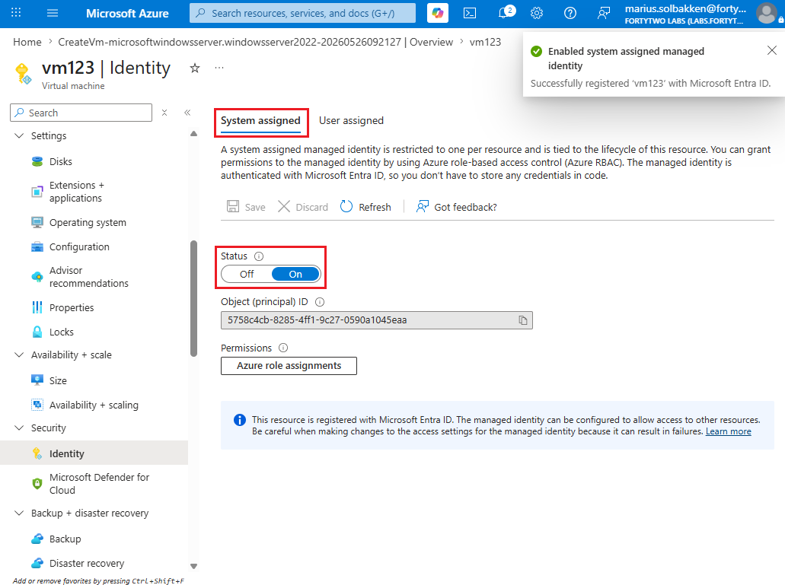
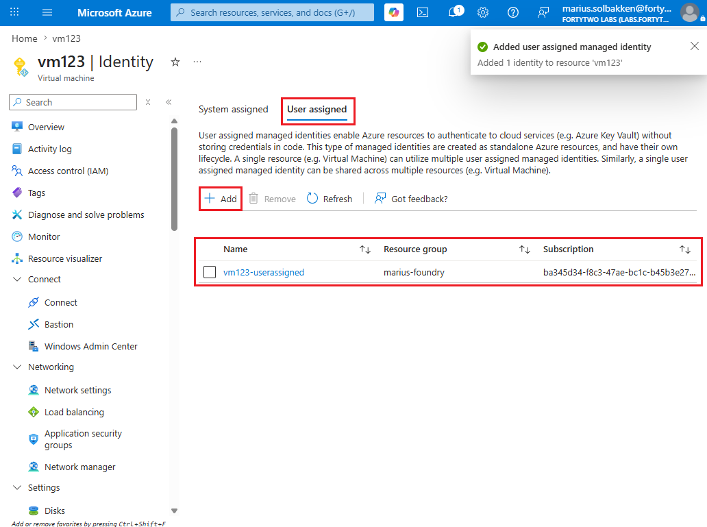
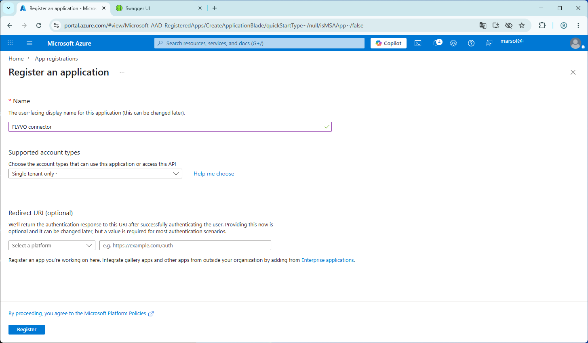
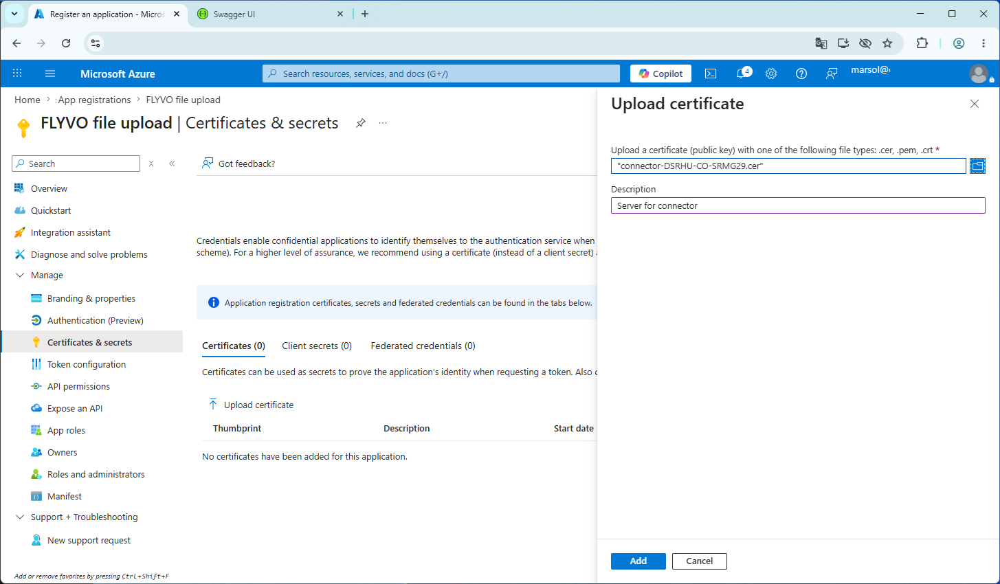

# Authenticating PowerShell

## Interactive PowerShell

To use PowerShell to connect to the Fortytwo Universe proper authentication must performed.

A valid PowerShell session can be configured in multiple ways, provided the proper authentication.

All API endpoints are authenticated with the customer's own Entra ID, through our multi tenant application Fortytwo Universe (for how to provide admin consent, if not already in place, see [this URL](https://login.microsoftonline.com/common/adminconsent?client_id=2808f963-7bba-4e66-9eee-82d0b178f408)).

This means that you can use any kind of identity to talk to our API! Users, Agents, Service Principals, Managed Service Identities, you name it. As long as you can get a token for the scope ```https://api.fortytwo.io/.default``` or the resource ```2808f963-7bba-4e66-9eee-82d0b178f408``` you are good.

### PowerShell module EntraIDAccessToken

Authentication is handled using the Fortytwo PowerShell module **EntraIDAccessToken**, available through PowerShell Gallery. Using the Fortytwo [EntraIDAccessToken](https://www.powershellgallery.com/packages/EntraIDAccessToken) PowerShell module is the way all Fortytwo PowerShell modules authenticate with the Fortytwo Universe.

EntraIDAccessToken has multiple ways of creating an **access token profile** using the ```Add-EntraID*AccessTokenProfile``` cmdlets (replace **\*** with preferred method). The available cmdlets are documented [here](https://github.com/fortytwoservices/powershell-module-entraidaccesstoken).

### Ways to issue an Entra ID access_token

To issue an Entra ID access token profile some common methods for an interactive user session are:

* Add-EntraIDClientSecretAccessTokenProfile
* Add-EntraIDClientCertificateAccessTokenProfile
* Add-EntraIDInteractiveUserAccessTokenProfile (here we are using this profile)

### Using EntraIDInteractiveUserAccessTokenProfile

To add an EntraIDAccessToken profile and authenticate to Fortytwo Universe:

```PowerShell
# Invoke interactive sign in
Add-EntraIDInteractiveUserAccessTokenProfile -Profile "Default" -TenantId "TENANTID" -ClientId "68bf2f1d-b9e1-4477-8b90-81314861f05f" -Scope https://api.fortytwo.io/.default 

# The TenantId will be your Entra tenant identifier (GUID) or tenant name
# The ClientId is for the "Fortytwo Universe - Prod - PowerShell Client"

# Get access_token and copy it to clipboard
Get-EntraIDAccessToken -Profile "Default" | Set-Clipboard

# To inspect the contents of the access_token
Get-EntraIDAccessToken -Profile "Default" | Get-EntraIDAccessTokenPayload

# Or invoke a request
Invoke-RestMethod "https://api.fortytwo.io/collections" -Headers (Get-EntraIDAccessTokenHeader -Profile "Default")
```

The **TenantId** will be your Entra tenant identifier (GUID) or tenant name.  
The **ClientId** is the enterprise application **Fortytwo Universe - PowerShell Client**.

### Consent

Enterprise application **Fortytwo Universe - PowerShell Client** requires consent. This can be provided when using the client id for the first time, or it can be provided by admin consent (this follows the same process as the [consent flow for Identity Universe WebUI](../../getting-started/index.md#admin-consent)).

Admin consent URL for **Fortytwo Universe - PowerShell Client**:  
[https://login.microsoftonline.com/common/adminConsent?client_id=68bf2f1d-b9e1-4477-8b90-81314861f05f](https://login.microsoftonline.com/common/adminConsent?client_id=68bf2f1d-b9e1-4477-8b90-81314861f05f)

With these steps completed you will have been issued an access_token that can be used to establish a connection with the collections API.

### More ways to issue an Entra ID access_token

A few common EntraIDAccessToken methods are described in this article. For a more extensive list, using system-assigned identities, or an Azure Arc identity, you may want to take a look [here](../../iam-core/api/authentication-powershell.md).


This page describes different ways of authenticating PowerShell to the Fortytwo Universe, for different automations, such as [uploading file data](../connectors/fileupload.md), talking to the [connector API](connector-api.md), etc.

All scripts use the [EntraIDAccessToken PowerShell module](https://www.powershellgallery.com/packages/EntraIDAccessToken), which means that the only thing required to connect is to complete one of the available ```Add-EntraID*AccessTokenProfile``` cmdlets. This is documented [here](https://github.com/fortytwoservices/powershell-module-entraidaccesstoken), but below are the most common scenarios covered.

## Running in an Azure VM

!!! info "Server must be in a subscription in the same tenant as you want to manage Fortytwo Universe for. If you need cross tenant authentication, use the certificate based approach just like alocal server."

### System assigned



```PowerShell
Add-EntraIDAzureVMMSIAccessTokenProfile -Scope "https://api.fortytwo.io/.scope" -Name Connector
```

### User assigned



```PowerShell
Add-EntraIDAzureVMMSIAccessTokenProfile -Scope "https://api.fortytwo.io/.scope" -Name Connector -UserAssignedIdentityClientId "00000000-0000-0000-0000-000000000000"
```

## Running on a local server

### Azure Arc

```PowerShell
Add-EntraIDAzureArcManagedMSITokenProfile -Resource "https://api.fortytwo.io" -TenantId "00000000-0000-0000-0000-000000000000" -ClientId "00000000-0000-0000-0000-000000000000"
```

### Certificate based authentication

In order to use certificate based authentication, the following steps must be completed:

- On the server you want to run your automation on, run PowerShell as an Administrator and create a new self signed certificate using the PowerShell cmdlet ```New-SelfSignedCertificate```:

```PowerShell
$Certificate = New-SelfSignedCertificate -Subject "connector" -NotAfter (Get-Date).AddYears(100)
[System.Convert]::ToBase64String($Certificate.Export([System.Security.Cryptography.X509Certificates.X509ContentType]::Cert), "InsertLineBreaks") | Set-Content -Path "connector-$($env:COMPUTERNAME).cer"
Write-Host "" "Thumbprint:       $($Certificate.ThumbPrint)" "Certificate file: connector-$($env:COMPUTERNAME).cer" "" -Separator "`n"
```

- Note down the thumbprint and keep the certificate file created available for the next steps
- Go to the Entra ID portal as an **Global Admin**, **Application admin**, **Cloud application admin**
- Create a new **App registration** with a name that suits your naming convention:



- Note down the **Client ID** and **Tenant ID** on the first page you get to after creating the app registration
- Go to **Certificates & secrets**, select **Certificates** and click **Upload certificate**
- Upload the exported .CER file from the PowerShell above



You have now configured authentication, and can authenticate to Fortytwo Universe as follows:

```PowerShell
Add-EntraIDClientCertificateAccessTokenProfile -TenantId "TENANTID" -ClientId "CLIENTID" -Thumbprint "THUMBPRINT" -Scope "https://api.fortytwo.io/.default"
```