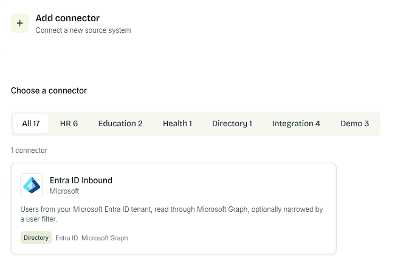
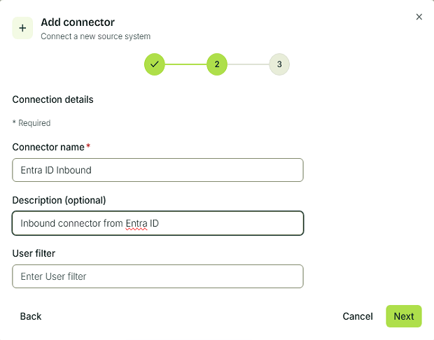
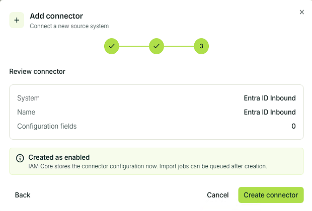
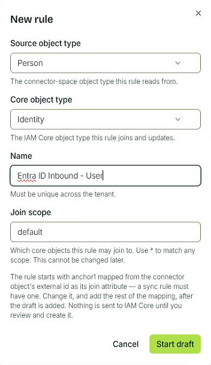
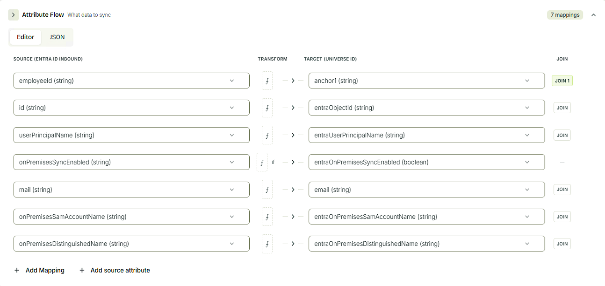

# Entra ID Inbound

In order for users to be able to use the Fortytwo Universe portal, we need to identify them. This is done by matching the ```oid``` claim in the Entra ID access token, to a [CoreIdentity's](../objecttypes/coreidentity.md) attribute ```entraObjectId```. In order to populate this attribute, you can use this connector.
This connector will connect to the Entra ID tenant that is associated with your Identity Universe instance.
It is expected that you already have an inbound HR connector configured and running; this connector will only provide additional attributes.

## Pre-reqs

- An attribute in Entra you can use to match and join an existing CoreIdentity. This might, for example, be an EmployeeID attribute you have synchonized from your on-Prem AD or set directly in Entra ID. If you have no other matching attribute, you can populate the [CoreIdentity's](../objecttypes/coreidentity.md) ```id``` attribute, either through syncing from AD or directly in Entra ID (when doing cloud only provisioning). When provisioning in AD, we recommend using ```msDs-cloudExtensionAttribute19``` as this attribute.
- [Admin consent our read access app](https://login.microsoftonline.com/common/adminconsent?client_id=2fcb40bf-98fd-499c-b47f-935aaa071984)

## Create connector

### Create connector in the Identity Universe Portal

1. Navigate to the Identity Universe portal. Go to **Identity Hub** and select **+ Add Connector**.
2. Select the **Entra ID Inbound** connector template from the list. Click **Next**.

    

3. Optionally, add a user filter and click **Next**.

    

4. Confirm the connector settings and click **Create connector**.
    
    

### Create connector using PowerShell


!!! note "Please follow the [Authenticating PowerShell](../api/authentication-powershell.md) documentation in order to have a working PowerShell connection"

Create a new connector using the below cmdlet:

```PowerShell
New-IAMCoreConnector -Name "Entra ID Inbound" -TemplateId "entraidinbound"
```

This will cause the connector to be created, and users will be imported.

## Create sync rule

### Create sync rule in the Identity Universe Portal

1. In the newly created connector, navigate to the **Sync Rules** tab and select **New Rule**.
2. Give the sync rule a name, such as **Entra ID Inbound - User** and click **Start Draft**.

    

3. Configure the attribute flows for the sync rule. More details can be found in the documentation for [sync rules](../sync/syncrules.md). Make sure you select the join attribute you selected in the pre-reqs.

    

4. Save the sync rule with **Review and save**.

### Create sync rule using PowerShell

```PowerShell
$InboundAttributeFlows = @(
    @{
        '$type'             = "string"
        targetAttributeName = "id"
        joinPriority        = 1
        value               = @{
            '$type'   = "attribute"
            attribute = "extension_6bc257b4005f49359d9fdca3e38cbfdf_msDS_cloudExtensionAttribute19"
        }
    }

    @{
        '$type'             = "string"
        targetAttributeName = "entraUserPrincipalName"
        value               = @{
            '$type'   = "attribute"
            attribute = "userPrincipalName"
        }
    }

    @{
        '$type'             = "string"
        targetAttributeName = "entraOnPremisesSamAccountName"
        value               = @{
            '$type'   = "attribute"
            attribute = "onPremisesSamAccountName"
        }
    }

    @{
        '$type'             = "string"
        targetAttributeName = "entraOnPremisesDistinguishedName"
        value               = @{
            '$type'   = "attribute"
            attribute = "onPremisesDistinguishedName"
        }
    }

    @{
        '$type'             = "string"
        targetAttributeName = "entraObjectId"
        value               = @{
            '$type'   = "externalid"
        }
    }

    @{
        '$type'             = "string"
        targetAttributeName = "email"
        value               = @{
            '$type'   = "attribute"
            attribute = "mail"
        }
    }
)

New-IAMCoreSyncRule `
    -Name "Entra ID Inbound - User" `
    -ConnectorId "00000000-0000-0000-0000-000000000000" `
    -ConnectorObjectType "user" `
    -CoreObjectType "Identity" `
    -ProvisioningEnabled:$false `
    -Priority 11000 `
    -InboundAttributeFlows $InboundAttributeFlows
```