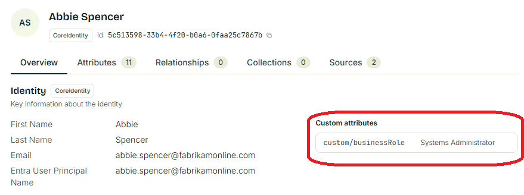

# Custom attributes

The core objects have a fixed schema, but you can extend these with custom string attributes. You can add these on any of the core object types.

The attribute’s name must start with **custom/**, for example **custom/businessRole**. The source and target attributes must both be strings.

Custom attributes are not listed when querying the core schema, for example with `Get-IAMCoreSchema`.

To configure in a Sync Rule, go to **Attribute Flows** and click **JSON**. Then add a proper attribute flow using JSON.

``` JSON
  {
    "$type": "string",
    "value": {
      "$type": "attribute",
      "attribute": "businessRole"
    },
    "joinPriority": null,
    "targetAttributeName": "custom/businessRole",
    "nullFlow": false
  }
```

Click **Review and save**. The flow will be visible in the attribute flow editor.

After synchronization of the identity has completed, any custom attribute can be seen in **Identity Explorer** on the user.


