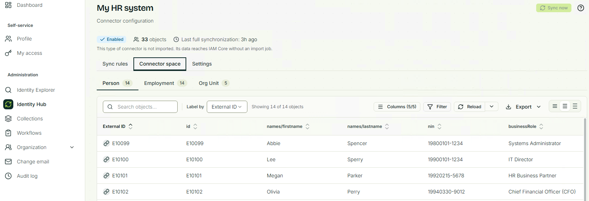
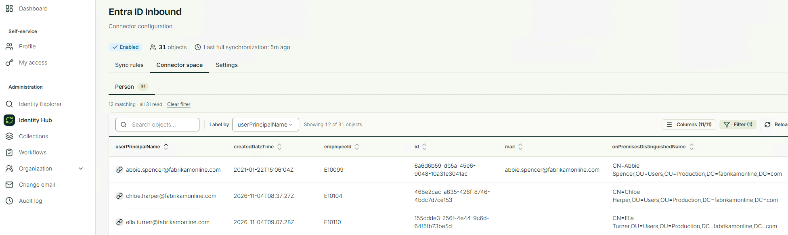

# Create Connectors

Our HR system is representing an employee (person) as a single record in the API. There is also an API to read the organization structure. The person will have a reference to the department number in the org structure.

In Identity Universe, there is fundamental support for having multiple employment records at the same time for one person. When you have an HR system that doesn't represent this, you might think you can ignore the [relationship object](../objecttypes/corerelationship.md) and synchronize everything directly to the [identity](../objecttypes/coreidentity.md). But the self-service interface for end-users assumes it can show a user's position, and for the best experience, we represent the single person object we have in HR with two objects in the connector space.

There is also an Entra tenant. We will connect to it and read users from it so they can sign in to the portal.

::::steps
### Create an Entra app and create connector

To authenticate with Identity Universe, you will need an Entra app. Follow the [setup steps in connector API](../api/connector-api.md#setting-up). Also create the connector itself in these steps and use the name **My HR system**.

Create a secret for the Entra app and note it.

:::note[Other ways to authenticate]
In this lab setup, we will use interactive sign-ins and review everything happening. In a production environment setup, use one of the methods in [Authentication](../api/authentication-powershell.md).
:::

### Create sample employee information and scripts

In a folder on your local machine, create the two PowerShell scripts in the appendix and the two CSV files.

- [ConnectConnectorHR](#connectconnectorhrps1)
- [ImportHR](#importhrps1)
- [Employees](#employeescsv)
- [orgStructure](#orgstructurecsv)

Things to note in the script:

- We create both a person object and an employee object from the same HR record.
- We are building a JSON structure. We are putting firstname and lastname under names. This is not needed but might be useful to more easily find an attribute later; you can have a flat structure with all attributes if you want to. When building your own connector, we recommend following the structure in the HR system as much as possible.
- We are doing a full import, so we must provide all objects; otherwise, the PowerShell module will treat objects as an implicit delete.
- Upper and lowercase in attribute names matter. To make it easier, we always use lowercase.
- When resolving references in sync rules, it is important that the values we look up are unique within the connector space. For this reason, we ensure the ID attributes are unique. It is also easiest to look up on the external ID, so we use this as the reference attribute.

### Run ImportHR

Run the ImportHR PowerShell script. It should suceed without errors.

### See the result in Identity Universe

Go to **Identity Hub** and click **My HR system**. Click **Connector space**



Look at the imported objects in “Person”, “Employment”, and “Org Unit”. Note that Org Unit has a space in the portal, but its core name is still orgUnit.

### Create an Entra ID connector

Create an Entra ID connector following the steps in [Entra ID inbound](../connectors/entraidinbound.md). You can skip the step for creating a sync rule; we will do that in the next step of this guide.

To actually complete the guide, create some of the users in the [employees](#employeescsv) file in Entra.

Click **Sync now** on the connector to read data from your Entra tenant.

Since your tenant probably has other users, use the filter option to find relevant users; for example, **employeeId is not empty**.



::::

At the end of this, you should have two connectors with data. The next step is to create sync rules and bring the data in.

## Appendix

### ConnectConnectorHR.ps1

:::warning[No secrets in clear text]
Obviously you should not put your secrets in clear text in scripts in a production environment.
An option for securely storing credentials can be found here:
https://practical365.com/saving-credentials-for-office-365-powershell-scripts-and-scheduled-tasks
:::

``` Powershell
$Secret = "replace-with-your-secret"
Add-EntraIDClientSecretAccessTokenProfile `
    -Name "My HR Connector" `
    -TenantId "replace-with-your-tenantid" `
    -ClientId "replace-with-your-clientid" `
    -ClientSecret ($Secret | ConvertTo-SecureString -AsPlainText -Force) `
    -Scope "https://api.fortytwo.io/.default"

Connect-Connector -ConnectorId "aee917c2-f445-4154-bba4-1db3b88b4963" -AccessTokenProfile "My HR Connector"
```

### ImportHR.ps1

``` Powershell
param(
    [string]$EmployeePath = '.\employees.csv',
    [string]$OrgStructurePath = '.\orgStructure.csv'
)

# Stop on PowerShell errors rather than applying a partially staged sync.
$ErrorActionPreference = 'Stop'

# Load both inputs before opening the sync session.
$employees = Import-Csv -LiteralPath $EmployeePath
$orgUnits  = Import-Csv -LiteralPath $OrgStructurePath

. '.\ConnectConnectorHR.ps1'
Start-ConnectorSyncSession

foreach ($employee in $employees) {
    Build-ConnectorObject -ExternalId $employee.Id -ObjectType 'person' -Data @{
        id = $employee.Id
        names = @{
            firstname = $employee.FirstName
            lastname  = $employee.LastName
        }
        nin          = $employee.NationalId
        businessRole = $employee.BusinessRole
    } | Add-ConnectorSyncSessionObject
}

foreach ($employee in $employees) {
    $employmentId = [guid]::NewGuid().ToString()
    Build-ConnectorObject -ExternalId $employmentId -ObjectType 'employment' -Data @{
        person     = $employee.Id
        department = $employee.Department
        location   = $employee.Location
        manager    = $employee.Manager
    } | Add-ConnectorSyncSessionObject
}

foreach ($orgUnit in $orgUnits) {
    Build-ConnectorObject -ExternalId $orgUnit.Id -ObjectType 'orgUnit' -Data @{
        id     = $orgUnit.Id
        name   = $orgUnit.Name
        parent = $orgUnit.Parent
    } | Add-ConnectorSyncSessionObject
}

# Calculate the full operation set before applying it.
$operations = Get-ConnectorSyncSessionOperation
$operations | Complete-ConnectorSyncSessionOperation
```

### employees.csv

``` CSV
Id,FirstName,LastName,NationalId,BusinessRole,Department,Location,Manager
E10099,Abbie,Spencer,19800101-1234,Systems Administrator,1004,Seattle,E10100
E10100,Lee,Sperry,19900101-1234,IT Director,1004,Seattle,E10109
E10101,Megan,Parker,19920215-5678,HR Business Partner,1003,London,E10109
E10102,Olivia,Perry,19940330-9012,Chief Financial Officer (CFO),1002,London,E10109
E10103,Emily,Sutton,19960512-3456,Accountant,1002,London,E10102
E10104,Chloe,Harper,19980724-7890,Service Desk Analyst,1004,Paris,E10105
E10105,Lily,Warren,20000905-2345,Support Manager,1004,Paris,E10100
E10106,Grace,Porter,20020118-6789,Technical Consultant,1004,Paris,E10100
E10107,Emma,Sawyer,20040429-0123,Sales Director,1005,London,E10109
E10108,Sophie,Palmer,2006061-14567,DevOps Engineer,1004,Seattle,E10100
E10109,Liam,Anderson,19810314-4567,Chief Executive Officer (CEO),1001,London,
E10110,Noah,Bennett,19820522-7812,Chief Technology Officer (CTO),1001,London,E10109
E10111,Oliver,Carter,19830809-2345,Accounts Payable Specialist,1002,Seattle,E10102
E10112,Elijah,Cooper,19841117-5678,Information Security Manager,1004,Seattle,E10100
```

### orgStructure.csv

``` CSV
Id,Name,Parent
1001,Corporate,
1002,Finance & Accounting,1001
1003,Human Resouces,1001
1004,Information Technology,1001
1005,Sales & Marketing,1001
```
