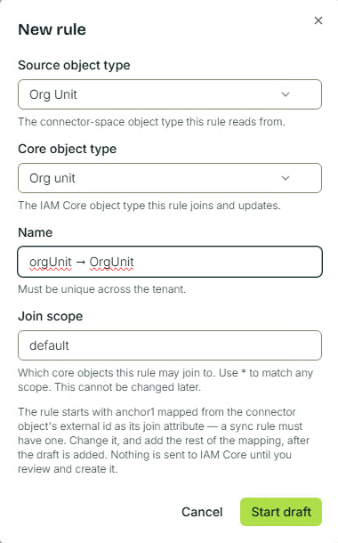
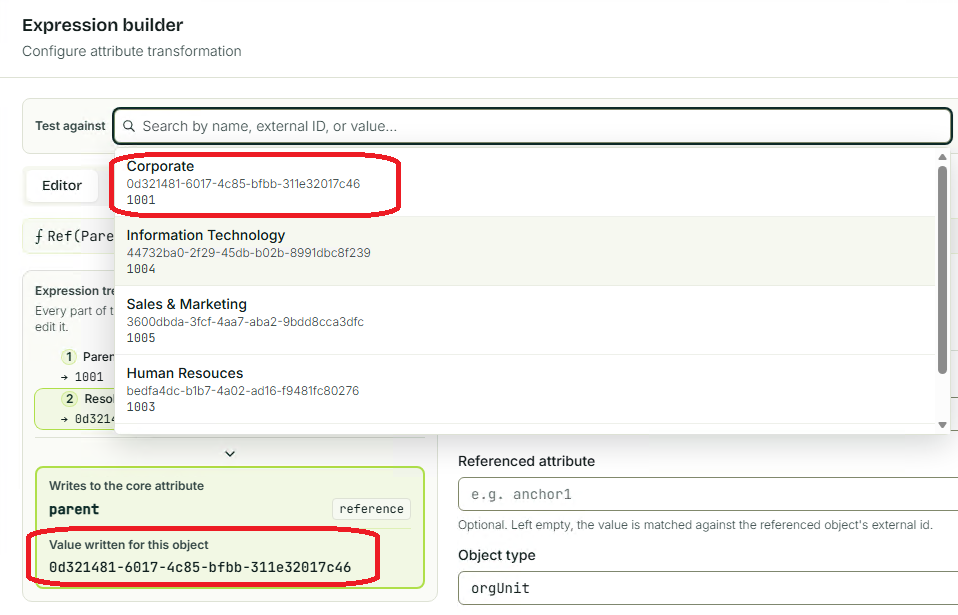
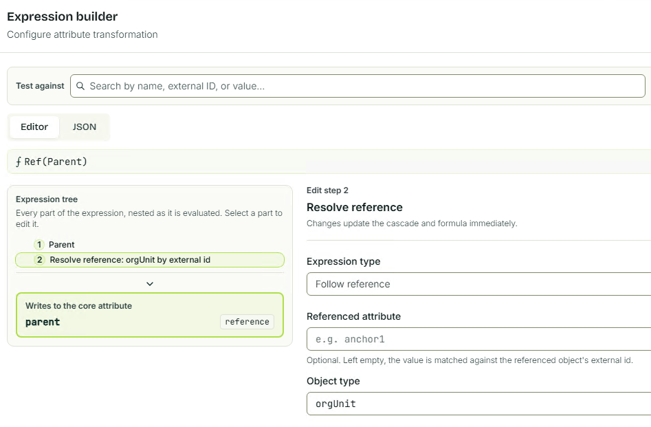
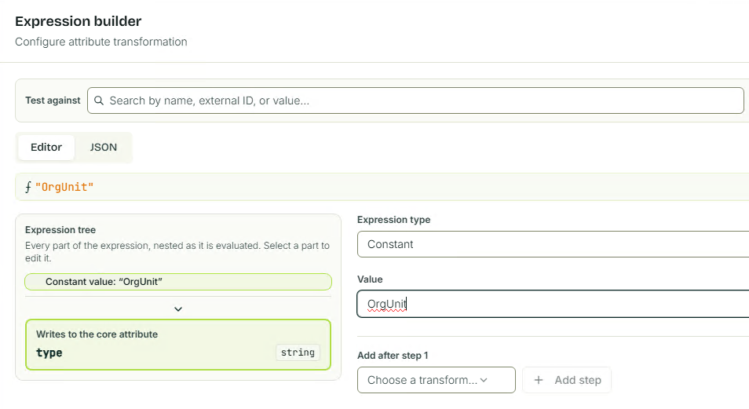
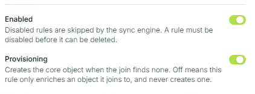
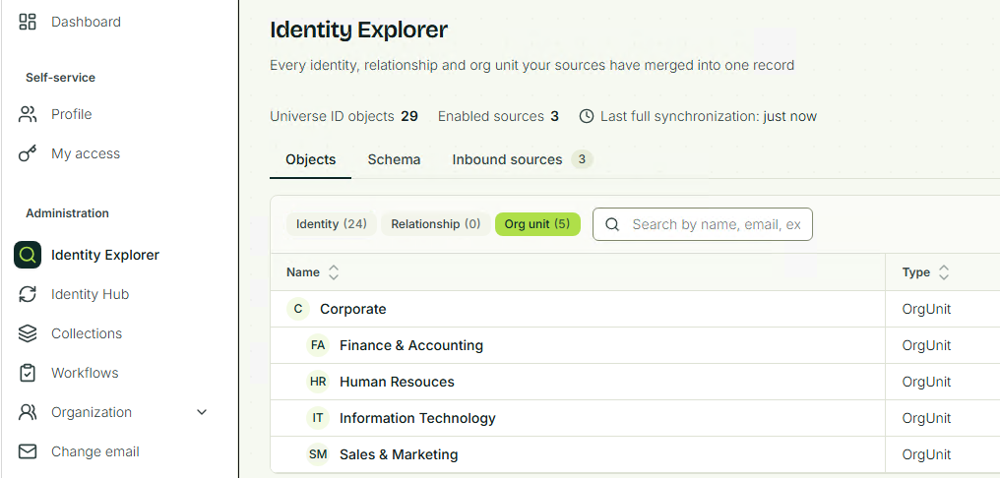
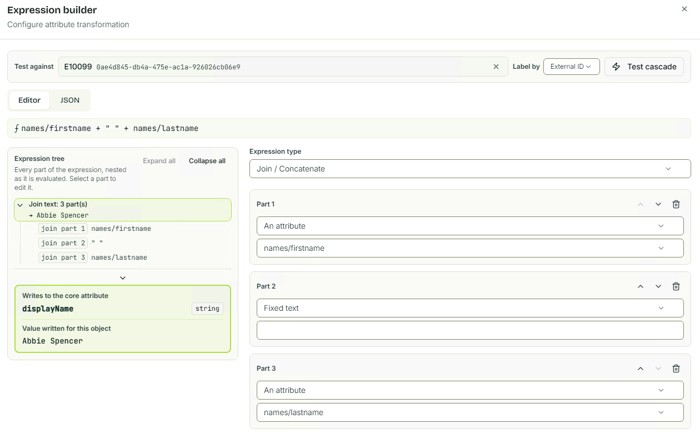
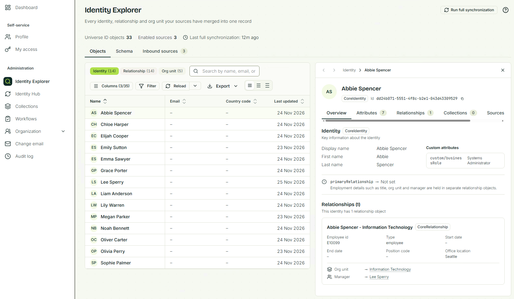

# Create Sync Rules

It is now time to create sync rules. We will do this in this order: Org Unit, Person, Employment. 

::::steps

### Sync rule for Org Unit
Start by going to **Identity Hub**, select your HR connector and select Sync Rules. Select **Org Unit** and click **+New rule**.

In the New rule window, accept the proposed values and click **Start Draft**.



Click **+Add Mapping** and add the rules as defined in the table below.

| Source | Target |
| --- | --- |
| **EXTID** ExternalID | anchor1 |
| Name | displayName |
| **REF** Parent | parent |
| **CONST** OrgUnit | type |

When you select parent, you will get the warning *Incompatible types*. Click the **ƒ Add** button. This will show the expression builder. The expression builder has already suggested that we need a **follow reference** function. In our case, the parent reference is the external ID attribute, so we do not need to enter anything in the **referenced attribute**. Enter **orgUnit** in **Object type**. An empty value in this field would not resolve the reference, so make a habit of always adding the object type. 

While we are here, we will show how to test the function to see if it works. At the top, in the box **Test against**, select **Information Technology** and see the result. The guid is the same as the parent (**Corporate**).



Click **Apply** to save the expression.



To create a constant flow, select the target attribute **type** and click **ƒ Add**. In Expression Type, change to **Constant** and enter the value **OrgUnit**. Click **Apply** to save.



After you have created all flows, click **Review and create** to save. Look att the result and confirm with **Create Rule**. The rule has been created but is still inactive and can only join. Click **Rule settings** and change **Enabled** and **Provisioning** to enabled.



To see the result, at the very top of the screen click the symbol that looks like a clock (Jobs) and select **Run full synchronization**. After synchronization has completed, navigate to **Identity Explorer**, **Objects**, and **Org unit**. You should see the organization tree.



### Sync rule for Person

Using similar steps as for Org Unit, create attribute flows as defined in the table below.

| Source | Target |
| --- | --- |
| **EXTID** ExternalID | anchor1 |
| nin | anchor2 |
| names/firstname | firstName |
| names/lastname | lastName |
| businessRole | custom/businessRole |
| **CONST** HR | source |
| **JOIN** names/firstname + "  " + names/lastname | displayName |

To create the attribute flow for **businessRole**, see [custom attributes](../sync/custom-attributes.md).

For **displayName**, create an attribute flow where you use the **Join / Concatenate** function.



Save the Sync Rule, enable the sync rule and provisioning. Run a full sync. Use Identity Explorer to verify all users have been provisioned as expected.

### Sync rule for Employment

For the employment object, we need to create the following rules. For reference attributes, remember to provide the object type (person for identity and manager, orgUnit for orgUnit).

| Source | Target |
| --- | --- |
| **EXTID** ExternalId | anchor1 |
| **REF** Ref(person) | identity |
| **REF** Ref(department) | orgUnit |
| **CONST** employee | type |
| **JOIN** *see below* | displayName |
| person | employeeID |
| location | officeLocation |
| **REF** Ref(manager) | manager |

For the displayName attribute, we will use the ability to paste an expression into the editor. Open the expression builder, click **JSON** and paste the below into the window. Click **Apply** and look at the result in the Editor.

``` JSON
{
  "$type": "join",
  "inputs": [
    {
      "$type": "trim",
      "input": {
        "$type": "join",
        "inputs": [
          {
            "$type": "trim",
            "input": {
              "$type": "followreferenceforstring",
              "referencingattribute": "person",
              "referredattribute": "id",
              "subrule": {
                "$type": "join",
                "inputs": [
                  {
                    "$type": "trim",
                    "input": {
                      "$type": "attribute",
                      "attribute": "names/firstname"
                    }
                  },
                  {
                    "$type": "constant",
                    "value": " "
                  },
                  {
                    "$type": "trim",
                    "input": {
                      "$type": "attribute",
                      "attribute": "names/lastname"
                    }
                  }
                ]
              }
            }
          },
          {
            "$type": "constant",
            "value": " - "
          },
          {
            "$type": "trim",
            "input": {
              "$type": "followreferenceforstring",
              "referencingattribute": "department",
              "referredattribute": "id",
              "subrule": {
                "$type": "trim",
                "input": {
                  "$type": "attribute",
                  "attribute": "name"
                }
              }
            }
          }
        ]
      }
    }
  ]
}
```
Save the sync rule, enable it and enable provisioning. Run a fulll sync.

### Review the result on an object

In Identity Explorer, find one user and look at all properties.



### Sync Rule for Entra

This should be quite simple. Select the Entra connector and add a sync rule. The main difference is that we will *not* enable provisioning. Entra is only allowed to join to existing objects. Note that we want to join on employeeID, so we will remove the default join attribute flow from ExternalID -> anchor1.

| Source | Target |
| --- | --- |
| employeeID | anchor1 - Join |
| id | entraObjectID |
| userPrincipalName | entraUserPrincipalName |
| mail | email |
| onPremisesSyncEnabled | entraOnPremisesSyncEnabled |
| onPremisesSamAccountName | entraOnPremisesSamAccountName |
| onPremisesDistinguishedName | entraOnPremisesDistinguisedName |

Don't forget to enable the sync rule (but do not turn on provisioning) and run a full sync.

Go back to your user in identity explorer and ensure everything has joined up and attributes from Entra are visible as well.

::::
