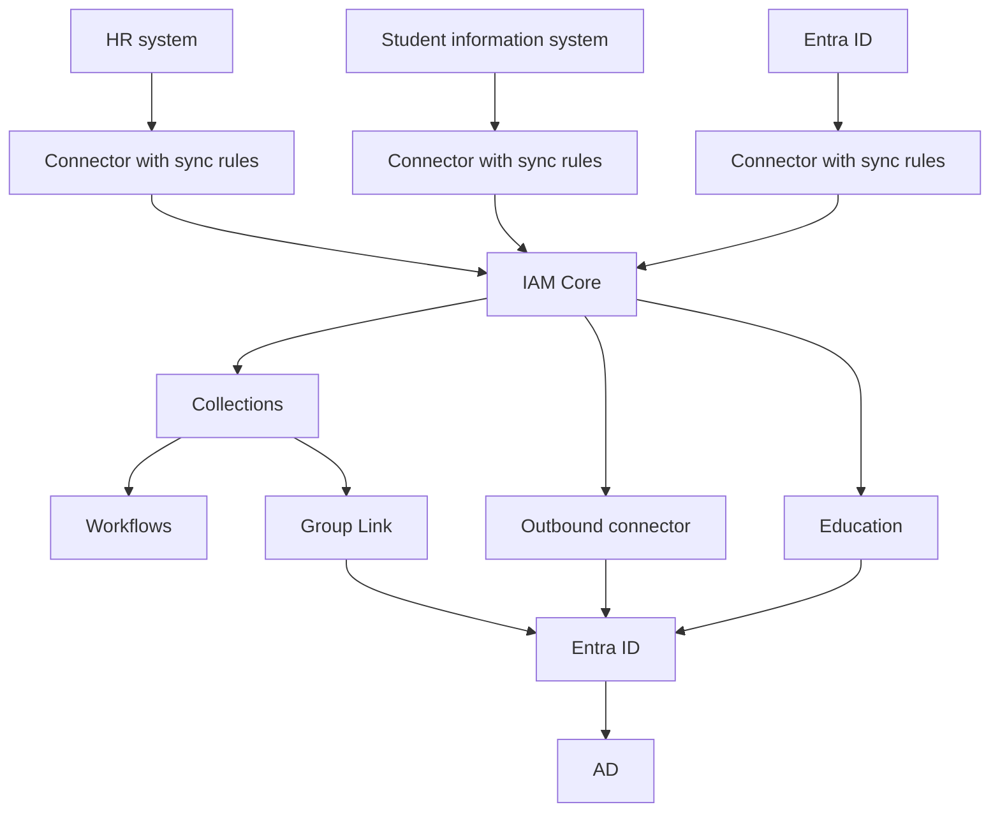

# Identity Universe

Identity Universe is Fortytwo's Identity Governance and Administration (IGA) platform. It takes the information your organisation already keeps about its people — in HR systems, ERP systems, CRMs, student information systems, and elsewhere — and builds one consistent picture of who everyone is and what they do, and uses that picture to decide who gets access to what.

Sign in at [universe.fortytwo.io](https://universe.fortytwo.io).

## The parts

| | |
|-|-|
| [**IAM Core**](./iam-core/index.md) | The data foundation. Source systems are brought in through [connectors](./iam-core/connectors/index.md), and [sync rules](iam-core/sync/syncrules.md) turn that raw data into identities, organizational units and relationships. [Organization](./iam-core/organization.md) adds organization-scoped workflows for identities beyond HR. |
| [**Collections**](./collections/index.md) | Groups of people, either defined by criteria over the core data or joinable on request with an approval flow. Collections are how access is expressed. |
| [**Group Link**](collections/plandesign/group-link-entraid.md) | Keeps a Microsoft Entra ID group's membership aligned with a collection, so applications that read Entra ID groups get their answer from the collection. |
| **Workflows** | Automation that reacts to people joining or leaving a collection, for example by calling a webhook. Configured from the Administration blade. |
| [**Education**](education/index.md) | Education specific features, such as student access policies and delegated password reset. |

## How it fits together

Information primarly flows in one direction, from source systems who owns the information, into Fortytwo Universe and out to Entra ID, AD, Google or other connected systems. Sync rules are used to interpret the source system data, translating it into a common schema in IAM Core based on identity, relationships and org units. The IAM Core is consumed by [Collections](./collections/index.md), [Education](./education/index.md) and other services.

## Where to start

- [**Get started**](./get-started/index.md) — signing in, consent, and a tour of the pages you will see as a user
- [**Roles and permissions**](get-started/permissions/index.md) — the roles needed to administer Identity Universe, and how to assign them
- [**IAM Core**](./iam-core/index.md) — the data model, connectors and sync rules
- [**Collections**](./collections/index.md) — criteria and joinable collections
- [**Group Link**](collections/plandesign/group-link-entraid.md) — connecting a collection to an Entra ID group, and the API for it

Most things can be done in the web interface, through a PowerShell module, or through the API — see the relevant section for each.
