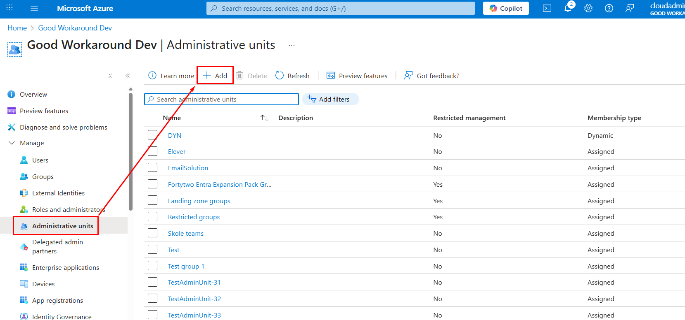
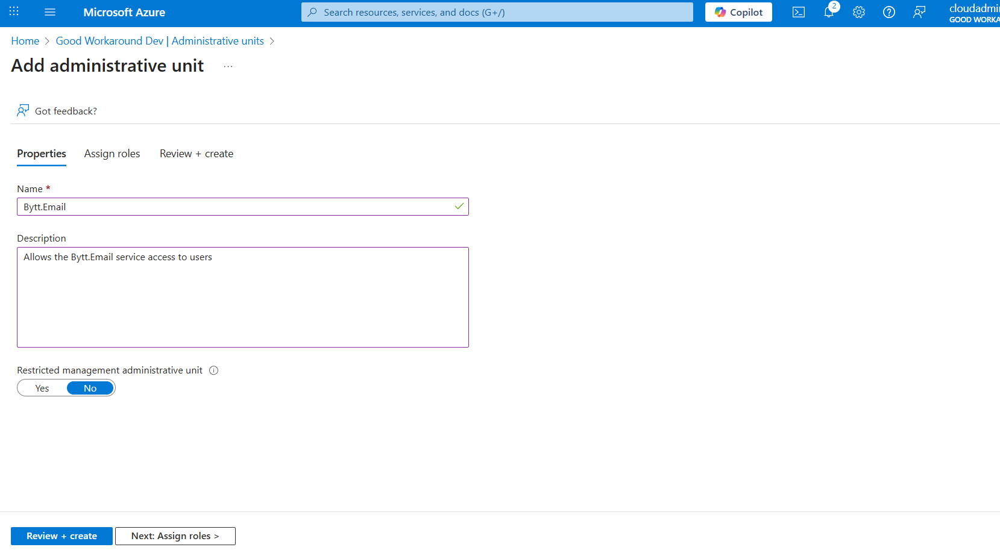
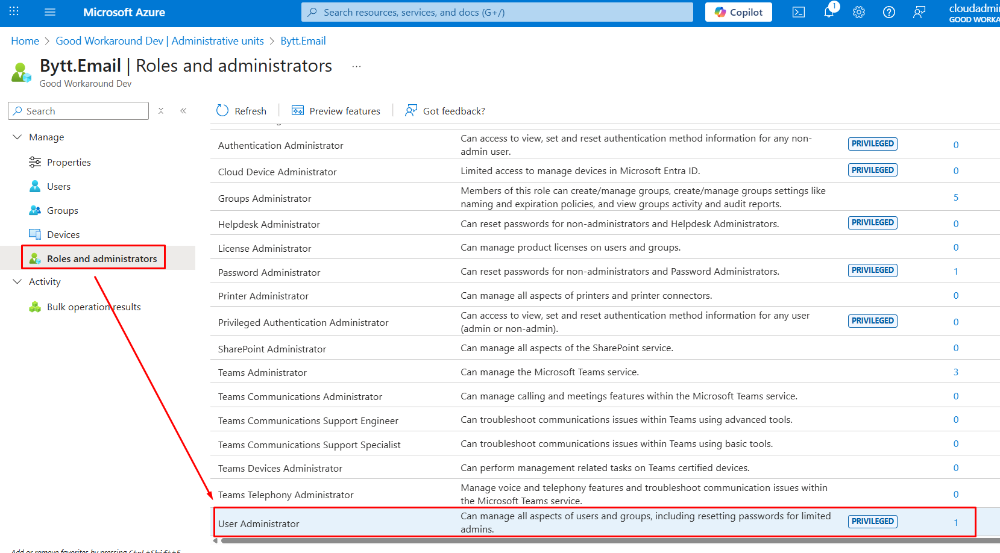
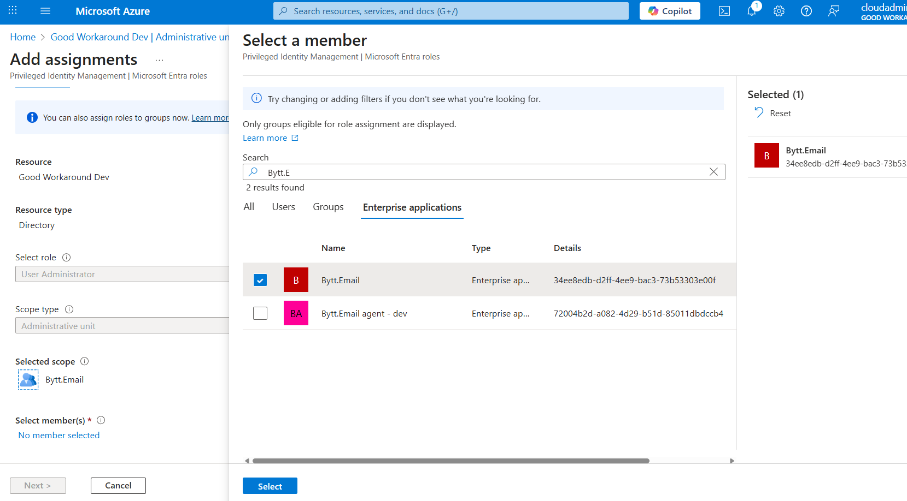
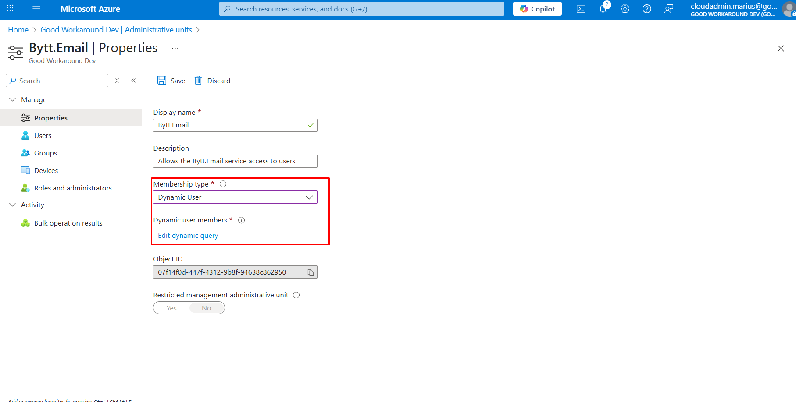

# Step 4 - Configure write permissions / fulfillment

:::note
It is possible to test the service without granting write permissions, in that case simply skip this configuration step.
:::

In order to minimize the permissions required by Bytt.Email, we are not requesting permissions like **user.readwrite.all**, which would work, but would grant more access than we need. Instead, the below approach is used, which minimizes the required permissions for Bytt.Email into your tenant.

::::steps
### Add an administrative unit

Sign into the [Azure Portal](https://portal.azure.com) as a Global Administrator, locate **Entra ID**, find **Administrative units** in the left menu and click **+ Add**.



### Name the AU

Name the AU something that makes sense in your environment and click **Review + create**



### Open the User Administrator role

Find the AU you created, go to **Roles and administrators** and click on **User Administrator**



### Assign the Bytt.Email application

Add an assignment for the **Bytt.Email** Enterprise application:



### Set the membership type

Finally, on the **properties** of the AU, change the **Membership type** to **Dynamic User** and define a criteria of the users to include:



We recommend using a user memberof query, which includes all the email pattern groups as follows:

```text
user.memberof -any (group.objectId -in ['email-pattern-group-objectid-1', 'email-pattern-group-objectid-2'])
```

**Or, you can use other criteria:**

| Who | Criteria |
|-|-|
| All enabled users                                  | (user.accountEnabled -eq true) |
| All enabled users with of different company values | (user.companyName -in ["Company 1", "Company 2"]) |
| All users with a certain UPN suffix                | (user.userPrincipalName -endsWith "@customer.com") |
| All members of group X                             | user.memberof -any (group.objectId -in ['group-x-object-id']) |
| All members in any of group X or Y                 | user.memberof -any (group.objectId -in ['group-x-object-id', 'group-y-object-id']) |
::::

## Next step

[Go to next step](config-step5.md)
