# Step 5 - Install the Active Directory agent

:::note
If you do not have Active Directory users that will be using Bytt.Email, or want to test out the service without granting access, [simply go to the next step](config-step6.md)
:::

The ChangeEmail agent module is a simple module made for listening to change requests from Bytt.Email / ChangeEmail by Fortytwo, updating the user account in Active Directory and reporting back the status of the change. There are a few steps required to install the module and run it.

## Server requirements

- The agent must be running on a domain joined windows server (You can run the agent on the Entra ID Connect or Entra ID Cloud sync server)
- [PowerShell 7.6](https://learn.microsoft.com/en-us/powershell/scripting/install/install-powershell-on-windows?view=powershell-7.6#msi)
- AD PowerShell installed:

  ```powershell
  Install-WindowsFeature -Name RSAT-AD-Tools -IncludeAllSubFeature
  ```

## Install the agent

::::steps
### Configure changeemail requirements

Run the following as administrator:

```powershell
New-EventLog -LogName "Application" -Source "ChangeEmailAgent"
$Certificate = New-SelfSignedCertificate -Subject "changeemail" -NotAfter (Get-Date).AddYears(100)
[System.Convert]::ToBase64String($Certificate.Export([System.Security.Cryptography.X509Certificates.X509ContentType]::Cert), "InsertLineBreaks") | Set-Content -Path "changeemail-$($env:COMPUTERNAME).cer"
Write-Host "" "Thumbprint:       $($Certificate.ThumbPrint)" "Certificate file: changeemail-$($env:COMPUTERNAME).cer" "" -Separator "`n"
```

### Consent to Fortytwo Universe (Our API) and create app registration for agent

1. As a global administrator, go to: [https://login.microsoftonline.com/common/adminconsent?client_id=2808f963-7bba-4e66-9eee-82d0b178f408](https://login.microsoftonline.com/common/adminconsent?client_id=2808f963-7bba-4e66-9eee-82d0b178f408)

2. In **Entra ID**, go to **App registrations** and click **New registration**

3. Give it a name and create **Register**

4. Note down the **Client ID** and **Tenant ID**:

    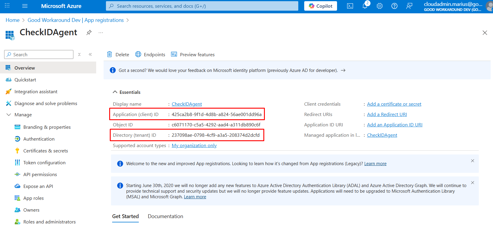

5. Under **Certificates & secrets** upload the certificate file created in Step 1

    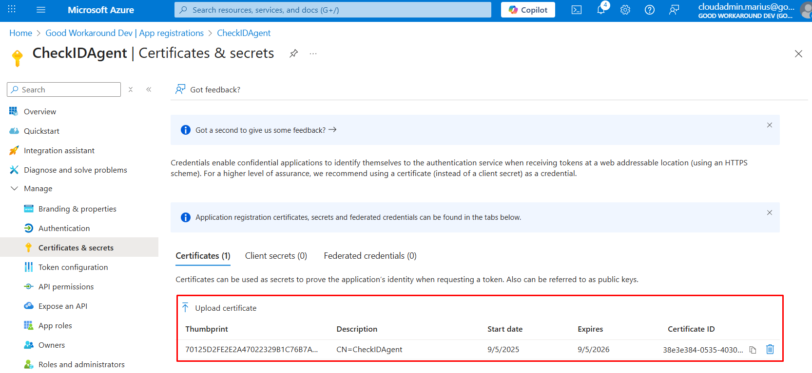

6. Under **API permissions**, click **Add a permission**, select **APIs my organization uses** and locate **Fortytwo Universe**

    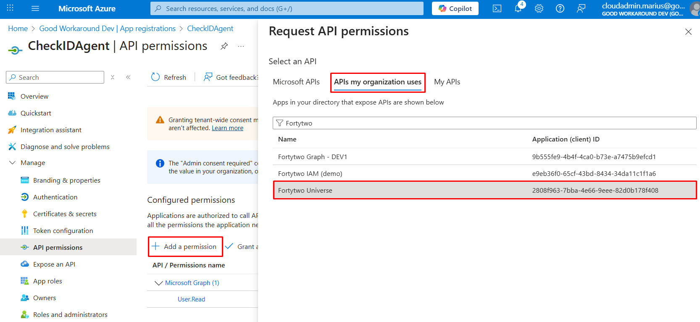

7. Under **Application permissions** check **changeemail.changerequest.readwrite.all** and click **Add permissions**.

8. Click **Grant admin consent**

### Create the run file for the ChangeEmail Agent

Create `C:\changeemail\run.ps1` with the following contents:

```powershell
# Install and auto update the agent module
Install-Module Fortytwo.ChangeEmail.Agent -Confirm:$false -Force -Verbose -Scope CurrentUser
Import-Module Fortytwo.ChangeEmail.Agent -force

Add-EntraIDClientCertificateAccessTokenProfile `
    -Scope "https://api.fortytwo.io/.default" `
    -Thumbprint "THUMBPRINT_FROM_STEP2" `
    -ClientId "CLIENT_ID_FROM_STEP3" `
    -TenantId "TENANT_ID_FROM_STEP3"

Start-ChangeEmailAgentActiveDirectoryListener -Sleep 60 -Verbose
```

If you are running Entra ID Connect Sync and the script is running on this server, we recommend granting the account that will be running the agent the "ADSyncAdmins" role (local group on the server) and adding the `RunBlockAfterChange` parameter to Start-ChangeEmailAgentActiveDirectoryListener, in order to allow it to trigger sync whenever there are email address changes:

```powershell
Start-ChangeEmailAgentActiveDirectoryListener -Sleep 60 -Verbose -RunBlockAfterChange {
    start-sleep 5
    powershell -command 'start-adsyncsynccycle'
}
```

You can also run the connect sync on another server, if you use Invoke-Command like below, replacing the SERVERNAME with your Entra Connect server. In this configuration, your gMSA must be added to the "Remote Management Users" group locally on your Entra Connect server, as well as the ADSyncAdmins group.

```powershell
Start-ChangeEmailAgentActiveDirectoryListener -Sleep 60 -Verbose -RunBlockAfterChange {
    start-sleep 5
    Invoke-Command -ScriptBlock {start-adsyncsynccycle} -ComputerName SERVERNAME
}
```

### Try to run the ChangeEmail agent manually

Open a PowerShell and run:

```powershell
cd c:\changeemail ; . c:\changeemail\run.ps1
```

At this point, you can test out ChangeEmail and see that requests are received and processed by the agent.

### Run the ChangeEmail agent as a scheduled task

#### Create a gMSA for the scheduled task

Run the below PowerShell in order to create a gMSA:

```powershell
New-ADServiceAccount -Name "changeemail" -PrincipalsAllowedToRetrieveManagedPassword "SERVERNAME$" -DNSHostname "bytt.email"
```

#### Delegate the gMSA permissions to three attributes in AD

For each OU where the agent should be able to handle email addresses, run the following three PowerShell lines (with the correct OU path and domain name):

```powershell
dsacls "OU=Users,DC=contoso,DC=com" /I:S /G '"contoso.com\changeemail$:rpwp;mail";user'
dsacls "OU=Users,DC=contoso,DC=com" /I:S /G '"contoso.com\changeemail$:rpwp;userPrincipalName";user'
dsacls "OU=Users,DC=contoso,DC=com" /I:S /G '"contoso.com\changeemail$:rpwp;proxyAddresses";user'
```

#### Grant permission to certificate

Run **certlm.msc**, locate the **changeemail** certificate under **Personal** certificates, and **Manage private keys**

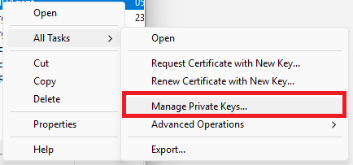

Locate the gMSA you created, and grant **Full control**

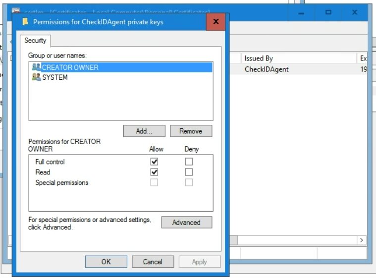

#### Grant permission to Log on as a batch job

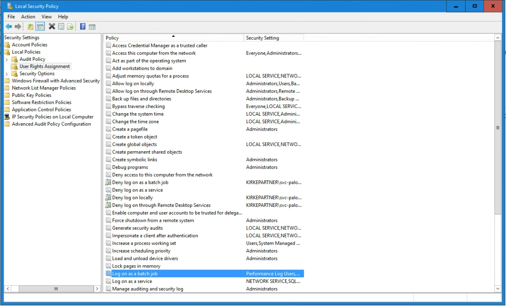

#### Create scheduled task for the agent

Create a scheduled task running as the gMSA that:

- Runs the action `pwsh` with the arguments `-file c:\changeemail\run.ps1`
- Trigger at startup
    - Delay 1 minute
    - Repeat every 5 minutes indefinitely (in order to restart the agent if it fails)
    - Do not stop task if it runs longer than anything
- Do not run multiple instances
- Never stop the task if running for a long time

Typical configuration:

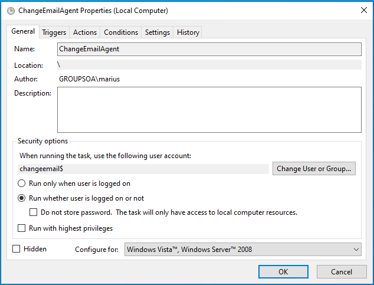

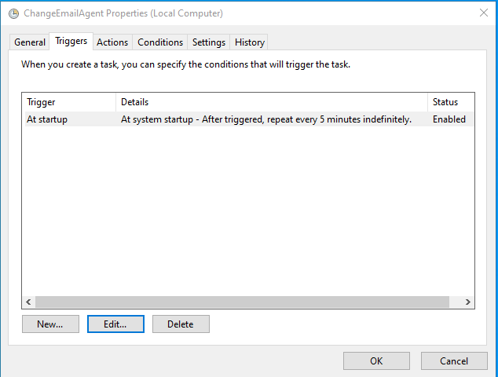

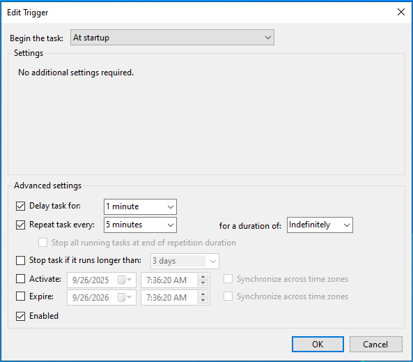

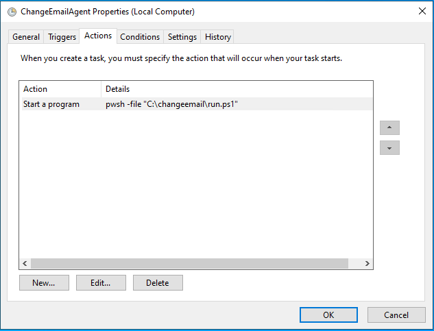

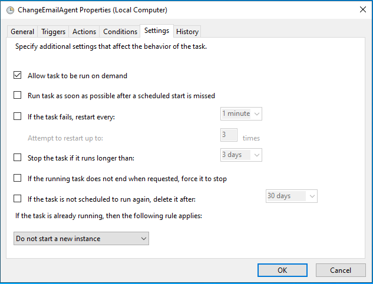

:::tip[Having trouble with adding the task as a gMSA?]
Create the task running as your own user account first, and update the task using PowerShell:

```powershell
$task = Get-ScheduledTask -TaskName "Bytt.Email Agent"
 
$principal = New-ScheduledTaskPrincipal -UserId "contoso.com\changeemail$" -LogonType ServiceAccount
 
$task.Principal = $principal
Set-ScheduledTask -InputObject $task
```
:::
::::

## Next step

[Go to next step](config-step6.md)
