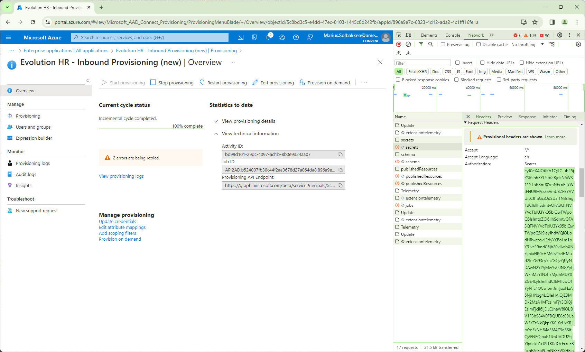
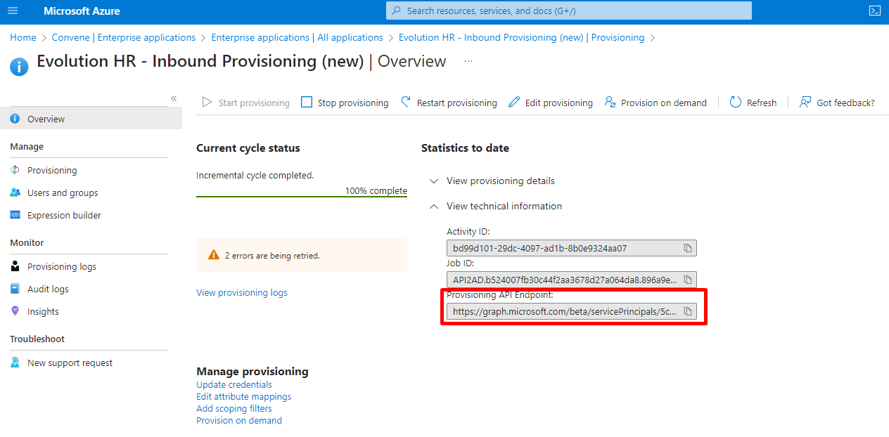
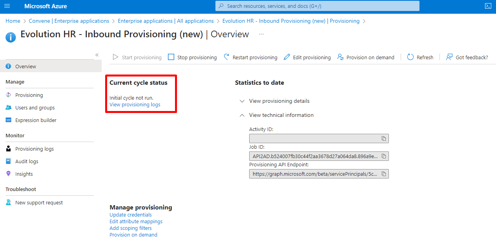

# Fully restarting sync

The Entra ID Inbound Provisioning API maintains a "sticky join", meaning it will statefully remember which Active Directory and Entra ID object has successfully been synced with a SCIM object.

This also means that a wrongly joined user can continue to be wrongly joined, even though an attribute is switched over to another user account.

:::warning
The "Restart provisioning" button in the Entra ID portal does not clear this sticky join. Instead, the below steps must be done.
:::

::::steps
### Find the Inbound Provisioning API

Sign into the Entra ID tenant and find the Inbound Provisioning API

### Open a PowerShell

### Set the access token

Extract your Graph access token using developer mode and set the $accesstoken variable in PowerShell:



```powershell
$accesstoken = "ey....=="
```

### Set the provisioning API endpoint

Find the provisioning API endpoint and copy it into the $api variable



```powershell
$api = "https://..../bulkUpload"
```

### Restart sync fully

Run the below PowerShell to restart sync fully:

```powershell
Invoke-RestMethod -Uri ($uri -replace "/bulkUpload","/restart") -Method Post -Body '{"criteria":{"resetScope":"Full"}}' -ContentType "application/json" -Headers @{Authorization = "Bearer $accesstoken"}
```

### Check the result

The API should now show the following:


::::

All joins will now be re-evaluated on the next full sync cycle from the Fortytwo HR provisioning service, which will happen each night.
