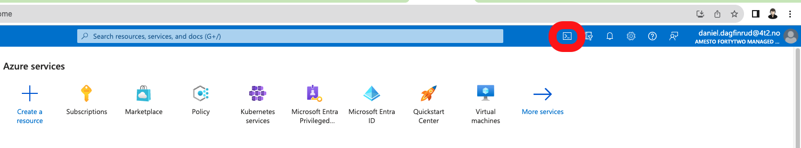

## Overview

This guide helps you connect to your Azure Kubernetes Service (AKS) cluster using Azure CLI commands.

## Prerequisites

- Azure account with necessary privileges.
- Azure Cloud Shell / Any CLI

## Connect to the AKS cluster

::::steps
### Log in to Azure

Go to the [Azure Portal](https://portal.azure.com/) and login.

Open your Azure Cloud Shell by clicking the following button:



Follow the browser prompt and use your Microsoft SSO login to authenticate.

### Set Azure Subscription

:::note
For convenience, Azure provides the commands below prefilled in the Azure Portal under your Kubernetes services resource's `Connect` section. Copy and paste the commands from there to avoid doing these steps manually
:::

Run the following command in your cloud shell, replacing `<subscription-id>` with your Azure subscription ID:

```bash
az account set --subscription <subscription-id>
```

### Get AKS Credentials

Replace `<resource-group-name>` and `<cluster-name>` with your resource group and cluster name, respectively:

```bash
az aks get-credentials --resource-group <resource-group-name> --name <cluster-name>
```

### Convert KubeConfig for Azure AD Integration

Use kubelogin to convert your kubeconfig:

```bash
kubelogin convert-kubeconfig -l azurecli
```
::::

## Conclusion

After executing these commands, you will be connected to your AKS cluster and can start managing it via `kubectl`.

## Next steps

- [Configure Keyvault addon for Kubernetes secrets](./4.%20Secrets%20integration.md)
