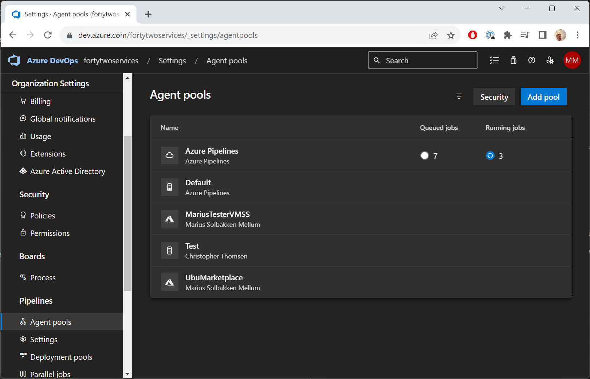
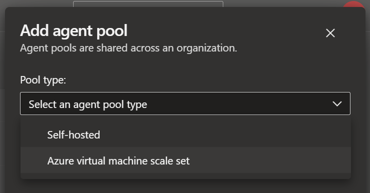
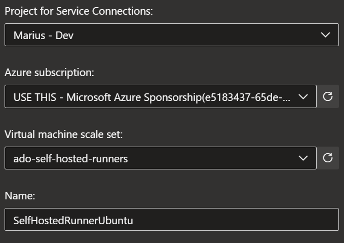
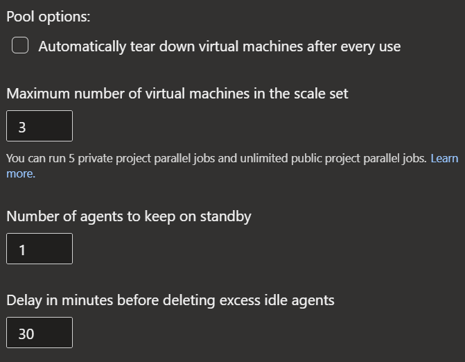
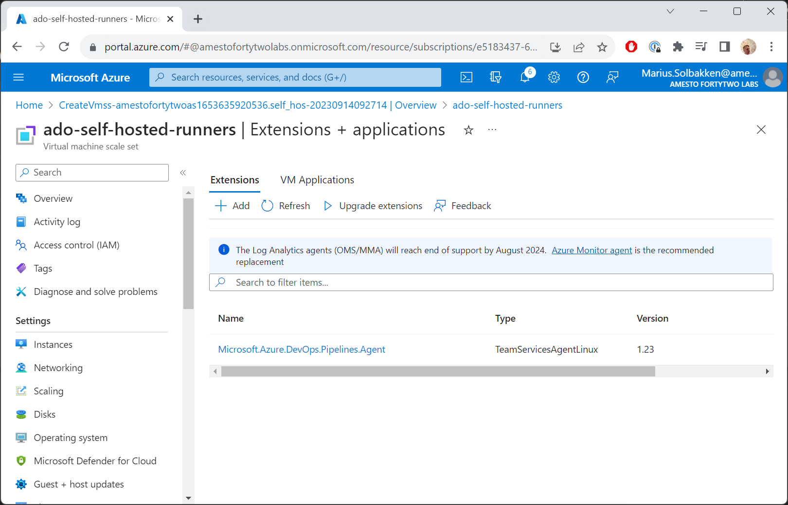

# Step 2 - Configuring the Azure DevOps Agent Pool

Now the VMSS is up and running, we are ready to configure the Azure DevOps side of things.

## Add the agent pool

::::steps
### Open Organization settings

On the organization level (not while in a project), go to **Organization settings**

### Add a pool

Find **Agent pools** and click **Add pools**

Select **Azure virtual machine scale set**

Find your VMSS and name your pool:

### Configure the pool options

Configure your preferred **Pool options**. We recommend having at least 1 agent on standby, though if cost is an issue, you can set it to 0 (you will have longer wait times for your first run due to provisioning the instance)

### Create the pool

Click **Create**.
::::

You should now be ready to use the VMSS as runners. After configuring the DevOps side of things, you should see the following extension added to your VMSS:

[Continue to step 3 - Testing the self hosted runner](./step3.md)
