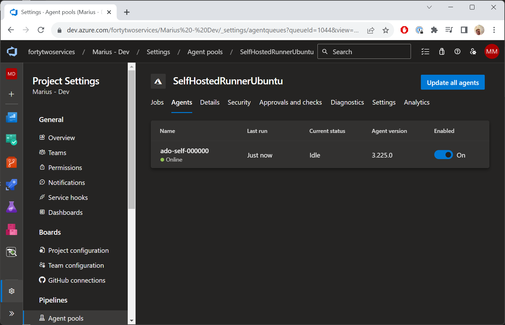
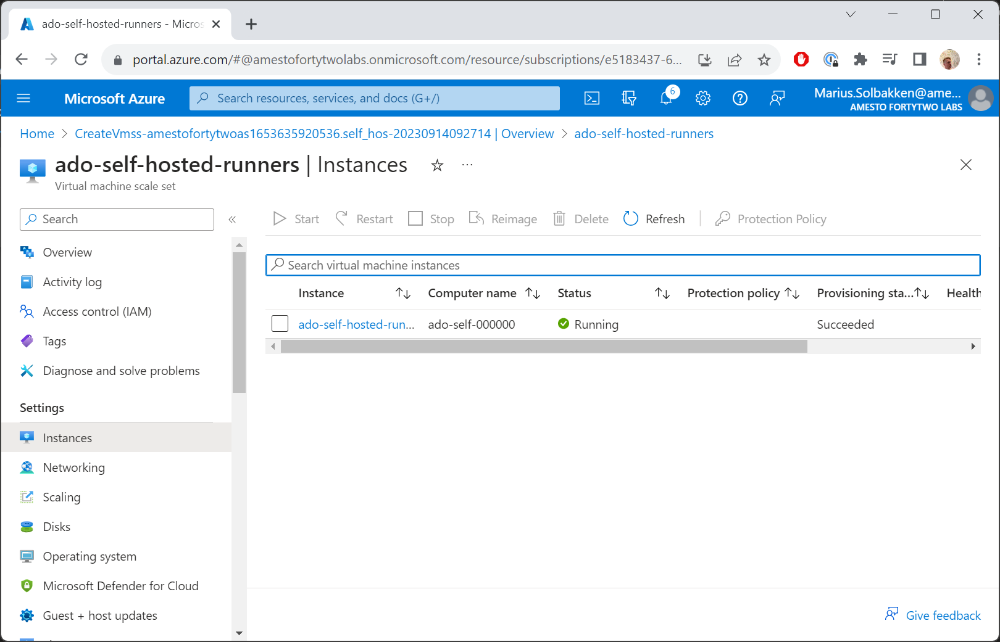
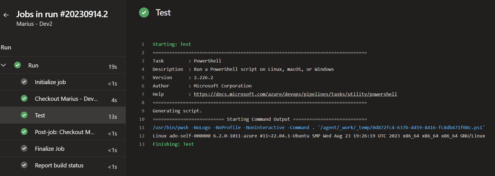

# Step 3 - Testing the self hosted runner

The following is an example pipeline using the pool we just created:

```yaml
stages:
  - stage: run
    displayName: Run
    jobs:
      - job: run
        displayName: Run
        pool: SelfHostedRunnerUbuntu # Name of your VMSS pool
        steps:
          - task: PowerShell@2
            name: Test
            displayName: "Test"
            inputs:
              targetType: inline
              pwsh: true
              script: uname -a
```

After running the pipeline, you should see that an agent has come online:



And from the VMSS side of things, we can see that an instance has been created:



And of course, we can see that the pipeline is working just fine:



That's it, you now have an agent pool in Azure DevOps, that will automatically be updated whenever the Microsoft Hosted Runners are updated (through our image). Have fun!
